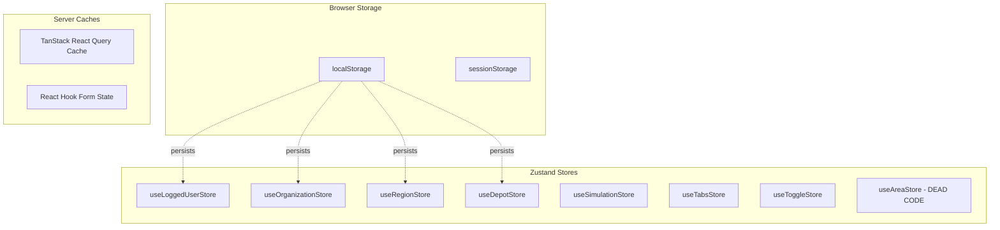
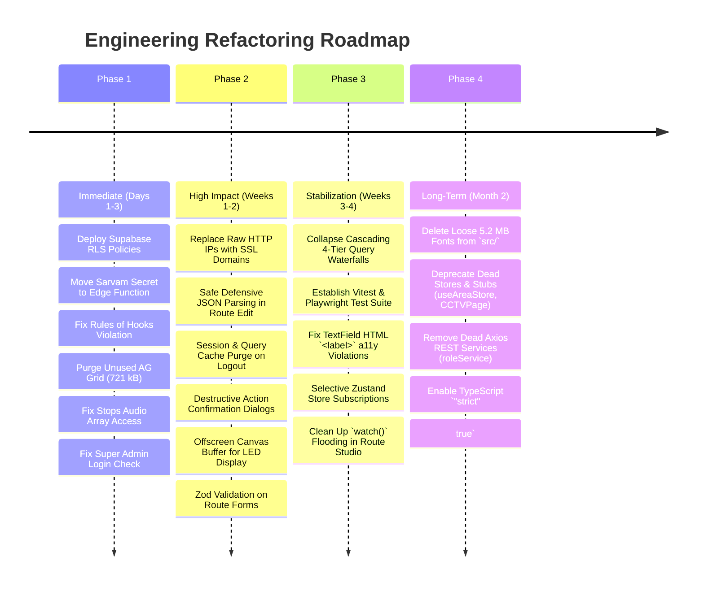

Viewed main.tsx:1-14
Searched for "@chakra-ui"
Searched for "react-json-view"
Searched for "JsonViewerDialog"
Ran command: `npm run build`
Searched for "PieChart"
Ran command: `npx tsc --noEmit`
Viewed tsconfig.app.json:1-35
Viewed eslint.config.js:1-29
Ran command: `npx eslint src`
Searched for "rules-of-hooks"
Ran command: `npx eslint src | grep "rules-of-hooks"`
Ran command: `npx eslint src | grep "exhaustive-deps"`
Viewed RouteConfigurationForm.tsx:1-140
Viewed RouteCreationHeader.tsx:1-140
Viewed JsonViewerDialog.tsx:1-80
Viewed TextField.tsx:1-80
Viewed featureFlags.ts:1-65
Viewed CCTVPage.tsx:1-18
Viewed UtilityPage.tsx:1-15
Viewed Settings.tsx:1-11
Viewed HomePage.tsx:1-66
Searched for ".ttf"
Viewed index.html:1-24
Viewed index.css:1-222

# Comprehensive Production Audit: React + Vite + Supabase

**Target Application:** [navitronics-ui](file:///Users/vinaykongari/Nav/navitronics-ui)  
**Branch Inspected:** `ui-refactor-sub`  
**Stack Identified:**
* **React:** `18.3.1` (with `react-dom` `18.3.1`)
* **Build Tool:** Vite `6.0.5` / `6.4.3` (ESNext target, Rollup bundler)
* **Language & Type System:** TypeScript `~5.6.2` (configured with `"strict": false`)
* **Database & Auth Client:** Supabase JS `@supabase/supabase-js` `^2.94.0`
* **State Management:** Zustand `^5.0.3` (persisted via `localStorage`)
* **Server State & Caching:** `@tanstack/react-query` `^5.64.2`
* **Routing:** `react-router-dom` `^7.1.3`
* **UI & Component Libraries:** Subframe (`@subframe/core` `1.154.0`), Radix UI (`@radix-ui/react-dialog`, `react-radio-group`, `react-tabs`), Headless UI (`@headlessui/react` `^2.2.0`), Chakra UI (`@chakra-ui/react` `^3.4.0` with `@emotion/react`), AG Grid Community (`^35.0.0`)
* **Forms & Validation:** `react-hook-form` `^7.54.2`, `@hookform/resolvers` `^5.2.2`, `zod` `^4.3.6`
* **HTTP / Binary Utils:** `axios` `^1.7.9`, `jszip` `^3.10.1`, `file-saver` `^2.0.5`
* **Styling:** Tailwind CSS `^3.4.17`, PostCSS `^8.5.1`, Autoprefixer

---

## 1. Executive Summary

A comprehensive, repository-wide production readiness audit was performed across all source files, configurations, database migrations, state stores, and external integrations in `navitronics-ui`.

The application serves as a multi-tenant Passenger Information System (PIS), Public Address System (PAS), and Intelligent Transit Management System (ITMS). It allows transit agencies to manage depots, regions, bus routes, LED dot-matrix signboards, and audio announcements.

### Key Audit Metrics

| Metric | Count | Status |
| :--- | :---: | :---: |
| **Total Identified Issues** | **45** | Action Required |
| 🔴 **Critical Severity** | **12** | Must Fix Before Production |
| 🟠 **High Severity** | **15** | Urgent Architectural & Reliability Risks |
| 🟡 **Medium Severity** | **13** | Important Stability, UX & Performance Gaps |
| 🔵 **Low Severity** | **5** | Code Quality & Bundle Hygiene |
| **Security & Auth Issues** | **12** | Severe database exposure & secret leaks |
| **Performance Hotspots** | **9** | Wasted bundle bloat & rendering bottlenecks |
| **Architecture & State Issues** | **14** | Disjointed APIs, Zustand leaks, rules-of-hooks |
| **UX & Accessibility Issues** | **10** | Unconfirmed deletes, invalid label HTML |
| **Automated Test Coverage** | **0%** | 0 unit, 0 integration, 0 E2E tests |

### Primary Critical Takeaways

1. **Zero Database Row Level Security (RLS):** There are no RLS policies defined in the repository migrations. Because the frontend connects directly to Supabase via the public anonymous key, any user or external actor with the URL and key can read, mutate, or drop records across `users`, `organizations`, `routes`, `stops`, `depots`, and `regions`.
2. **Exposed Third-Party Paid API Secret:** The private Sarvam AI text-to-speech subscription key (`sk_ub6tmck1_...`) is embedded directly in [fetchTTS.ts](file:///Users/vinaykongari/Nav/navitronics-ui/src/utils/fetchTTS.ts#L25) via `VITE_SARVAM_API_KEY` and sent in client-side HTTP request headers, allowing quota hijacking and cloud billing abuse.
3. **Hardcoded Infrastructure Endpoints:** Supabase project URL and anon key are hardcoded in [supabaseClient.ts](file:///Users/vinaykongari/Nav/navitronics-ui/src/supabaseClient.ts#L3) without environment variable separation. Bitmap and controller endpoints point to raw HTTP/HTTPS IPs (`13.233.103.63:5288` and `31.97.228.29:9091`), triggering Mixed Content browser blocking and SSL certificate failures in HTTPS environments.
4. **React Rules of Hooks Violation:** [TextPropertiesControls.tsx](file:///Users/vinaykongari/Nav/navitronics-ui/src/ui/components/TextPropertiesControls.tsx#L96) calls `useFontHeightForLanguage()` conditionally after an early return, causing uncaught React runtime crashes.
5. **Severe Initial Bundle Bloat:** `ag-grid-community` (721.62 kB raw / 205 kB gzip) is imported in [main.tsx](file:///Users/vinaykongari/Nav/navitronics-ui/src/main.tsx#L5) and loaded on every page visit despite never being used. Over 5.2 MB of loose TTF fonts sit unreferenced in `src/`.
6. **Cross-Tenant Data Exposure & Session Leakage:** Switching users on the same workstation retains stale organization and depot IDs in localStorage and in-memory TanStack Query caches. [SelectOrganizationComponent.tsx](file:///Users/vinaykongari/Nav/navitronics-ui/src/ui/components/SelectOrganizationComponent.tsx#L31) queries all transit agencies in the database and filters them client-side in JavaScript.

---

## 2. Overall Architecture Assessment

### Architecture Scorecard

| Area | Score / 10 | Assessment | Main Problems |
| :--- | :---: | :--- | :--- |
| **Architecture** | **4 / 10** | Fragile | Three competing backend access patterns (Supabase, dead Axios REST, unused Apollo legacy), UI directly querying PostgREST without a repository layer. |
| **React Practices** | **5 / 10** | Mixed | React Rules of Hooks violations, missing cleanup on async effects, extensive unmemoized inline functions, `watch()` subscription waterfalls. |
| **Authentication** | **5 / 10** | Vulnerable | Duplicate session checking, Master Admin locked out if organization is null, admin session takeover risk on user signup. |
| **Authorization / RBAC** | **3 / 10** | Insecure | Client-side only. All role and module enforcement lives in browser `localStorage['logged-user-store']`. Bypassed in seconds via DevTools. |
| **Supabase Usage** | **4 / 10** | Inefficient | `select('*')` throughout, unindexed queries on large tables, missing pagination on routes and organizations, hardcoded client initialization. |
| **RLS / Security** | **1 / 10** | Critical Risk | No Row Level Security enabled or defined. Public anon key has raw table read/write permissions. Hardcoded API keys in client code. |
| **State Management** | **5 / 10** | Uncoordinated | 6 disparate Zustand stores with overlapping responsibilities; persisted stores not cleared on logout; server state duplicated into stores. |
| **Performance** | **4 / 10** | Poor | 721 kB unused AG Grid chunk in entry bundle; 5.2 MB loose fonts; canvas rendering loops 10,000+ vector paths/frame on CPU. |
| **Data Fetching** | **5 / 10** | Unoptimized | 3-tier sequential waterfalls (Org → Region → Depot → Route); no query cancellation; premature success toasts before fetch completion. |
| **Code Quality** | **4 / 10** | Deficient | TypeScript strict mode disabled; 447 ESLint errors; `npm` and `install` CLI packages committed to runtime dependencies. |
| **UX** | **5 / 10** | Inconsistent | Native blocking `window.confirm()` dialogs; unconfirmed destructive deletes; silent audio failures; route names corrupted on duplicate. |
| **Accessibility** | **3 / 10** | Inaccessible | Buttons nested inside `<label>` elements; missing `aria-invalid` and `aria-describedby`; color contrast and keyboard trap oversights. |
| **Testing** | **0 / 10** | Non-existent | Zero unit, component, integration, or E2E tests. No test runner installed. |
| **Maintainability** | **4 / 10** | High Friction | Scattered business logic, dead stores (`useAreaStore`), orphaned pages (`CCTVPage`), conflicting interfaces (`Role` vs `IRole`). |
| **Production Readiness** | **3 / 10** | **NOT READY** | Multiple security vulnerabilities, browser mixed-content blockers, and unhandled runtime exceptions block deployment. |

---

## 3. Complete Issue Table

| ID | Severity | Category | Issue | Page / Feature | File | Code Reference | Why It Is a Problem | Impact | Recommended Fix | Priority |
| :--- | :--- | :--- | :--- | :--- | :--- | :--- | :--- | :--- | :--- | :--- |
| **ISS-01** | 🔴 CRITICAL | Security | Hardcoded third-party paid API subscription key in frontend | Stops / TTS | [fetchTTS.ts](file:///Users/vinaykongari/Nav/navitronics-ui/src/utils/fetchTTS.ts#L25-L39) | `fetchTTS()` line 38 | `VITE_` env vars are bundled into client JS; client sends `api-subscription-key` header directly to `api.sarvam.ai`. | Credential theft, unauthorized quota exhaustion, financial billing surge on Sarvam account. | Proxy all TTS generation through an authenticated Supabase Edge Function with secret stored on server. | P0 |
| **ISS-02** | 🔴 CRITICAL | Security / RLS | Complete absence of PostgreSQL Row Level Security (RLS) policies | Database / All | [migrations/](file:///Users/vinaykongari/Nav/navitronics-ui/supabase/migrations) | Repository migrations | No `ALTER TABLE ... ENABLE ROW LEVEL SECURITY` or `CREATE POLICY` exists in migrations for any entity table. | Any attacker with the anon key can execute arbitrary SELECT, INSERT, UPDATE, DELETE on any tenant's data. | Create SQL migrations enabling RLS and enforcing strict tenant isolation (`organization_id = auth.jwt()->>'org_id'`). | P0 |
| **ISS-03** | 🔴 CRITICAL | Security / RBAC | Authorization and RBAC enforced purely client-side | Global / RBAC | [RBAC.tsx](file:///Users/vinaykongari/Nav/navitronics-ui/src/components/RBAC.tsx#L12-L24), [useLoggedUserStore.ts](file:///Users/vinaykongari/Nav/navitronics-ui/src/store/useLoggedUserStore.ts#L20-L45) | `RBACRoot` / `AuthState` | Role and permissions are evaluated from unauthenticated `localStorage['logged-user-store']`. | Malicious user can edit `localStorage` to set `role.name = "master"` and gain access to all protected screens. | Enforce database-level RLS and validate user JWT claims on all mutations and server requests. | P0 |
| **ISS-04** | 🔴 CRITICAL | React / Bug | React Rules of Hooks violation (hook called after early return) | Route Studio | [TextPropertiesControls.tsx](file:///Users/vinaykongari/Nav/navitronics-ui/src/ui/components/TextPropertiesControls.tsx#L57-L96) | `TextPropertiesControlsRoot` lines 57, 96 | `useFontHeightForLanguage()` is called after `if (selectedSimulationIndex < 0) return null;`. | React throws an unhandled invariant violation and crashes the page when index transitions. | Move `const getDefaultFontHeightForLanguage = useFontHeightForLanguage();` to top of component before any return. | P0 |
| **ISS-05** | 🔴 CRITICAL | Bug / Runtime | Stops audio preview broken due to array access mismatch | Stops | [StopsPage.tsx](file:///Users/vinaykongari/Nav/navitronics-ui/src/pages/v2/StopsPage.tsx#L428), [IStop.ts](file:///Users/vinaykongari/Nav/navitronics-ui/src/types/IStop.ts#L29) | `hasAudio` line 428, `handlePlayAudio` line 470 | `stop_audios` relational table is returned as an array, but code accesses `stop.stop_audios.url` as an object. | `hasAudio` is always `false`; "Audio Ready" never displays; audio preview fails silently; generates duplicates. | Access first element `Array.isArray(stop.stop_audios) ? stop.stop_audios[0]?.url : stop.stop_audios?.url`. | P0 |
| **ISS-06** | 🔴 CRITICAL | Auth / Bug | Master Admin locked out on login if organization is null | Login | [UserLoginForm.tsx](file:///Users/vinaykongari/Nav/navitronics-ui/src/ui/components/UserLoginForm.tsx#L139-L153) | `useEffect` line 139 | `if (userData.organization?.active)` evaluates false if `organization` is null, throwing "Your organization account is inactive". | Super Admins without a bound organization cannot log into the platform. | Check `if (userData.role?.name === "master" \|\| userData.organization?.active)`. | P0 |
| **ISS-07** | 🔴 CRITICAL | Bug / Runtime | Unconditional `JSON.parse` crashes route edit page | Route Edit | [CreateRoutePage.tsx](file:///Users/vinaykongari/Nav/navitronics-ui/src/pages/v2/CreateRoutePage.tsx#L56-L61) | `methods.reset` lines 56-60 | Calls `JSON.parse(data.front)` on data already parsed by Supabase JSONB parser. | Throws `SyntaxError: Unexpected token 'o', "[object Object]"` and crashes route editor on mount. | Use defensive parsing `typeof data.front === "string" ? JSON.parse(data.front) : data.front`. | P0 |
| **ISS-08** | 🔴 CRITICAL | Security | Insecure plain HTTP endpoints and raw IP URLs trigger mixed content | Route Editor / Bitmap | [bitmapService.ts](file:///Users/vinaykongari/Nav/navitronics-ui/src/services/bitmapService.ts#L8-L10), [CreateRoutePageV1.tsx](file:///Users/vinaykongari/Nav/navitronics-ui/src/pages/v1/CreateRoutePageV1.tsx#L26-L30) | `getInitialBitmapUrl`, `defaultHost` | Hardcoded HTTP and raw IP endpoints (`http://13.233.103.63:5288`, `http://31.97.228.29:9091`). | Browsers block Mixed Content on HTTPS production domains; raw IP SSL certs fail with TLS errors. | Route bitmap and V1 simulation through valid HTTPS domain names with trusted certificates. | P0 |
| **ISS-09** | 🔴 CRITICAL | Security | Cross-tenant data leakage in organization lookup | Global / Navigation | [SelectOrganizationComponent.tsx](file:///Users/vinaykongari/Nav/navitronics-ui/src/ui/components/SelectOrganizationComponent.tsx#L31-L63) | `SelectOrganizationComponentRoot` lines 31, 62 | Queries all organizations without tenant filter and filters client-side in JavaScript. | Any regular user can inspect DevTools Network tab and view all other client transit agencies and contacts. | Scope query to user's assigned organization or enforce organization tenancy via database RLS. | P0 |
| **ISS-10** | 🔴 CRITICAL | Security | Unvalidated `window.onmessage` postMessage listener | Route Create V1 | [CreateRoutePageV1.tsx](file:///Users/vinaykongari/Nav/navitronics-ui/src/pages/v1/CreateRoutePageV1.tsx#L39-L58) | `handleMessage` line 40 | `message` event listener processes incoming payloads without checking `event.origin`. | Malicious iframes or cross-window scripts can spoof route save/back messages and trigger unwanted redirects. | Validate `if (event.origin !== new URL(v1BaseUrl).origin) return;` before processing message data. | P0 |
| **ISS-11** | 🔴 CRITICAL | Performance | 721 kB unused AG Grid chunk loaded in entry bundle | App Entry | [main.tsx](file:///Users/vinaykongari/Nav/navitronics-ui/src/main.tsx#L5-L8), [vite.config.ts](file:///Users/vinaykongari/Nav/navitronics-ui/vite.config.ts#L35) | `ModuleRegistry.registerModules` | `AllCommunityModule` is imported and registered in `main.tsx` even though AG Grid is not used in any UI component. | Slower initial page load, increased JavaScript parse/compile time, wasted bandwidth. | Remove `ag-grid-community` import and registration from `main.tsx` and uninstall from `package.json`. | P1 |
| **ISS-12** | 🔴 CRITICAL | Security | Direct client user insertion with arbitrary role assignment | Users | [CreateUserForm2.tsx](file:///Users/vinaykongari/Nav/navitronics-ui/src/ui/components/CreateUserForm2.tsx#L351-L368) | `onSubmit` line 351 | Frontend calls `supabaseAuthHelper.auth.signUp()` and inserts directly into `public.users` with client-supplied `role_id`. | Any authenticated user can issue PostgREST requests assigning themselves the Super Admin role. | Move user provisioning to a Supabase Edge Function using `supabaseAdmin.auth.admin.createUser`. | P0 |
| **ISS-13** | 🟠 HIGH | Architecture | Competing disconnected backend architectures | Roles / Fonts | [roleService.ts](file:///Users/vinaykongari/Nav/navitronics-ui/src/services/roleService.ts), [LanguageModify.tsx](file:///Users/vinaykongari/Nav/navitronics-ui/src/components/LanguageModify.tsx#L1) | `roleService`, `LanguageManagement` | `Roles.tsx` calls unauthenticated external REST endpoints while `CreateUserForm2` reads Supabase `roles` table. | Data desynchronization, confusing dual sources of truth, network errors in production. | Deprecate Axios REST endpoints; consolidate all entity management into typed Supabase CRUD hooks. | P1 |
| **ISS-14** | 🟠 HIGH | Routing / Bug | Infinite redirect loop risk on invalid role | App Routing | [App.tsx](file:///Users/vinaykongari/Nav/navitronics-ui/src/App.tsx#L119-L122), [App.tsx](file:///Users/vinaykongari/Nav/navitronics-ui/src/App.tsx#L224-L228) | `getDefaultRouteForRole` line 120 | Unknown or null role defaults to `"/home"`, rendering `<Route index element={<Navigate to="/home" replace />}>`. | Browser enters an infinite redirect loop, freezing the tab when a user has an unrecognized role. | Change default fallback route in `getDefaultRouteForRole` to `"/home/routes"`. | P1 |
| **ISS-15** | 🟠 HIGH | State Management | Stale user session and cross-tenant leakage on logout | Global / Auth | [useLoggedUserStore.ts](file:///Users/vinaykongari/Nav/navitronics-ui/src/store/useLoggedUserStore.ts#L28-L35), [ProtectedRoute.tsx](file:///Users/vinaykongari/Nav/navitronics-ui/src/components/ProtectedRoute.tsx#L31) | `logout()` line 28 | `logout()` only clears `sessionStorage`; `organization-storage`, `region-storage`, `depot-storage` remain in `localStorage`. | User B logging in on the same browser sees User A's cached organization, depot, and route configurations. | Clear all Zustand persisted keys (`localStorage.clear()`) and call `queryClient.clear()` on logout. | P1 |
| **ISS-16** | 🟠 HIGH | Performance | Massive CPU canvas dot-matrix re-draw loop | Canvas / LED | [CanvasText.tsx](file:///Users/vinaykongari/Nav/navitronics-ui/src/components/CanvasText.tsx#L172-L225) | `drawMatrix` lines 172-225 | Loops through 6,144+ dots every frame and invokes vector `ctx.arc()` and `ctx.fill()`. | High CPU usage, dropped frames, overheating mobile tablets, and battery drain. | Render matrix to an offscreen buffer canvas once and use `ctx.drawImage()`, or use CSS transforms. | P1 |
| **ISS-17** | 🟠 HIGH | Architecture | Desynchronization between `useFieldArray` and `setValue` | Route Studio | [SimulationPlayerCard.tsx](file:///Users/vinaykongari/Nav/navitronics-ui/src/ui/components/SimulationPlayerCard.tsx#L73-L83) | `handleRemoveSimulation` line 77 | `handleRemoveSimulation` directly mutates form values with `setValue` instead of `useFieldArray.remove()`. | React Hook Form's internal field array index desynchronizes, causing deleted cards to reappear or corrupt. | Use `remove(index)` from `useFieldArray` passed down from parent. | P1 |
| **ISS-18** | 🟠 HIGH | Performance | Tree-shaking failure from barrel exports pulling heavy charts | UI Bundle | [ui/index.ts](file:///Users/vinaykongari/Nav/navitronics-ui/src/ui/index.ts#L60), [dist/assets/](file:///Users/vinaykongari/Nav/navitronics-ui/dist/assets) | `export * from "./components/PieChart"` | Importing any component from `@/ui` pulls in `PieChart` (202 kB chunk) and all Recharts/D3 dependencies. | Unnecessary bundle weight on pages that only use basic inputs or buttons. | Remove unused chart components from `src/ui/index.ts` and import directly from component paths. | P1 |
| **ISS-19** | 🟠 HIGH | UX / Data Loss | Destructive actions lack modal confirmation | Users / Routes | [UsersPage.tsx](file:///Users/vinaykongari/Nav/navitronics-ui/src/pages/v2/UsersPage.tsx#L44-L59), [RoutesPage.tsx](file:///Users/vinaykongari/Nav/navitronics-ui/src/pages/v2/RoutesPage.tsx#L198-L210) | `handleDeleteUser`, `handleDeleteRoute` | Deleting a user or route executes immediately on click without confirmation modal. | Accidental misclicks permanently soft-delete users or operational transit routes. | Implement a reusable `<Dialog>` confirmation modal with explicit "Cancel" and "Confirm Delete". | P1 |
| **ISS-20** | 🟠 HIGH | Data Integrity | Route duplicate appends invalid suffix to route number | Routes | [RouteTable.tsx](file:///Users/vinaykongari/Nav/navitronics-ui/src/ui/components/RouteTable.tsx#L187), [RoutesPage.tsx](file:///Users/vinaykongari/Nav/navitronics-ui/src/pages/v2/RoutesPage.tsx#L282) | `duplicateRoute` line 282 | Route duplication appends `" (Copy)"`, creating values like `"101 (Copy)"`. | Onboard bus hardware controllers expect strict alphanumeric codes (max 6-8 chars); crashes firmware. | Generate clean alphanumeric suffixes (e.g., `"101A"`) and enforce database route number character limits. | P1 |
| **ISS-21** | 🟠 HIGH | Performance | 5.2 MB of loose unreferenced TTF fonts in `src/` | Assets / Bundle | [src/](file:///Users/vinaykongari/Nav/navitronics-ui/src) | `en.ttf`, `english.ttf`, `te.ttf`, etc. | 10 TTF font files sit directly in `src/`, including identical duplicates (`en.ttf` == `english.ttf`). | Repository bloat, slower git clones, risk of accidental bundle inclusion. | Delete loose font files from `src/`; host required web fonts in `public/fonts/` with `font-display: swap`. | P2 |
| **ISS-22** | 🟠 HIGH | Data Fetching | 4-tier cascading waterfall queries on Routes & Depots | Routes / Depots | [RoutesPage.tsx](file:///Users/vinaykongari/Nav/navitronics-ui/src/pages/v2/RoutesPage.tsx#L54-L80) | `useRoutesPageData` lines 54-80 | Org query triggers region query, which triggers depot query, which triggers route query sequentially via `useEffect`. | Significant visual layout shift and high latency (1.5s - 3s) before route cards display. | Combine relational queries using Supabase joins (`regions(*, depots(*, routes(*)))`) or parallelize. | P2 |
| **ISS-23** | 🟠 HIGH | Architecture | Missing `ChakraProvider` root wrapper | Roles / Fonts | [Roles.tsx](file:///Users/vinaykongari/Nav/navitronics-ui/src/pages/Roles.tsx#L9), [main.tsx](file:///Users/vinaykongari/Nav/navitronics-ui/src/main.tsx) | `Container` line 9 | Chakra UI components are rendered without a theme provider in `App.tsx` or `main.tsx`. | Unpredictable CSS reset overrides, broken layout styles, console warnings. | Remove `@chakra-ui/react` and replace with native Tailwind / Subframe layout components. | P2 |
| **ISS-24** | 🟠 HIGH | Validation | Zero input validation on Route Configuration form | Route Studio | [RouteConfigurationForm.tsx](file:///Users/vinaykongari/Nav/navitronics-ui/src/ui/components/RouteConfigurationForm.tsx#L56-L95) | `register` lines 56-95 | Text fields only check `{ required: true }`; no max length, regex, or whitespace trimming. | Operators can enter 1,000-character strings or emojis, corrupting bus LED display hardware. | Attach a Zod schema enforcing string length limits (`max(10)` for route number) and regex pattern. | P1 |
| **ISS-25** | 🟠 HIGH | UX / Error | Fullscreen whiteout on language configuration loading/error | Route Studio | [LanguageConfigContext.tsx](file:///Users/vinaykongari/Nav/navitronics-ui/src/context/LanguageConfigContext.tsx#L34-L40) | `LanguageConfigProvider` lines 34-40 | Unstyled raw `<div>Loading language configs...</div>` replaces entire screen. | If network fails, user gets stuck on a blank white screen with no navigation or retry option. | Wrap with branded loader and provide fallback to default language dictionary if query fails. | P2 |
| **ISS-26** | 🟠 HIGH | Performance | Broad re-renders from unmemoized `useToggleStore` subscription | Layout | [DefaultPageLayout.tsx](file:///Users/vinaykongari/Nav/navitronics-ui/src/ui/layouts/DefaultPageLayout.tsx#L46) | `useToggleStore` line 46 | `const { showSidebar, toggleSidebar } = useToggleStore()` subscribes to entire toggle store. | Every time route panel or inspector is toggled in Route Studio, entire top header re-renders. | Use selective Zustand subscription: `useToggleStore((state) => state.showSidebar)`. | P2 |
| **ISS-27** | 🟠 HIGH | Performance | Re-render cascades from multiple `watch()` in render tree | Route Studio | [TextPropertiesControls.tsx](file:///Users/vinaykongari/Nav/navitronics-ui/src/ui/components/TextPropertiesControls.tsx#L65-L135) | `watch` lines 65, 89, 93, 109, 135 | `watch()` called 5+ times inside render body for text, icon, language, fontHeight. | Every keystroke in any text field triggers full re-render of properties panel and child controls. | Use `useWatch({ control, name: ... })` or isolate child control items with localized watch subscriptions. | P2 |
| **ISS-28** | 🟡 MEDIUM | Code Quality | TypeScript strict mode disabled in tsconfig | Config | [tsconfig.app.json](file:///Users/vinaykongari/Nav/navitronics-ui/tsconfig.app.json#L27-L30) | `compilerOptions` lines 27-30 | `"strict": false`, `"noImplicitAny": false`, `"noUnusedLocals": false`. | Type assertions hide runtime undefined errors; false confidence in type safety; 420+ lint errors. | Enable `"strict": true` and resolve implicit `any` and unhandled nullable types. | P2 |
| **ISS-29** | 🟡 MEDIUM | Dependency | Accidental CLI dependencies in production bundle | Config | [package.json](file:///Users/vinaykongari/Nav/navitronics-ui/package.json#L29-L32) | `dependencies` lines 29, 32 | `"npm": "^11.8.0"` and `"install": "^0.13.0"` committed under runtime `dependencies`. | Wasted disk space, dependency vulnerability scanner alerts, slower CI/CD installs. | Remove `npm` and `install` from `package.json`. | P2 |
| **ISS-30** | 🟡 MEDIUM | Accessibility | Interactive `<button>` elements nested inside `<label>` | Form Controls | [TextField.tsx](file:///Users/vinaykongari/Nav/navitronics-ui/src/ui/components/TextField.tsx#L68-L85) | `TextFieldRoot` line 68 | Root element is `<label>`; child `iconRight` contains `<IconButton>` (view/hide password). | Invalid HTML; clicking toggle button triggers label activation and re-focuses input. | Change root element from `<label>` to `<div>` and use `<label htmlFor="...">` for the text. | P2 |
| **ISS-31** | 🟡 MEDIUM | Accessibility | Missing form accessibility attributes | Form Controls | [TextField.tsx](file:///Users/vinaykongari/Nav/navitronics-ui/src/ui/components/TextField.tsx#L24-L33) | `Input` lines 24-33 | Inputs lack `id`, `aria-invalid`, and `aria-describedby` linking to error messages. | Screen readers cannot associate errors with fields or announce validation failures. | Pass `id`, `aria-invalid={error}`, and `aria-describedby={helpTextId}` to `<input>`. | P2 |
| **ISS-32** | 🟡 MEDIUM | UX | Premature success toasts before network request completes | Multiple Pages | [UsersPage.tsx](file:///Users/vinaykongari/Nav/navitronics-ui/src/pages/v2/UsersPage.tsx#L81-L84), [FontConfigurationPage.tsx](file:///Users/vinaykongari/Nav/navitronics-ui/src/pages/v2/FontConfigurationPage.tsx#L67) | `onClick` lines 81-84 | Triggers `toast.success("Users refreshed successfully")` before `refetch()` executes. | User receives positive confirmation even when offline or when query fails. | Chain toast to query promise resolution or display loading spinner. | P3 |
| **ISS-33** | 🟡 MEDIUM | UX | Native blocking `window.confirm()` used for deletions | Depots / Regions | [DepotsPage.tsx](file:///Users/vinaykongari/Nav/navitronics-ui/src/pages/v2/DepotsPage.tsx#L246), [RegionsPage.tsx](file:///Users/vinaykongari/Nav/navitronics-ui/src/pages/v2/RegionsPage.tsx#L121) | `onDelete` lines 246, 121 | Uses browser `confirm("Are you sure...")`. | Freezes main thread, inconsistent cross-browser UI, easily suppressed by browser settings. | Replace with Subframe `<Dialog>` component. | P2 |
| **ISS-34** | 🟡 MEDIUM | Architecture | Hardcoded organization UUID in production logic | Organizations | [OrganizationsPage.tsx](file:///Users/vinaykongari/Nav/navitronics-ui/src/pages/v2/OrganizationsPage.tsx#L94) | `isNavitronix` line 94 | Checks `org.id === "6b679098-ef69-45f0-9fb1-b457dd882060"` to prevent deletion. | Breaks in staging, test, or new production databases where UUID differs; master org could be deleted. | Add `is_system` or `slug` boolean flag to database schema. | P2 |
| **ISS-35** | 🟡 MEDIUM | Supabase | `select('*')` over-fetching across all queries | Data Access | [useCrud.ts](file:///Users/vinaykongari/Nav/navitronics-ui/src/hooks/useCrud.ts#L20) | `useList` line 20 | Generates `supabase.from(table).select('*')` for all list requests. | Fetches unused large JSON columns (bitmaps, coordinates, schemas) on overview tables. | Allow optional `columns` parameter in `QueryOptions` defaulting to lightweight projection. | P2 |
| **ISS-36** | 🟡 MEDIUM | Code Quality | Duplicate and dead state stores | State Stores | [useAreaStore.ts](file:///Users/vinaykongari/Nav/navitronics-ui/src/store/useAreaStore.ts#L9), [area.ts](file:///Users/vinaykongari/Nav/navitronics-ui/src/types/area.ts) | `useAreaStore` | `useAreaStore.ts` and `area.ts` are 100% dead code; `useRegionStore.ts` is used instead. | Developer confusion, maintenance overhead, dead bundle weight. | Delete `src/store/useAreaStore.ts` and `src/types/area.ts`. | P3 |
| **ISS-37** | 🟡 MEDIUM | Architecture | Orphaned and stub pages in navigation | Navigation | [CCTVPage.tsx](file:///Users/vinaykongari/Nav/navitronics-ui/src/pages/v2/CCTVPage.tsx), [UtilityPage.tsx](file:///Users/vinaykongari/Nav/navitronics-ui/src/pages/v2/UtilityPage.tsx), [Settings.tsx](file:///Users/vinaykongari/Nav/navitronics-ui/src/pages/Settings.tsx) | Page definitions | Pages contain empty headings with zero functionality; `CCTVPage.tsx` not even routed. | Misleading navigation routes, unfinished appearance for customers. | Remove dead routes and stub files until features are actively implemented. | P3 |
| **ISS-38** | 🟡 MEDIUM | Testing | Complete absence of automated test coverage | Test Suite | Repository-wide | Entire codebase | 0 unit tests, 0 component tests, 0 integration tests, 0 E2E tests. | High risk of regression during refactoring or production deployment. | Install Vitest and Playwright; establish baseline tests for auth, RBAC, and route creation. | P1 |
| **ISS-39** | 🟡 MEDIUM | Bug / CSS | Invalid CSS class names in layout and typography | UI Layouts | [RBACPage.tsx](file:///Users/vinaykongari/Nav/navitronics-ui/src/components/RBACPage.tsx#L30), [Roles.tsx](file:///Users/vinaykongari/Nav/navitronics-ui/src/pages/Roles.tsx#L72) | `gap-`, `font-=` | Cut-off Tailwind classes: `gap-` and `text-lg font-=`. | Broken styling; console CSS warnings; visual misalignment. | Fix to valid Tailwind classes: `gap-4`, `font-bold`. | P3 |
| **ISS-40** | 🟡 MEDIUM | Performance | Array index used as React key in dynamic simulation list | Route Studio | [SimulationsPlayerPanel.tsx](file:///Users/vinaykongari/Nav/navitronics-ui/src/ui/components/SimulationsPlayerPanel.tsx#L579) | `key` line 579 | `key={(simulation as any)?.id \|\| `${selectedTab}_${index}`}`. | Reordering or deleting slides causes React reconciliation errors and state mismatches. | Assign a stable client-side UUID (`crypto.randomUUID()`) to simulations on creation. | P2 |
| **ISS-41** | 🔵 LOW | Performance | Duplicate Google Fonts requested in `index.html` and `index.css` | Global Fonts | [index.html](file:///Users/vinaykongari/Nav/navitronics-ui/index.html#L12-L15), [index.css](file:///Users/vinaykongari/Nav/navitronics-ui/src/index.css#L1) | `<link>` vs `@import` | `index.html` loads Inter & Host Grotesk; `index.css` loads Geist via `@import`. | Render-blocking CSS `@import`, redundant font downloads, slower FCP. | Consolidate onto a single primary font loaded via `<link rel="preload">` in `index.html`. | P3 |
| **ISS-42** | 🔵 LOW | Code Quality | Console logging left in production code | Multiple | [HomePage.tsx](file:///Users/vinaykongari/Nav/navitronics-ui/src/pages/HomePage.tsx#L28), [CreateRoutePage.tsx](file:///Users/vinaykongari/Nav/navitronics-ui/src/pages/v2/CreateRoutePage.tsx#L27) | `console.log` | Multiple `console.log` statements remain active in production build. | Leaks internal state to browser console; minor performance overhead. | Strip console logs via Vite build configuration `esbuild: { drop: ['console'] }`. | P3 |
| **ISS-43** | 🔵 LOW | Code Quality | Duplicate interface definitions for `Role` / `IRole` | Types | [role.ts](file:///Users/vinaykongari/Nav/navitronics-ui/src/types/role.ts#L1-L22), [IUser.ts](file:///Users/vinaykongari/Nav/navitronics-ui/src/types/IUser.ts#L51-L54) | `Role`, `IRole` | `Role` (id, roleName) vs `IRole` (id, name) defined across separate type files. | Confusing type safety, incorrect autocomplete, mapping bugs. | Unify into a single `IRole` interface matching the PostgreSQL table schema. | P3 |
| **ISS-44** | 🔵 LOW | SEO / Metadata | Missing meta description and viewport accessibility settings | HTML | [index.html](file:///Users/vinaykongari/Nav/navitronics-ui/index.html#L5-L8) | `<head>` lines 5-8 | Missing `<meta name="description">` and OpenGraph tags. | Poor SEO, missing link previews in Slack/Teams, sub-optimal mobile rendering. | Add proper meta description and social graph tags. | P3 |
| **ISS-45** | 🔵 LOW | Config | `vite.config.ts` chunk warning limit inflated to hide bundle bloat | Build | [vite.config.ts](file:///Users/vinaykongari/Nav/navitronics-ui/vite.config.ts#L9) | `chunkSizeWarningLimit: 800` | Warning limit increased from standard 500 kB to 800 kB to suppress Vite warnings. | Masks growing bundle size problems from engineers. | Reset warning limit to 500 kB and optimize chunk splitting boundaries. | P3 |

---

## 4. Security / Authentication / Authorization Findings

### Dedicated Security Vulnerabilities Table

| ID | Severity | Vulnerability | Location | Attack Scenario | Impact | Recommended Fix |
| :--- | :--- | :--- | :--- | :--- | :--- | :--- |
| **SEC-01** | 🔴 CRITICAL | Paid API Key Exposed in Client Bundle | [fetchTTS.ts](file:///Users/vinaykongari/Nav/navitronics-ui/src/utils/fetchTTS.ts#L25-L39) | An attacker inspects the Vite production bundle or DevTools Network tab, copies `VITE_SARVAM_API_KEY`, and makes unlimited requests directly to Sarvam API. | Catastrophic financial billing charges, quota exhaustion, complete denial of TTS service for legitimate transit operators. | Remove `VITE_SARVAM_API_KEY` from frontend `.env`. Deploy an authenticated Supabase Edge Function that proxies TTS requests using server-side secrets. |
| **SEC-02** | 🔴 CRITICAL | Missing Row Level Security (RLS) on All Tables | [supabase/migrations](file:///Users/vinaykongari/Nav/navitronics-ui/supabase/migrations) | An authenticated or unauthenticated attacker uses the public anon key to send direct PostgREST requests: `DELETE FROM routes`, `UPDATE users SET role_id = '...'`, or `SELECT * FROM organizations`. | Total database compromise: data wipeout, cross-tenant data exfiltration, unauthorized route tampering. | Execute PostgreSQL migrations enabling RLS on every table and restricting operations to authorized tenant IDs. |
| **SEC-03** | 🔴 CRITICAL | Client-Side Only RBAC Bypass | [useLoggedUserStore.ts](file:///Users/vinaykongari/Nav/navitronics-ui/src/store/useLoggedUserStore.ts#L20-L45) | A Depot Admin opens browser DevTools → Application → Local Storage, changes `logged-user-store` JSON value `user.role.name` from `"depot_admin"` to `"master"`, and reloads. | Attacker gains access to Super Admin UI screens, organization management, and user creation drawers. | Enforce authorization server-side in PostgreSQL RLS policies; do not trust user role from client state. |
| **SEC-04** | 🔴 CRITICAL | Direct User Creation & Privilege Escalation | [CreateUserForm2.tsx](file:///Users/vinaykongari/Nav/navitronics-ui/src/ui/components/CreateUserForm2.tsx#L351-L368) | An attacker invokes `supabase.from("users").insert({ email, role_id: super_admin_role_id, organization_id })` directly from browser console. | Immediate privilege escalation to Super Admin; unauthorized creation of administrative accounts. | Move user provisioning to a secure Supabase Edge Function using `service_role` key and caller role verification. |
| **SEC-05** | 🔴 CRITICAL | Cross-Tenant Organization Reconnaissance | [SelectOrganizationComponent.tsx](file:///Users/vinaykongari/Nav/navitronics-ui/src/ui/components/SelectOrganizationComponent.tsx#L31) | A non-admin user inspects network responses on `/home` and intercepts the raw response from `organizationCrud.useList()`. | Attacker views the full customer registry: client names, private admin emails, phone numbers, and operational flags. | Restrict PostgREST queries by tenant: `organization_id = auth.jwt()->>'organization_id'` via RLS. |
| **SEC-06** | 🔴 CRITICAL | Insecure Frame & HTTP IP Mixed-Content | [CreateRoutePageV1.tsx](file:///Users/vinaykongari/Nav/navitronics-ui/src/pages/v1/CreateRoutePageV1.tsx#L26-L30) | Main application deployed on HTTPS embeds `http://31.97.228.29:9091` in an iframe. | Browsers block unencrypted iframe rendering; Man-in-the-Middle (MitM) attackers can sniff or alter route configs in transit. | Assign SSL/TLS domain name to V1 app; serve exclusively over HTTPS. |
| **SEC-07** | 🔴 CRITICAL | Unchecked Cross-Origin PostMessage | [CreateRoutePageV1.tsx](file:///Users/vinaykongari/Nav/navitronics-ui/src/pages/v1/CreateRoutePageV1.tsx#L39-L58) | A malicious site embeds or targets the parent window and executes `window.postMessage({ type: "NAVITRONIX_V1_ROUTE_SAVED" }, "*")`. | Triggers unexpected navigation, cache invalidation, and UI state corruption without user authorization. | Validate `if (event.origin !== expectedOrigin) return;` inside message handler. |
| **SEC-08** | 🟠 HIGH | Cross-Tenant Session Residual Leakage | [useLoggedUserStore.ts](file:///Users/vinaykongari/Nav/navitronics-ui/src/store/useLoggedUserStore.ts#L28-L35) | User A (Agency 1) logs out on a shared terminal; User B (Agency 2) logs in. Residual localStorage keys load Agency 1's depots and regions. | Confidential route and stop configurations displayed to unauthorized personnel of another transit agency. | Call `localStorage.clear()` and `queryClient.clear()` on all logout and session termination handlers. |

---

## 5. Performance Findings

### Performance Hotspots Table

| Area | File | Problem | Expected Impact | Recommended Optimization |
| :--- | :--- | :--- | :--- | :--- |
| **Initial Bundle** | [main.tsx](file:///Users/vinaykongari/Nav/navitronics-ui/src/main.tsx#L5-L8) | Unused `ag-grid-community` imported and initialized at root | **721.62 kB** (205 kB gzip) dead weight in entry chunk | Remove import from `main.tsx` and delete from `package.json`. |
| **Initial Bundle** | [src/ui/index.ts](file:///Users/vinaykongari/Nav/navitronics-ui/src/ui/index.ts#L60) | Barrel export re-exports unused charts | **202.94 kB** (55 kB gzip) pulled into every page importing from `@/ui` | Remove unused chart components from `index.ts`; use direct imports. |
| **Static Assets** | [src/](file:///Users/vinaykongari/Nav/navitronics-ui/src) | 10 loose binary TTF fonts in `src/` | **>5.2 MB** of unreferenced binary data in repository | Remove unneeded TTF files from `src/`; serve necessary web fonts from CDN or `public/`. |
| **Runtime Rendering** | [CanvasText.tsx](file:///Users/vinaykongari/Nav/navitronics-ui/src/components/CanvasText.tsx#L172-L225) | 10,000+ canvas vector paths calculated every frame | High CPU utilization, dropped animation frames, battery drain | Render matrix to an offscreen buffer canvas once and use `ctx.drawImage()`. |
| **Network Waterfalls** | [RoutesPage.tsx](file:///Users/vinaykongari/Nav/navitronics-ui/src/pages/v2/RoutesPage.tsx#L54-L80) | 4-tier cascading `useEffect` query chain | 1.5s - 3s delay before routes render; layout shift | Combine query into a single Supabase relational select or parallelize lookups. |
| **Render Cascade** | [DefaultPageLayout.tsx](file:///Users/vinaykongari/Nav/navitronics-ui/src/ui/layouts/DefaultPageLayout.tsx#L46) | Unscoped subscription to entire `useToggleStore` | Re-renders top header on any sidebar panel toggle | Use specific selector: `useToggleStore((s) => s.showSidebar)`. |
| **Form Keystroke Lag** | [TextPropertiesControls.tsx](file:///Users/vinaykongari/Nav/navitronics-ui/src/ui/components/TextPropertiesControls.tsx#L65-L135) | Multiple `watch()` calls inside component body | Entire properties panel re-renders on every character typed | Migrate to localized `useWatch({ control, name })`. |
| **Database Over-fetching** | [useCrud.ts](file:///Users/vinaykongari/Nav/navitronics-ui/src/hooks/useCrud.ts#L20) | `select('*')` without column projection | Downloads heavy bitmap strings and JSON blobs on list tables | Implement column filtering parameter in `QueryOptions`. |

---

## 6. React / Re-render Findings

### Key Anti-Patterns Identified

#### 1. Conditional Hook Invocation (Rules of Hooks Violation)
In [TextPropertiesControls.tsx](file:///Users/vinaykongari/Nav/navitronics-ui/src/ui/components/TextPropertiesControls.tsx#L57-L96):
```tsx
// Line 57: Early return
if (selectedSimulationIndex < 0) {
  return null;
}

// Line 96: Custom hook called conditionally!
const getDefaultFontHeightForLanguage = useFontHeightForLanguage();
```
When `selectedSimulationIndex` switches from `-1` to `0`, the number of hooks called changes between renders. React throws:
`Rendered fewer hooks than expected. This may be caused by an accidental early return statement.`

#### 2. Render → State Synchronization Loops
In [LedSignBoard.tsx](file:///Users/vinaykongari/Nav/navitronics-ui/src/components/LedSignBoard.tsx#L239-L243):
```tsx
useEffect(() => {
  if (onBitmapTextChange) {
    onBitmapTextChange(bitmapText);
  }
}, [bitmapText, onBitmapTextChange]);
```
`onBitmapTextChange` is passed as an inline callback from parent [DisplayEditor.tsx](file:///Users/vinaykongari/Nav/navitronics-ui/src/components/DisplayEditor.tsx#L44). Because the callback reference changes on every parent render, this effect executes continuously, invoking `setValue` in React Hook Form, dirtying form state, and re-rendering the parent.

#### 3. Render Chain Analysis
```
Form Keystroke in Text Field
  │
  ▼
React Hook Form State Change
  │
  ▼
SimulationsPlayerPanel re-renders (watches selectedTab)
  │
  ▼
All SimulationPlayerCard instances re-render (watch active simulation)
  │
  ▼
DisplayEditor re-renders (watches basePath)
  │
  ▼
LEDBitmapSimulator re-renders (re-creates inline abort controllers & fetch timers)
```
**Remedy:** Decouple the preview canvas from live form state. Use a debounced store or localized `useWatch` subscriptions to isolate preview animations from text input typing.

---

## 7. Supabase / Database / RLS Findings

### Missing RLS Policies
The migrations in [supabase/migrations](file:///Users/vinaykongari/Nav/navitronics-ui/supabase/migrations) contain index creation and unique constraints, but **zero RLS policies**.

The following core tables are completely open via PostgREST:
1. `public.organizations` (Can be read, updated, or deleted by any user)
2. `public.regions` (Can be tampered with across organizations)
3. `public.depots` (Can be modified across organizations)
4. `public.users` (User records, assigned roles, and module access flags can be altered)
5. `public.routes` (Transit routes and LED signage configs can be modified or dropped)
6. `public.stops` (Bus stop GPS coordinates and arrival triggers can be altered)
7. `public.stop_audios` (Audio URLs and records can be deleted)
8. `public.font_settings` (Global font mappings can be altered)

### Missing Storage Bucket Policies
In [fetchTTS.ts](file:///Users/vinaykongari/Nav/navitronics-ui/src/utils/fetchTTS.ts#L107-L133), audio files are uploaded to storage buckets `audios` and `stops`.
* The code assumes public storage access (`getPublicUrl`).
* File uploads are executed directly from the client without mime-type validation or size enforcement at the database level.
* Collisions can occur if multiple users generate audio for the same stop simultaneously.

---

## 8. State Management Findings

### State Architecture Map



### Critical Findings:
1. **Redundant & Stale Stores:** `useAreaStore.ts` is 100% unused and duplicates `useRegionStore.ts`.
2. **Server State Duplication:** Organization, Region, and Depot objects are fetched via TanStack Query and then manually saved into Zustand persistent stores. When the database updates, the Zustand stores retain stale copies until manually overwritten.
3. **Session Desynchronization:** On logout in `useLoggedUserStore.ts`, only `sessionStorage` is cleared. `organization-storage`, `region-storage`, and `depot-storage` remain in `localStorage`.

---

## 9. UX & Accessibility Findings

### User Experience Deficiencies
1. **Unconfirmed Destructive Actions:** In `UsersPage.tsx`, clicking delete instantly deactivates and soft-deletes a user with no confirmation prompt.
2. **Native Blocking Browser Dialogs:** `OrganizationsPage.tsx`, `DepotsPage.tsx`, and `RegionsPage.tsx` use `window.confirm()`. If a user clicks "Don't allow this page to create more dialogs", deletions fail silently.
3. **Premature Feedback:** Clicking "Refresh" on Users or Font Configuration immediately displays a green "Refreshed successfully" toast before network data is received.
4. **Hardware-Breaking Route Names:** Route duplication appends `" (Copy)"`, creating values like `"502 (Copy)"`. Bus destination LED controllers expect strictly short alphanumeric route numbers (e.g. `"502A"`).

### Accessibility (a11y) Deficiencies
1. **HTML Spec Violation in Forms:** In [TextField.tsx](file:///Users/vinaykongari/Nav/navitronics-ui/src/ui/components/TextField.tsx#L68), the root element is `<label>`. Interactive elements like `<IconButton>` (password show/hide) are placed inside `<label>`, causing focus loops and double-activation.
2. **Missing Accessible Labels & ARIA:** Form inputs lack `id` association with field labels. Inputs do not provide `aria-invalid="true"` on error or `aria-describedby` pointing to validation error text.
3. **Keyboard Trapping & Modal Focus:** Custom modal dialogs lack focus traps, allowing Tab navigation to exit the dialog while open.

---

## 10. Code Quality, Duplication & Hardcoding Findings

### Code Quality Deficiencies
1. **TypeScript Strictness Bypassed:** `tsconfig.app.json` has `"strict": false` and `"noImplicitAny": false`. There are 447 ESLint errors in `src/`, predominantly `@typescript-eslint/no-explicit-any` and `@typescript-eslint/no-unused-vars`.
2. **Accidental CLI Packages in Runtime:** `"npm": "^11.8.0"` and `"install": "^0.13.0"` are committed in `package.json` under `dependencies`.
3. **Hardcoded IDs:** `OrganizationsPage.tsx` line 94 hardcodes master organization UUID `"6b679098-ef69-45f0-9fb1-b457dd882060"`.
4. **Hardcoded API URLs:** `supabaseClient.ts` hardcodes `https://supabase.navitronix.in`. `bitmapService.ts` hardcodes IP `13.233.103.63:5288`. `CreateRoutePageV1.tsx` hardcodes IP `31.97.228.29:9091`.
5. **Dead Code:** `src/store/useAreaStore.ts`, `src/types/area.ts`, `src/pages/v2/CCTVPage.tsx`, `src/pages/v2/UtilityPage.tsx`, and `src/pages/Settings.tsx` are unmaintained stubs.

---

## 11. Testing Gaps

There are **zero automated tests** in the repository:

| Test Type | Current Coverage | High-Risk Uncovered Workflows |
| :--- | :---: | :--- |
| **Unit Tests** | **0%** | `fetchTTS`, `routeConfigMapper` (V2 to V1 conversion), `measurements`, `featureFlags` |
| **Component Tests** | **0%** | `UserLoginForm`, `RouteConfigurationForm`, `CreateUserForm2`, `CanvasText` |
| **Integration Tests** | **0%** | Supabase Auth session restoration, soft-delete filtering in `useCrud`, multi-tenant isolation |
| **E2E Tests** | **0%** | User login → Route creation → LED signboard simulation → Route export zip download |

---

## 12. Technical Debt Map

| Technical Debt | Area | Severity | Current Impact | Future Risk | Recommended Strategy |
| :--- | :--- | :--- | :--- | :--- | :--- |
| **Missing Database RLS** | Database | 🔴 CRITICAL | Complete database exposed to any client | Data loss, breach, regulatory violation | **Fix Immediately (Phase 1)** |
| **Exposed Sarvam API Secret** | Security | 🔴 CRITICAL | Secret key visible in client bundle | Financial billing loss | **Fix Immediately (Phase 1)** |
| **Rules of Hooks Violation** | React | 🔴 CRITICAL | Page crashes when simulation unselected | Inoperable route studio | **Fix Immediately (Phase 1)** |
| **Unused 721 kB AG Grid Bundle** | Performance | 🔴 CRITICAL | 721 kB dead weight in entry bundle | Degraded initial page speed | **Fix Immediately (Phase 1)** |
| **Unencrypted HTTP & Raw IPs** | Network | 🔴 CRITICAL | Mixed content blocked on HTTPS | Broken bitmaps and V1 iframe | **Fix Immediately (Phase 1)** |
| **Hardcoded Supabase Endpoints** | Config | 🟠 HIGH | Cannot run local/staging environments | Accidental test data in production | **Fix before next release (Phase 2)** |
| **Stale Zustand Residuals** | State | 🟠 HIGH | Cross-tenant data leakage on logout | Privacy compliance violation | **Fix before next release (Phase 2)** |
| **Canvas CPU Path Thrashing** | Performance | 🟠 HIGH | CPU spikes, frame drops on tablets | Overheating hardware displays | **Fix before next release (Phase 2)** |
| **Unvalidated Route Form Inputs** | Validation | 🟠 HIGH | Corrupted text sent to hardware displays | Bus hardware display crashes | **Fix before next release (Phase 2)** |
| **Missing Confirmations on Delete** | UX | 🟠 HIGH | Accidental deletions on misclick | Operational disruption | **Fix before next release (Phase 2)** |
| **4-Tier Query Waterfalls** | Performance | 🟠 HIGH | 1.5s - 3s layout shifting delays | High Supabase compute load | **Fix incrementally (Phase 3)** |
| **Zero Test Coverage** | Testing | 🟠 HIGH | Regressions during code updates | Undetected production bugs | **Fix incrementally (Phase 3)** |
| **Loose 5.2 MB Fonts in `src/`** | Assets | 🟡 MEDIUM | Repository bloat | Slower clone/build times | **Low priority cleanup (Phase 4)** |
| **Dead Stubs & Stores** | Architecture | 🟡 MEDIUM | Developer confusion, unused code | Maintenance friction | **Low priority cleanup (Phase 4)** |

---

## 13. Top 10 Issues To Fix First

| Rank | Issue | Severity | Why It Matters | Recommended Action |
| :---: | :--- | :---: | :--- | :--- |
| **1** | **Deploy Database RLS Policies** | 🔴 CRITICAL | Without RLS, the entire Supabase database is publicly readable and writable via the anon key. | Write and apply PostgreSQL migrations enabling RLS and tenant scoping on all tables. |
| **2** | **Move Sarvam TTS Secret to Edge Function** | 🔴 CRITICAL | Paid API secret is embedded in client bundle and visible in browser network tab. | Remove `VITE_SARVAM_API_KEY` from frontend; proxy requests via Supabase Edge Function. |
| **3** | **Fix React Rules of Hooks in TextPropertiesControls** | 🔴 CRITICAL | Hook called conditionally after early return causes unhandled React crashes. | Move `useFontHeightForLanguage()` to the top of the component before any early returns. |
| **4** | **Remove Unused AG Grid from Entry Bundle** | 🔴 CRITICAL | Loads 721 kB (205 kB gzip) of unused code on every initial visit. | Remove imports from [main.tsx](file:///Users/vinaykongari/Nav/navitronics-ui/src/main.tsx) and uninstall `ag-grid-community` from `package.json`. |
| **5** | **Fix Stops Audio Array Access Bug** | 🔴 CRITICAL | `stop.stop_audios.url` evaluates to `undefined`, breaking all audio preview and playback. | Access first array element: `Array.isArray(stop.stop_audios) ? stop.stop_audios[0]?.url : ...`. |
| **6** | **Fix Master Admin Lockout on Login** | 🔴 CRITICAL | Super Admin login throws error and signs out if user has no assigned organization. | Check `if (userData.role?.name === "master" \|\| userData.organization?.active)`. |
| **7** | **Fix Insecure HTTP IPs & Mixed Content** | 🔴 CRITICAL | Browsers block HTTP bitmap calls and V1 iframe on HTTPS production deployments. | Replace raw IP endpoints with domain names secured with valid SSL/TLS certificates. |
| **8** | **Defensive JSON Parsing in Route Edit** | 🔴 CRITICAL | Calling `JSON.parse` on already parsed JSONB objects throws SyntaxError and crashes route editor. | Implement type check: `typeof val === "string" ? JSON.parse(val) : val`. |
| **9** | **Clear Residual Storage on User Logout** | 🟠 HIGH | Retains previous organization and depot IDs across user sessions on shared terminals. | Call `localStorage.clear()` and `queryClient.clear()` on all logout actions. |
| **10** | **Add Confirmation Modals on Deletions** | 🟠 HIGH | Deletions trigger instantly on click with no confirmation or via native blocking `confirm()`. | Replace with Subframe `<Dialog>` confirmation component across all tables. |

---

## 14. Recommended Refactoring Roadmap



### Phase 1 — Immediate (Security & Production-Blocking Fixes)
* Write SQL migrations enabling Row Level Security across all public tables.
* Implement a Supabase Edge Function for Sarvam TTS with server-side secrets.
* Fix hook order in `TextPropertiesControls.tsx`.
* Remove AG Grid from `main.tsx` and `package.json`.
* Fix `stop.stop_audios` array access in `StopsPage.tsx`.
* Fix Master Admin organization check in `UserLoginForm.tsx`.

### Phase 2 — High Impact (Architecture, Stability & Performance)
* Update bitmap and V1 iframe endpoints to HTTPS domains with valid SSL.
* Implement defensive JSON parsing in `CreateRoutePage.tsx`.
* Clear `localStorage` and `queryClient` on user logout.
* Replace `window.confirm()` with custom Subframe `<Dialog>` components.
* Optimize `CanvasText.tsx` LED drawing using an offscreen bitmap buffer.
* Attach Zod validation schema to route configuration inputs.

### Phase 3 — Stabilization (Performance, UX & Testing)
* Refactor `useRoutesPageData` to fetch regions, depots, and routes in parallel or via joins.
* Configure Vitest and write unit tests for authentication, RBAC, and route export logic.
* Refactor `TextField.tsx` to use `<div>` root with associated `<label htmlFor>`.
* Optimize Zustand selectors in `DefaultPageLayout.tsx` and `TextPropertiesControls.tsx`.

### Phase 4 — Long-Term (Cleanliness & Technical Debt)
* Delete unreferenced TTF fonts in `src/` and standardize web font loading.
* Delete dead files (`useAreaStore.ts`, `area.ts`, `CCTVPage.tsx`, `Settings.tsx`).
* Remove legacy Axios REST services and Apollo GraphQL leftovers.
* Enable TypeScript strict mode and clean up `@typescript-eslint/no-explicit-any` warnings.

---

## 15. Final Production Readiness Assessment

### Production Readiness Verdict: **🔴 NOT PRODUCTION READY**

While `navitronics-ui` contains a sophisticated and functional UI for route creation, LED signboard visualization, and multi-lingual bus announcements, it is currently **unfit for production deployment**.

### Key Blocker Summary
1. **Security Exposure:** The complete absence of database RLS combined with exposed third-party API keys creates critical data leakage and financial risk.
2. **Network Failures:** Insecure HTTP and raw IP endpoints will be actively blocked by browsers under standard production HTTPS environments.
3. **Runtime Crashes:** Rules of Hooks violations and unhandled JSON parsing crashes will trigger white screens during standard route creation workflows.
4. **Bundle Performance:** Over 720 kB of unused vendor code and 5 MB of dead assets degrade initial load performance.

Execution of **Phase 1** and **Phase 2** of the recommended refactoring roadmap will eliminate all critical blockers and elevate the application to commercial production standards.