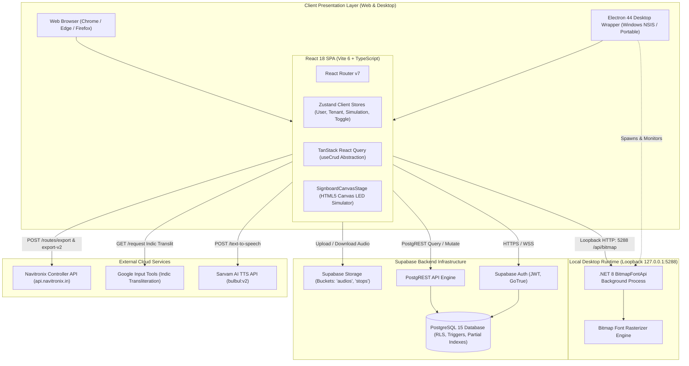
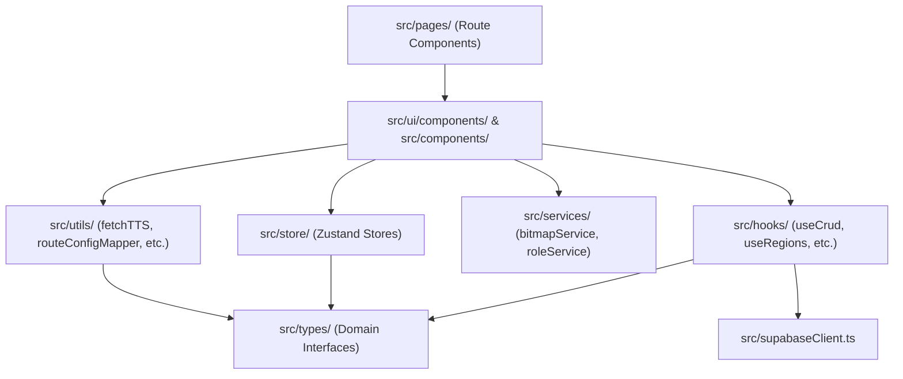

# System Architecture: Navitronix RMS

**Target Application:** Navitronix RMS (`navitronics-ui`)  
**Specification Version:** 1.0.0-FINAL  
**Date:** October 12, 2026  
**Audience:** Principal Architects, Systems Engineers, Full-Stack Developers  

---

## 1. High-Level Architecture Topology

Navitronix RMS is architected as a hybrid single-page web and desktop application interfacing directly with a Supabase PostgreSQL backend, an embedded .NET 8 sidecar engine for LED bitmap rasterization, and external cloud services for speech synthesis and hardware export.

---

## 2. Subsystem Boundaries & Responsibilities

### 2.1 Presentation & State Layer (`src/`)
- **UI Framework:** React 18.3.1 with Vite 6.0.5 bundler.
- **Styling Architecture:** TailwindCSS 3.4 combined with Subframe UI components and custom CSS for LED matrices (`LedSignBoard.css`, `fonts.css`).
- **Routing:** `react-router-dom` 7.1.3 with route-level code splitting via `React.lazy()` and Suspense.
- **Client State Stores:** Zustand 5.0.3 stores with `persist` middleware:
  - `useLoggedUserStore`: User authentication state, profile metadata, roles, and remember-me preferences.
  - `useOrganizationStore`: Active tenant organization selection.
  - `useRegionStore` & `useDepotStore`: Active operational territory selections.
  - `useSimulationStore`: Active LED slide selection, slide index, and canvas inspector state.
  - `useToggleStore`: Sidebar docking, mobile drawer, and inspector drawer visibility toggles.
  - `useTabsStore`: Active signboard board selector (`front`, `side`, `rear`, `internal`).
- **Server State & Caching:** `@tanstack/react-query` 5.64.2 wrapping PostgREST CRUD operations with 5-minute stale-time caching.

### 2.2 Local Desktop Engine Layer (`electron/`)
- **Main Process (`electron/main.cjs`):**
  - Configures BrowserWindow with 1440x900 resolution.
  - Implements Option 1 "Thin Client" architecture: attempts loading remote production URL (`https://app.navitronix.in`) for instant live updates, falling back to local `dist/index.html` if offline.
  - Disables `webSecurity` (`webSecurity: false`) to permit hosted HTTPS web apps to make loopback HTTP requests to `http://127.0.0.1:5288`.
  - Spawns and supervises the .NET 8 `BitmapFontApi.exe` child process upon application bootstrap.
  - Cleans up child processes upon exit via `taskkill /pid ... /T /F` on Windows to prevent orphan zombies.
- **Preload Script (`electron/preload.cjs`):** Exposes `window.navitronixDesktop` bridge containing `isDesktop: true`, `backendUrl: 'http://127.0.0.1:5288/api/bitmap'`, and `enginePort: 5288`.

### 2.3 Database & Storage Layer (`supabase/`)
- **PostgreSQL 15 Database:**
  - Relational multi-tenant schema with soft-delete patterns (`deleted = false`).
  - Active partial unique constraints preventing duplicate active route numbers and entity names.
  - Row-Level Security policies enforcing tenant scoping.
- **Supabase Storage:**
  - Bucket `audios`: Stores public audio files (`/static/en/`, `/static/hi/`, etc.).
  - Bucket `stops`: Stores dynamic stop announcement WAV/MP3 files (`${stopId}/${timestamp}-${filename}`).

### 2.4 External Integration Services
- **Sarvam AI Text-to-Speech API (`https://api.sarvam.ai/text-to-speech`):** Synthesizes natural transit speech in 11+ Indian languages using the `bulbul:v2` model with speakers "meera" (female) and "arvind" (male).
- **Google Input Tools API (`https://inputtools.google.com/request`):** Translates Latin keystrokes into Indic scripts (Telugu, Hindi, Kannada, Tamil, etc.) for transit destination boards.
- **Navitronix Controller API (`https://api.navitronix.in/navitranix/api`):** Proprietary backend service that compiles V1 and V2 route configurations into hardware binary packages.

---

## 3. Modular Dependency Topology

The application code adheres to a unidirectional dependency hierarchy:

---

## 4. Key Architectural Patterns

1. **Thin-Client Desktop Shell Pattern:** Instead of packaging the entire web application as a static offline bundle, the Electron desktop client functions as an auto-updating thin client that loads the latest cloud release while running native background sidecars.
2. **Graceful Degradation Pattern:** If cloud TTS is unreachable or unconfigured, the application falls back to an in-memory synthetic 16-bit PCM WAV chime generator (`createSyntheticWavBlob`).
3. **Optimistic UI with React Query Invalidation:** All data mutations (`useCreate`, `useUpdate`, `useDelete`) automatically invalidate table query keys in TanStack Query, guaranteeing immediate UI synchronization.
4. **Client-Side Transliteration & Rasterization:** Multi-language text typed into transit destination inputs is transliterated in real time via Google IME and sent to the local Bitmap API for instant dot-matrix preview rendering.
