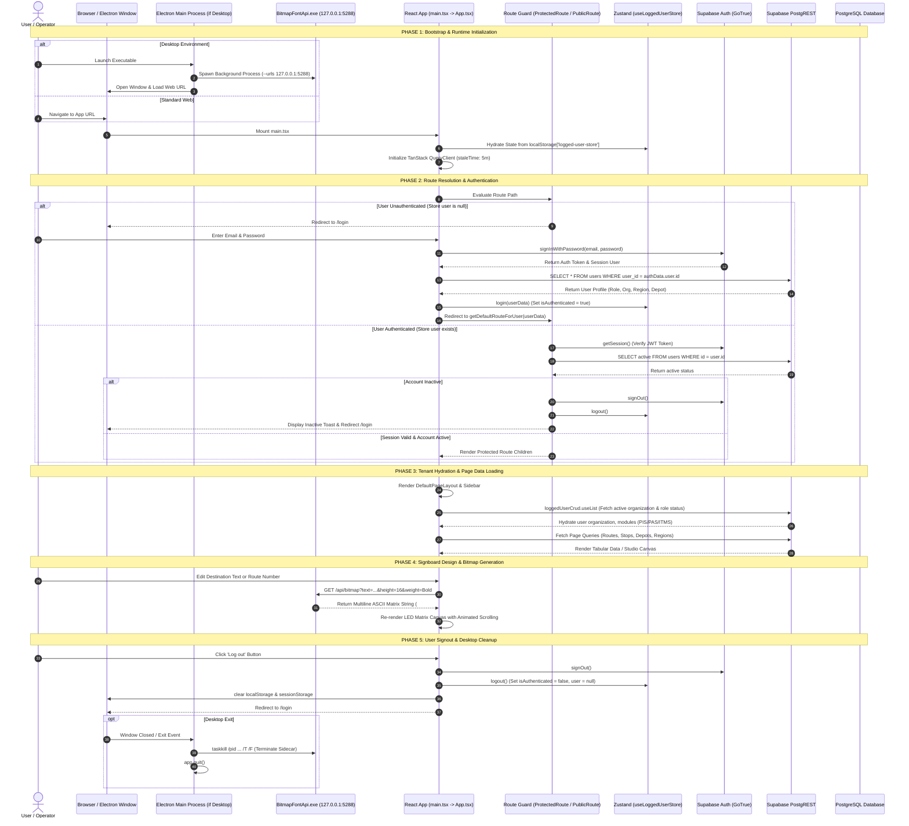

# Application Execution Lifecycle: Navitronix RMS

**Target Application:** Navitronix RMS (`navitronics-ui`)  
**Specification Version:** 1.0.0-FINAL  
**Date:** October 12, 2026  

---

## 1. Complete Application Execution Lifecycle

The following Mermaid sequence diagram traces the complete execution lifecycle from initial browser load or desktop launch through session hydration, route resolution, data loading, user mutation, and session termination:

---

## 2. Detailed Lifecycle Stages

### 2.1 Stage 1 — Application Bootstrap & Environment Discovery
1. **Entry Point:** Execution begins at [src/main.tsx](file:///Users/vinaykongari/Nav/old/navitronics-ui/src/main.tsx). It renders `<App />` into the DOM `#root` container.
2. **Theme Initialization:** `next-themes` wraps the app tree in `<ThemeProvider attribute="class" defaultTheme="system" enableSystem>`, determining initial theme classes (`light` vs `dark`).
3. **Desktop Bridge Detection:** The app inspects `window.navitronixDesktop`. If present, it binds the local Bitmap API to `http://127.0.0.1:5288/api/bitmap`. Otherwise, it falls back to `VITE_BITMAP_API_URL` or defaults.
4. **React Query Cache:** Initializes `QueryClient` with default options:
   - `staleTime: 1000 * 60 * 5` (5 minutes)
   - `retry: 1`
   - In development mode (`import.meta.env.DEV`), injects `<ReactQueryDevtools />`.

### 2.2 Stage 2 — Client State Hydration
1. **Zustand Store Rehydration:** On startup, Zustand automatically restores persisted state from browser `localStorage`:
   - `localStorage['logged-user-store']` -> Restores `isAuthenticated`, `user`, `rememberMe`.
   - `localStorage['organization-storage']` -> Restores `selectedOrganization`.
   - `localStorage['region-storage']` -> Restores `selectedRegion`, `depotsPageRegion`, `routesPageRegion`.
   - `localStorage['depot-storage']` -> Restores `selectedDepot`, `routesPageDepot`.
2. **Security & Session Drift Risk:** Zustand restores `isAuthenticated: true` even if the underlying Supabase JWT session expired or was revoked remotely. Stage 3 mitigates this.

### 2.3 Stage 3 — Route Guard & Session Verification
1. **Protected Route Execution ([ProtectedRoute.tsx](file:///Users/vinaykongari/Nav/old/navitronics-ui/src/components/ProtectedRoute.tsx)):**
   - Displays a fullscreen spinner while `isValidating === true`.
   - Invokes `supabase.auth.getSession()`. If no valid auth session exists, triggers `logout()`, sets `isSessionValid = false`, and redirects to `/login`.
   - Queries `public.users` table for `active` column. If `active === false`, displays error toast `"Your account is inactive. Please contact support at support@navitronix.in."`, issues `supabase.auth.signOut()`, and forces redirect to `/login`.
2. **Public Route Execution ([PublicRoute.tsx](file:///Users/vinaykongari/Nav/old/navitronics-ui/src/components/PublicRoute.tsx)):**
   - If an authenticated session already exists, redirects the user immediately to `/home` (preventing re-login).

### 2.4 Stage 4 — Role-Based Access Control (RBAC) & Dynamic Landing
1. **Root Navigation:** Navigating to `/` triggers `<Navigate to="/home" replace />`.
2. **Home Landing Resolution:** The index route of `/home` executes `getDefaultRouteForUser(user)` ([customerType.ts:69-85](file:///Users/vinaykongari/Nav/old/navitronics-ui/src/utils/customerType.ts#L69-L85)):
   - `master` / `super_admin` -> Navigates to `/home/organizations`
   - `regular` / Standalone Customer -> Navigates to `/home/regular-routes`
   - `organization_admin` & `region_admin` -> Navigates to `/home/dashboard`
   - `depot_admin` -> Navigates to `/home/routes`
   - `guest` -> Navigates to `/home/organizations`
   - Unauthenticated -> Navigates to `/login`
3. **RBAC Route Gates ([RBACPage.tsx](file:///Users/vinaykongari/Nav/old/navitronics-ui/src/components/RBACPage.tsx)):**
   - Verifies whether `user.role.name` matches the route's allowed `roles` array.
   - Verifies whether the organization/user possesses required `features` (`PIS`, `PAS`, `ITMS`, `v1_routes`, `v2_routes`).
   - If unauthorized, renders an "Access Denied" view rather than throwing an unhandled error.

### 2.5 Stage 5 — Route Creation Studio Lifecycle
1. **Creation Studio Entry (`/routes/create`, `/routes/create/:routeId`):**
   - Wrapped by `<LanguageConfigProvider>` ([LanguageConfigContext.tsx](file:///Users/vinaykongari/Nav/old/navitronics-ui/src/context/LanguageConfigContext.tsx)), which preloads `font_settings` table configurations.
   - Form state initialized via `useForm<IRouteCreate>` with `defaultDisplayConfigPostRequest`.
   - If `:routeId` is present, fetches route from `public.routes` and parses JSON strings (`front`, `side`, `rear`, `internal`, `stops`).
2. **Unsaved Edits Protection:**
   - [RouteCreatePage.tsx:81-91](file:///Users/vinaykongari/Nav/old/navitronics-ui/src/pages/v2/CreateRoutePage.tsx#L81-L91) registers a `beforeunload` event listener when `formState.isDirty === true` to block accidental tab closures.
   - [RouteCreationHeader.tsx:211-228](file:///Users/vinaykongari/Nav/old/navitronics-ui/src/ui/components/RouteCreationHeader.tsx#L211-L228) renders a confirmation dialog when the back button is clicked with unsaved edits.
3. **Studio Cleanup:**
   - On component unmount, [RouteCreatePage.tsx:94-98](file:///Users/vinaykongari/Nav/old/navitronics-ui/src/pages/v2/CreateRoutePage.tsx#L94-L98) calls `useSimulationStore.getState().reset()`, resetting active slide indices and clearing canvas memory.

### 2.6 Stage 6 — Logout & Clean Teardown
1. **Signout Execution ([DefaultPageLayout.tsx:91-105](file:///Users/vinaykongari/Nav/old/navitronics-ui/src/ui/layouts/DefaultPageLayout.tsx#L91-L105)):**
   - Calls `await supabase.auth.signOut()` to revoke Supabase JWT session.
   - Calls Zustand `logout()` to reset `isAuthenticated: false` and `user: null`.
   - Executes `localStorage.clear()` and `sessionStorage.clear()`.
   - Navigates to `/login` with `{ replace: true }`.
2. **Desktop Shutdown ([electron/main.cjs:76-98](file:///Users/vinaykongari/Nav/old/navitronics-ui/electron/main.cjs#L76-L98)):**
   - Listens on `before-quit`, `will-quit`, and `window-all-closed` events.
   - Executes `stopBackendSidecar()`: forces execution of `taskkill /pid ${pid} /T /F` on Windows to kill the .NET child process tree.
