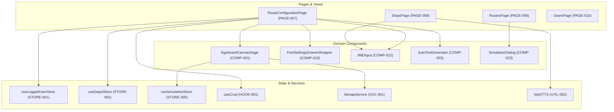

# Component and Module Inventory: Navitronix RMS

**Target Application:** Navitronix RMS (`navitronics-ui`)  
**Specification Version:** 1.0.0-FINAL  
**Date:** October 12, 2026  
**Status:** Verified  
**Audience:** Principal Architects, Frontend Engineers, Migration Engineering Team  

---

## 1. Overview and Taxonomy

This document provides an exhaustive inventory of all 145 application-owned runtime components, layout wrappers, state stores, custom hooks, service singletons, and utility modules discovered within `navitronics-ui/src`. 

### Categorization System
- **Pages (`PAGE-xxx`):** Top-level route views (detailed in [`12-ROUTE-AND-NAVIGATION-INVENTORY.md`](file:///Users/vinaykongari/Nav/old/navitronics-ui/docs/migration-handover/12-ROUTE-AND-NAVIGATION-INVENTORY.md) and [`22-PAGE-BY-PAGE-SPECIFICATIONS.md`](file:///Users/vinaykongari/Nav/old/navitronics-ui/docs/migration-handover/22-PAGE-BY-PAGE-SPECIFICATIONS.md)).
- **Domain & Studio Components (`COMP-001` - `COMP-035`):** Specialized display simulation, font rasterization, multilingual IME, and route editor widgets located in `src/components/`.
- **Legacy V1 Components (`COMP-040` - `COMP-047`):** Deprecated v1 LED signboard editor panels located in `src/components/v1/`.
- **Subframe UI Design System Components (`UI-001` - `UI-085`):** Curated design tokens, atomic inputs, dialogs, drawers, and form controls located in `src/ui/components/` and `src/ui/layouts/`.
- **State Stores (`STORE-001` - `STORE-009`):** Zustand-managed global reactive stores located in `src/store/`.
- **Custom Hooks (`HOOK-001` - `HOOK-004`):** React Query data fetching and mutation abstractions located in `src/hooks/`.
- **Services (`SVC-001` - `SVC-002`):** Network and sidecar API client abstractions located in `src/services/`.
- **Utilities (`UTIL-001` - `UTIL-011`):** Mathematical, transliteration, audio generation, and data mapping algorithms located in `src/utils/`.

---

## 2. Domain & LED Signboard Studio Components (`src/components/`)

| Component ID | Component Name | Source Path | Key Responsibilities & Behavior | Primary Consumers / Callers | Status |
| :--- | :--- | :--- | :--- | :--- | :--- |
| `COMP-001` | `SignboardCanvasStage` | [`src/ui/components/SignboardCanvasStage.tsx`](file:///Users/vinaykongari/Nav/old/navitronics-ui/src/ui/components/SignboardCanvasStage.tsx) | HTML5 Canvas LED matrix simulation engine. Renders pitch grids, physical LED pixels (circular glow / square flat), multiline text layout, bilingual split-screen, scroll animation, and sidecar ASCII rasterization fallback. | `RouteConfigurationPage`, `SimulationDialog` | Verified |
| `COMP-002` | `LedSignBoard` | [`src/components/LedSignBoard.tsx`](file:///Users/vinaykongari/Nav/old/navitronics-ui/src/components/LedSignBoard.tsx) | WebGL/CSS grid-based LED display previewer. Renders dot-matrix styling (`LedSignBoard.css`) for front (128x16/32), side (128x16), rear (96x16), and internal cabin boards. | `DashboardPage`, `RoutesPage` | Verified |
| `COMP-003` | `AutoTextGenerator` | [`src/components/AutoTextGenerator.tsx`](file:///Users/vinaykongari/Nav/old/navitronics-ui/src/components/AutoTextGenerator.tsx) | Automated stop-list synthesis. Takes source stop names, via points, and destinations; automatically generates sequence slides and assigns transit transitions. | `RouteConfigurationPage` | Verified |
| `COMP-004` | `CanvasText` | [`src/components/CanvasText.tsx`](file:///Users/vinaykongari/Nav/old/navitronics-ui/src/components/CanvasText.tsx) | Direct 2D Canvas text rasterizer for font metrics testing and glyph inspection across Latin and Indic Unicode scripts. | `FontConfigurationPage` | Verified |
| `COMP-005` | `DisplayEditor` | [`src/components/DisplayEditor.tsx`](file:///Users/vinaykongari/Nav/old/navitronics-ui/src/components/DisplayEditor.tsx) | Signboard hardware profile configurator. Sets width (96, 128, 160, 192), height (16, 32), color (Monochrome Amber, Red, Green, White, Full RGB), and matrix pitch. | `RouteConfigurationPage` | Verified |
| `COMP-006` | `DisplaySettings` | [`src/components/DisplaySettings.tsx`](file:///Users/vinaykongari/Nav/old/navitronics-ui/src/components/DisplaySettings.tsx) | Visual parameter settings panel: brightness, contrast, scan rate, frame rate, scroll speed (1-10), pause duration (seconds), and blink frequency. | `RouteConfigurationPage` | Verified |
| `COMP-007` | `ExportFormatDialog` | [`src/components/ExportFormatDialog.tsx`](file:///Users/vinaykongari/Nav/old/navitronics-ui/src/components/ExportFormatDialog.tsx) | Firmware binary format selector modal. Supports Navitronix Controller v1 binary (`.bin`), v2 JSON firmware bundle, and ZIP package export with onboard audio clips. | `RouteConfigurationPage`, `RoutesPage` | Verified |
| `COMP-008` | `FeatureRBAC` | [`src/components/FeatureRBAC.tsx`](file:///Users/vinaykongari/Nav/old/navitronics-ui/src/components/FeatureRBAC.tsx) | Feature-flag and permission wrapper. Conditionally renders child nodes based on evaluated permission bitmask and customer tier flags. | Universal layout | Verified |
| `COMP-009` | `FontHeightControl` | [`src/components/FontHeightControl.tsx`](file:///Users/vinaykongari/Nav/old/navitronics-ui/src/components/FontHeightControl.tsx) | Stepper and slider control bound to pixel font heights (7px, 8px, 10px, 12px, 14px, 16px, 24px, 32px). | `FontSettingsDrawerWrapper` | Verified |
| `COMP-010` | `FontSettingsDrawerWrapper` | [`src/components/FontSettingsDrawerWrapper.tsx`](file:///Users/vinaykongari/Nav/old/navitronics-ui/src/components/FontSettingsDrawerWrapper.tsx) | Comprehensive slide and typography inspector (40KB). Controls font family selection, alignment (left, center, right), letter spacing, vertical offset, and language bindings. | `RouteConfigurationPage` | Verified |
| `COMP-011` | `FullScreenBoard` | [`src/components/FullScreenBoard.tsx`](file:///Users/vinaykongari/Nav/old/navitronics-ui/src/components/FullScreenBoard.tsx) | Fullscreen presentation mode for passenger terminal / depot departure board testing. | `RouteConfigurationPage` | Verified |
| `COMP-012` | `IMEInput` | [`src/components/IMEInput.tsx`](file:///Users/vinaykongari/Nav/old/navitronics-ui/src/components/IMEInput.tsx) | Multilingual phonetics engine input field. Intercepts keystrokes and queries Google Input Tools / Indic Sanscript to transliterate English keystrokes into Hindi/Telugu in real time. | `RouteConfigurationPage`, `StopsPage` | Verified |
| `COMP-013` | `LanguageModify` | [`src/components/LanguageModify.tsx`](file:///Users/vinaykongari/Nav/old/navitronics-ui/src/components/LanguageModify.tsx) | Route language configurator. Enables toggling active languages (English, Hindi, Telugu, Marathi, Kannada) and setting primary / secondary presentation orders. | `RouteConfigurationPage` | Verified |
| `COMP-014` | `PageHeader` | [`src/components/PageHeader.tsx`](file:///Users/vinaykongari/Nav/old/navitronics-ui/src/components/PageHeader.tsx) | Standardized page title header banner displaying page title, breadcrumbs, contextual action buttons, and depot context selector. | All top-level pages | Verified |
| `COMP-015` | `ProtectedRoute` | [`src/components/ProtectedRoute.tsx`](file:///Users/vinaykongari/Nav/old/navitronics-ui/src/components/ProtectedRoute.tsx) | Route guard verifying authentication session, role clearance, active tenant status, and STU depot assignment before rendering child routes. | `App.tsx` | Verified |
| `COMP-016` | `PublicRoute` | [`src/components/PublicRoute.tsx`](file:///Users/vinaykongari/Nav/old/navitronics-ui/src/components/PublicRoute.tsx) | Inverse route guard. Redirects authenticated users from `/login` back to `/dashboard` or tier-specific landing routes. | `App.tsx` | Verified |
| `COMP-017` | `RBAC` | [`src/components/RBAC.tsx`](file:///Users/vinaykongari/Nav/old/navitronics-ui/src/components/RBAC.tsx) | Inline declarative permission guard. Renders `fallback` if the current user fails role criteria (`allowedRoles={['master', 'admin']}`). | Subframe forms & tables | Verified |
| `COMP-018` | `RBACPage` | [`src/components/RBACPage.tsx`](file:///Users/vinaykongari/Nav/old/navitronics-ui/src/components/RBACPage.tsx) | Full-page 403 Forbidden boundary with "Access Denied" messaging and "Return to Dashboard" action. | `App.tsx` | Verified |
| `COMP-019` | `RegionSelect` | [`src/components/RegionSelect.tsx`](file:///Users/vinaykongari/Nav/old/navitronics-ui/src/components/RegionSelect.tsx) | Dropdown selector filtering depots by parent region ID. | `DepotsPage`, `UsersPage` | Verified |
| `COMP-020` | `RouteLanguageSettings` | [`src/components/RouteLanguageSettings.tsx`](file:///Users/vinaykongari/Nav/old/navitronics-ui/src/components/RouteLanguageSettings.tsx) | Slide-level language configuration widget. Controls single-language, bilingual alternating, or bilingual split-screen display modes. | `RouteConfigurationPage` | Verified |
| `COMP-021` | `SideWithSingleTextBoard` | [`src/components/SideWithSingleTextBoard.tsx`](file:///Users/vinaykongari/Nav/old/navitronics-ui/src/components/SideWithSingleTextBoard.tsx) | LED canvas simulator for side destination board format 1: Single continuous scroll text block. | `RouteConfigurationPage` | Verified |
| `COMP-022` | `SideWithTwoHalfsBoard` | [`src/components/SideWithTwoHalfsBoard.tsx`](file:///Users/vinaykongari/Nav/old/navitronics-ui/src/components/SideWithTwoHalfsBoard.tsx) | LED canvas simulator for side destination board format 2: Left half fixed route number + Right half scrolling stops. | `RouteConfigurationPage` | Verified |
| `COMP-023` | `SimulationDialog` | [`src/components/SimulationDialog.tsx`](file:///Users/vinaykongari/Nav/old/navitronics-ui/src/components/SimulationDialog.tsx) | Modal player executing continuous signboard animation loop with real-time playback controls (Play, Pause, Step Next, Speed 0.5x-2.0x). | `RoutesPage`, `RegularRoutesPage` | Verified |
| `COMP-024` | `TextToLedMatrix` | [`src/components/TextToLedMatrix.tsx`](file:///Users/vinaykongari/Nav/old/navitronics-ui/src/components/TextToLedMatrix.tsx) | Text to matrix converter invoking local sidecar `.NET` engine or client-side Canvas fallback. | `SignboardCanvasStage` | Verified |
| `COMP-025` | `ThemeToggle` | [`src/components/ThemeToggle.tsx`](file:///Users/vinaykongari/Nav/old/navitronics-ui/src/components/ThemeToggle.tsx) | Light / Dark / System theme switcher using `next-themes`. | `DefaultPageLayout` | Verified |
| `COMP-026` | `bitmap` | [`src/components/bitmap.tsx`](file:///Users/vinaykongari/Nav/old/navitronics-ui/src/components/bitmap.tsx) | Low-level Canvas bitmap glyph rasterizer extracting binary byte arrays (1 bit per pixel) for firmware serialization. | `RouteConfigurationPage` | Verified |
| `COMP-027` | `ledBitmap` | [`src/components/ledBitmap.tsx`](file:///Users/vinaykongari/Nav/old/navitronics-ui/src/components/ledBitmap.tsx) | ASCII matrix parser turning string blobs of `#` (active LED) and `.` (inactive LED) into visual canvas dots. | `TextToLedMatrix` | Verified |
| `COMP-028` | `canvasUtility` | [`src/components/canvasUtility.ts`](file:///Users/vinaykongari/Nav/old/navitronics-ui/src/components/canvasUtility.ts) | Pure rendering algorithms for drawing circular LED beads, glow halos, bevels, grid lines, and scanlines. | `SignboardCanvasStage` | Verified |
| `COMP-029` | `RoleForm` | [`src/components/roles/RoleForm.tsx`](file:///Users/vinaykongari/Nav/old/navitronics-ui/src/components/roles/RoleForm.tsx) | Modal form managing custom role creation, code generation, and permission bitmask assignment. | `RolesPage` | Verified |

---

## 3. Legacy V1 Signboard Studio Components (`src/components/v1/`)

| Component ID | Component Name | Source Path | Key Responsibilities & Behavior | Status |
| :--- | :--- | :--- | :--- | :--- |
| `COMP-040` | `RouteCreationHeaderV1` | [`src/components/v1/RouteCreationHeaderV1.tsx`](file:///Users/vinaykongari/Nav/old/navitronics-ui/src/components/v1/RouteCreationHeaderV1.tsx) | Header actions for deprecated v1 editor: Route Number, Route Name, Save, and Export to V1 Binary. | Deprecated |
| `COMP-041` | `V1LeftPanel` | [`src/components/v1/V1LeftPanel.tsx`](file:///Users/vinaykongari/Nav/old/navitronics-ui/src/components/v1/V1LeftPanel.tsx) | Left sidebar list of display boards (Front, Side, Rear, Internal) and sequence slides for v1 data schema. | Deprecated |
| `COMP-042` | `V1RightPanel` | [`src/components/v1/V1RightPanel.tsx`](file:///Users/vinaykongari/Nav/old/navitronics-ui/src/components/v1/V1RightPanel.tsx) | Form controls for v1 text properties: font size, speed, effect (Scroll, Freeze, Curtain), and display duration. | Deprecated |
| `COMP-043` | `V1DisplayEditor` | [`src/components/v1/V1DisplayEditor.tsx`](file:///Users/vinaykongari/Nav/old/navitronics-ui/src/components/v1/V1DisplayEditor.tsx) | HTML5 Canvas workspace rendering v1 monochrome LED grid and previewing animations. | Deprecated |
| `COMP-044` | `V1SimulationPanel` | [`src/components/v1/V1SimulationPanel.tsx`](file:///Users/vinaykongari/Nav/old/navitronics-ui/src/components/v1/V1SimulationPanel.tsx) | Mini simulation controller for v1 editor (Play, Stop, Speed slider). | Deprecated |
| `COMP-045` | `ConfirmBackDialog` | [`src/components/v1/ConfirmBackDialog.tsx`](file:///Users/vinaykongari/Nav/old/navitronics-ui/src/components/v1/ConfirmBackDialog.tsx) | Unsaved changes confirmation modal shown when navigating away from v1 editor. | Deprecated |
| `COMP-046` | `FieldErrorsDialog` | [`src/components/v1/FieldErrorsDialog.tsx`](file:///Users/vinaykongari/Nav/old/navitronics-ui/src/components/v1/FieldErrorsDialog.tsx) | Validation errors modal listing missing required v1 route fields. | Deprecated |
| `COMP-047` | `getTextItemsForFormat` | [`src/components/v1/getTextItemsForFormat.ts`](file:///Users/vinaykongari/Nav/old/navitronics-ui/src/components/v1/getTextItemsForFormat.ts) | Helper transforming display format enum into text item input schema. | Deprecated |

---

## 4. Subframe Presentation & Form Components (`src/ui/components/`)

The application leverages Subframe UI components built on Tailwind CSS and Radix UI primitives. Below is the functional mapping of key business and form components:

| Component ID | Component Name | Source Path | Responsibilities & Form Fields Handled | Status |
| :--- | :--- | :--- | :--- | :--- |
| `UI-001` | `DefaultPageLayout` | [`src/ui/layouts/DefaultPageLayout.tsx`](file:///Users/vinaykongari/Nav/old/navitronics-ui/src/ui/layouts/DefaultPageLayout.tsx) | Primary application chrome: Collapsible sidebar, tier-based navigation items, depot switcher, user profile pill, theme toggle, and breadcrumbs. | Verified |
| `UI-002` | `CreateOrganizationDrawer` | [`src/ui/components/CreateOrganizationDrawer.tsx`](file:///Users/vinaykongari/Nav/old/navitronics-ui/src/ui/components/CreateOrganizationDrawer.tsx) | Slide-over drawer for creating STU organizations (`name`, `code`, `state`, `contact_email`, `contact_phone`, `address`). | Verified |
| `UI-003` | `CreateRegionForm` | [`src/ui/components/CreateRegionForm.tsx`](file:///Users/vinaykongari/Nav/old/navitronics-ui/src/ui/components/CreateRegionForm.tsx) | Modal form for creating administrative transit regions (`name`, `code`, `organization_id`). | Verified |
| `UI-004` | `CreateDepotForm` | [`src/ui/components/CreateDepotForm.tsx`](file:///Users/vinaykongari/Nav/old/navitronics-ui/src/ui/components/CreateDepotForm.tsx) | Modal form for creating bus depots (`name`, `code`, `region_id`, `organization_id`, `location`). | Verified |
| `UI-005` | `CreateRegularCustomerDrawer` | [`src/ui/components/CreateRegularCustomerDrawer.tsx`](file:///Users/vinaykongari/Nav/old/navitronics-ui/src/ui/components/CreateRegularCustomerDrawer.tsx) | Slide-over drawer for onboarding standalone bus operators (`username`, `email`, `phone_number`, `password`). Generates a virtual depot and auto-provisions user. | Verified |
| `UI-006` | `CreateGuestDrawer` | [`src/ui/components/CreateGuestDrawer.tsx`](file:///Users/vinaykongari/Nav/old/navitronics-ui/src/ui/components/CreateGuestDrawer.tsx) | Slide-over drawer creating read-only guest evaluator accounts (`username`, `email`, `password`, `expires_at`). | Verified |
| `UI-007` | `CreateUserForm2` | [`src/ui/components/CreateUserForm2.tsx`](file:///Users/vinaykongari/Nav/old/navitronics-ui/src/ui/components/CreateUserForm2.tsx) | Comprehensive user provisioning form (41KB). Handles role selection, organization/region/depot scoping, and plaintext password persistence (`SEC-02`). | Verified |
| `UI-008` | `CreateStopForm` | [`src/ui/components/CreateStopForm.tsx`](file:///Users/vinaykongari/Nav/old/navitronics-ui/src/ui/components/CreateStopForm.tsx) | Multilingual bus stop creator. Captures stop names in English, Telugu, Hindi; generates TTS audio files via Sarvam AI API. | Verified |
| `UI-009` | `STUOnboardingWizard` | [`src/ui/components/STUOnboardingWizard.tsx`](file:///Users/vinaykongari/Nav/old/navitronics-ui/src/ui/components/STUOnboardingWizard.tsx) | Multi-step setup wizard (36KB). Sequentially provisions Organization -> Region -> Depot -> Depot Admin user. Suffers from non-atomic rollback (`ARC-01`). | Verified |
| `UI-010` | `UserLoginForm` | [`src/ui/components/UserLoginForm.tsx`](file:///Users/vinaykongari/Nav/old/navitronics-ui/src/ui/components/UserLoginForm.tsx) | Authentication card supporting username/password submission, Supabase authentication, and role hydration. | Verified |
| `UI-011` | `RouteCreationHeader` | [`src/ui/components/RouteCreationHeader.tsx`](file:///Users/vinaykongari/Nav/old/navitronics-ui/src/ui/components/RouteCreationHeader.tsx) | Header toolbar for Route Configuration V2: Route Number 1/2, via stops summary, Save button, and Firmware Export trigger. | Verified |
| `UI-012` | `RouteSpecificationPanel` | [`src/ui/components/RouteSpecificationPanel.tsx`](file:///Users/vinaykongari/Nav/old/navitronics-ui/src/ui/components/RouteSpecificationPanel.tsx) | Form controls for primary route metadata: Bus service type (Express, Palle Velugu, City Ordinary), route code, and direction (Up/Down). | Verified |
| `UI-013` | `RouteTable` | [`src/ui/components/RouteTable.tsx`](file:///Users/vinaykongari/Nav/old/navitronics-ui/src/ui/components/RouteTable.tsx) | AG Grid / HTML table listing routes with status badges, search filtering, and action menus (Edit, Duplicate, Delete, Export). | Verified |
| `UI-014` | `UsersTable` | [`src/ui/components/UsersTable.tsx`](file:///Users/vinaykongari/Nav/old/navitronics-ui/src/ui/components/UsersTable.tsx) | Data table for user management featuring unmasked plaintext passwords (`PasswordViewerCell`, `SEC-02`). | Verified |
| `UI-015` | `PasswordViewerCell` | [`src/ui/components/PasswordViewerCell.tsx`](file:///Users/vinaykongari/Nav/old/navitronics-ui/src/ui/components/PasswordViewerCell.tsx) | Cell renderer with eye toggle icon displaying unmasked user passwords in cleartext. | Verified |
| `UI-016` | `AudioFileContainer` | [`src/ui/components/AudioFileContainer.tsx`](file:///Users/vinaykongari/Nav/old/navitronics-ui/src/ui/components/AudioFileContainer.tsx) | Audio player and wave previewer for synthesized WAV/MP3 bus stop announcements. | Verified |
| `UI-017` | `MaterialSymbolPicker` | [`src/ui/components/MaterialSymbolPicker.tsx`](file:///Users/vinaykongari/Nav/old/navitronics-ui/src/ui/components/MaterialSymbolPicker.tsx) | Modal picker searching through Google Material Symbols to embed transit icons onto LED display slides. | Verified |
| `UI-018` | `StudioInspectorPanel` | [`src/ui/components/StudioInspectorPanel.tsx`](file:///Users/vinaykongari/Nav/old/navitronics-ui/src/ui/components/StudioInspectorPanel.tsx) | Right-hand property inspector for route studio: typography, transitions, font selection, and speed parameters. | Verified |
| `UI-019` | `SlidePropertyInspector` | [`src/ui/components/SlidePropertyInspector.tsx`](file:///Users/vinaykongari/Nav/old/navitronics-ui/src/ui/components/SlidePropertyInspector.tsx) | Detailed slide timing controls: Duration (seconds), In-effect, Out-effect, Scroll Speed, and Display Order. | Verified |
| `UI-020` | `SimulationPlayerCard` | [`src/ui/components/SimulationPlayerCard.tsx`](file:///Users/vinaykongari/Nav/old/navitronics-ui/src/ui/components/SimulationPlayerCard.tsx) | Embedded playback widget for route animation preview with frame-stepping capabilities. | Verified |
| `UI-021` | `SimulationsPlayerPanel` | [`src/ui/components/SimulationsPlayerPanel.tsx`](file:///Users/vinaykongari/Nav/old/navitronics-ui/src/ui/components/SimulationsPlayerPanel.tsx) | Multiboard synchronized playback panel running Front, Side, Rear, and Internal boards concurrently in simulated real time. | Verified |
| `UI-022` | `JsonViewerDialog` | [`src/ui/components/JsonViewerDialog.tsx`](file:///Users/vinaykongari/Nav/old/navitronics-ui/src/ui/components/JsonViewerDialog.tsx) | Debug inspection dialog displaying formatted raw JSON payload of routes and signboard configurations. | Verified |
| `UI-023` | `FormatSelectionControl` | [`src/ui/components/FormatSelectionControl.tsx`](file:///Users/vinaykongari/Nav/old/navitronics-ui/src/ui/components/FormatSelectionControl.tsx) | Card radio selector for signboard layout formats (Single full-width, Two-half, Three-section). | Verified |
| `UI-024` | `HeightControl` | [`src/ui/components/HeightControl.tsx`](file:///Users/vinaykongari/Nav/old/navitronics-ui/src/ui/components/HeightControl.tsx) | Control for adjusting display height and line partitioning in LED pixels. | Verified |
| `UI-025` | `WidthControl` | [`src/ui/components/WidthControl.tsx`](file:///Users/vinaykongari/Nav/old/navitronics-ui/src/ui/components/WidthControl.tsx) | Control for setting board pixel width. | Verified |
| `UI-026` | `TextPropertiesControls` | [`src/ui/components/TextPropertiesControls.tsx`](file:///Users/vinaykongari/Nav/old/navitronics-ui/src/ui/components/TextPropertiesControls.tsx) | Text styling tool: Bold, Italic, Invert (Negative LED), Flashing, and Custom Glyphs. | Verified |
| `UI-027` | `SelectOrganizationComponent` | [`src/ui/components/SelectOrganizationComponent.tsx`](file:///Users/vinaykongari/Nav/old/navitronics-ui/src/ui/components/SelectOrganizationComponent.tsx) | Multi-tier cascading dropdown selecting Organization -> Region -> Depot. | Verified |
| `UI-028` | `ResetPassword` | [`src/ui/components/ResetPassword.tsx`](file:///Users/vinaykongari/Nav/old/navitronics-ui/src/ui/components/ResetPassword.tsx) | Administrative password reset modal. | Verified |
| `UI-029` | `StopDetailsCard` | [`src/ui/components/StopDetailsCard.tsx`](file:///Users/vinaykongari/Nav/old/navitronics-ui/src/ui/components/StopDetailsCard.tsx) | Summary card showing stop code, multilingual names, and audio playback status. | Verified |
| `UI-030` | `TreeView` | [`src/ui/components/TreeView.tsx`](file:///Users/vinaykongari/Nav/old/navitronics-ui/src/ui/components/TreeView.tsx) | Hierarchical tree navigator for STU Organization -> Region -> Depot navigation. | Verified |

---

## 5. Zustand Reactive State Stores (`src/store/`)

| Store ID | Store Symbol | Source Path | State Contract & Actions | Persistence Mechanism |
| :--- | :--- | :--- | :--- | :--- |
| `STORE-001` | `useLoggedUserStore` | [`src/store/useLoggedUserStore.ts`](file:///Users/vinaykongari/Nav/old/navitronics-ui/src/store/useLoggedUserStore.ts) | Holds logged-in user profile (`IUser`), role code, permissions bitmask, and active depot ID. Actions: `setUser`, `clearUser`, `updateDepot`. | `localStorage` key: `logged-user-storage` |
| `STORE-002` | `useDepotStore` | [`src/store/useDepotStore.tsx`](file:///Users/vinaykongari/Nav/old/navitronics-ui/src/store/useDepotStore.tsx) | Holds currently selected depot object (`IDepot`) for STU enterprise scope. Actions: `setSelectedDepot`, `clearSelectedDepot`. | `localStorage` key: `selected-depot-storage` |
| `STORE-003` | `useRegionStore` | [`src/store/useRegionStore.ts`](file:///Users/vinaykongari/Nav/old/navitronics-ui/src/store/useRegionStore.ts) | Holds currently selected transit region (`IRegion`). Actions: `setSelectedRegion`, `clearSelectedRegion`. | `localStorage` key: `selected-region-storage` |
| `STORE-004` | `useOrganizationStore` | [`src/store/useOrganizationStore.ts`](file:///Users/vinaykongari/Nav/old/navitronics-ui/src/store/useOrganizationStore.ts) | Holds selected STU tenant (`IOrganization`). Actions: `setSelectedOrganization`, `clearOrganization`. | `localStorage` key: `selected-org-storage` |
| `STORE-005` | `useSimulationStore` | [`src/store/useSimulationStore.ts`](file:///Users/vinaykongari/Nav/old/navitronics-ui/src/store/useSimulationStore.ts) | Simulation playback state: `isPlaying`, `speed`, `currentSlideIndex`, `elapsedMs`, `activeBoard`. Actions: `play`, `pause`, `step`, `setSpeed`, `reset`. | In-memory only |
| `STORE-006` | `useToggleStore` | [`src/store/useToggleStore.ts`](file:///Users/vinaykongari/Nav/old/navitronics-ui/src/store/useToggleStore.ts) | UI layout toggles: sidebar collapsed, grid snap enabled, LED pitch preview scale, debug inspector visible. | `localStorage` key: `ui-toggle-storage` |
| `STORE-007` | `useTabsStore` | [`src/store/useTabsStore.ts`](file:///Users/vinaykongari/Nav/old/navitronics-ui/src/store/useTabsStore.ts) | Active navigation tab for Route Studio (Front, Side, Rear, Internal, General Settings). | In-memory only |
| `STORE-008` | `useAreaStore` | [`src/store/useAreaStore.ts`](file:///Users/vinaykongari/Nav/old/navitronics-ui/src/store/useAreaStore.ts) | Filter state for geographical areas / clusters within a depot. | In-memory only |
| `STORE-009` | `authStore` | [`src/store/authStore.tsx`](file:///Users/vinaykongari/Nav/old/navitronics-ui/src/store/authStore.tsx) | Low-level Supabase session indicator (`session`, `isLoading`). | Supabase GoTrue storage |

---

## 6. Custom React Hooks (`src/hooks/`)

| Hook ID | Hook Symbol | Source Path | Responsibilities & Data Operations |
| :--- | :--- | :--- | :--- |
| `HOOK-001` | `useCrud` | [`src/hooks/useCrud.ts`](file:///Users/vinaykongari/Nav/old/navitronics-ui/src/hooks/useCrud.ts) | Universal TanStack React Query CRUD abstraction. Implements `getAll`, `getById`, `create`, `update`, and soft-delete (`status = 'deleted'`) against any Supabase table. Handles automatic query cache invalidation. |
| `HOOK-002` | `useRoutes` | [`src/hooks/useRoutes.ts`](file:///Users/vinaykongari/Nav/old/navitronics-ui/src/hooks/useRoutes.ts) | Specialized route fetching hook filtering by `depot_id` (STU) or `created_by` (Regular customer). Automates stop sequence expansion and relation joins. |
| `HOOK-003` | `useDepots` | [`src/hooks/useDepots.ts`](file:///Users/vinaykongari/Nav/old/navitronics-ui/src/hooks/useDepots.ts) | Fetches depots scoped to the active region and organization with active-status filters. |
| `HOOK-004` | `useRegions` | [`src/hooks/useRegions.ts`](file:///Users/vinaykongari/Nav/old/navitronics-ui/src/hooks/useRegions.ts) | Fetches transit regions scoped to the selected organization. |

---

## 7. Service Layer Singletons (`src/services/`)

| Service ID | Service Symbol | Source Path | Protocol / Destination | Responsibilities & Error Handling |
| :--- | :--- | :--- | :--- | :--- |
| `SVC-001` | `bitmapService` | [`src/services/bitmapService.ts`](file:///Users/vinaykongari/Nav/old/navitronics-ui/src/services/bitmapService.ts) | HTTP REST to `127.0.0.1:5288/api/bitmap` | Communicates with .NET sidecar `BitmapFontApi.exe`. Sends text string, font size, language code; receives multiline ASCII `#`/`.` grid. Falls back gracefully to browser Canvas rasterizer if sidecar connection fails. |
| `SVC-002` | `roleService` | [`src/services/roleService.ts`](file:///Users/vinaykongari/Nav/old/navitronics-ui/src/services/roleService.ts) | Supabase PostgREST | Manages role CRUD and fetches role permission matrices from `public.roles`. |

---

## 8. Domain Utilities & Algorithms (`src/utils/`)

| Utility ID | Module Name | Source Path | Responsibilities & Mathematical Logic |
| :--- | :--- | :--- | :--- |
| `UTIL-001` | `customerType` | [`src/utils/customerType.ts`](file:///Users/vinaykongari/Nav/old/navitronics-ui/src/utils/customerType.ts) | Evaluates user tenancy: `isMaster(user)`, `isSTU(user)`, `isRegular(user)`, `isGuest(user)`. Governs navigation visibility and route filters. |
| `UTIL-002` | `fetchTTS` | [`src/utils/fetchTTS.ts`](file:///Users/vinaykongari/Nav/old/navitronics-ui/src/utils/fetchTTS.ts) | Invokes Sarvam AI TTS API (`bulbul:v2`) for Indian languages (Telugu, Hindi, Kannada, etc.). Encodes audio to WAV and uploads to Supabase `audios` storage bucket. |
| `UTIL-003` | `transliteration` | [`src/utils/transliteration.ts`](file:///Users/vinaykongari/Nav/old/navitronics-ui/src/utils/transliteration.ts) | Indic Sanscript and Google Input Tools wrapper converting Latin Roman script into Telugu and Devanagari phonetically. |
| `UTIL-004` | `routeConfigMapper` | [`src/utils/routeConfigMapper.ts`](file:///Users/vinaykongari/Nav/old/navitronics-ui/src/utils/routeConfigMapper.ts) | Bidirectional transformer converting V1 and V2 JSON route representations for firmware serialization and backward compatibility. |
| `UTIL-005` | `simulationUtils` | [`src/utils/simulationUtils.ts`](file:///Users/vinaykongari/Nav/old/navitronics-ui/src/utils/simulationUtils.ts) | Calculates LED frame timing, step offsets, scroll interpolation, and multiline word wrapping on discrete pixel grids. |
| `UTIL-006` | `measurements` | [`src/utils/measurements.ts`](file:///Users/vinaykongari/Nav/old/navitronics-ui/src/utils/measurements.ts) | Calculates display hardware dimensions, physical board aspect ratios, LED pixel pitch (P10, P13.33), and power consumption estimates. |
| `UTIL-007` | `getFontFileByLanguage` | [`src/utils/getFontFileByLanguage.ts`](file:///Users/vinaykongari/Nav/old/navitronics-ui/src/utils/getFontFileByLanguage.ts) | Resolves bundled TTF font assets (`mangal.ttf`, `gautami.ttf`, `notosans.ttf`, `pixeloperator.ttf`) based on language code and pixel height. |
| `UTIL-008` | `featureFlags` | [`src/utils/featureFlags.ts`](file:///Users/vinaykongari/Nav/old/navitronics-ui/src/utils/featureFlags.ts) | Feature toggle resolution checking customer tier and environment configuration. |
| `UTIL-009` | `dateUtils` | [`src/utils/dateUtils.ts`](file:///Users/vinaykongari/Nav/old/navitronics-ui/src/utils/dateUtils.ts) | Standardized IST (Indian Standard Time, UTC+5:30) date/time formatting. |
| `UTIL-010` | `fileSystemExport` | [`src/utils/fileSystemExport.ts`](file:///Users/vinaykongari/Nav/old/navitronics-ui/src/utils/fileSystemExport.ts) | Browser download trigger saving `.bin`, `.json`, and `.zip` files via `file-saver`. |
| `UTIL-011` | `utils` | [`src/utils/utils.ts`](file:///Users/vinaykongari/Nav/old/navitronics-ui/src/utils/utils.ts) | Class name merging (`clsx` / `twMerge`) and common string helpers. |

---

## 9. Component Cross-Dependency Topology

