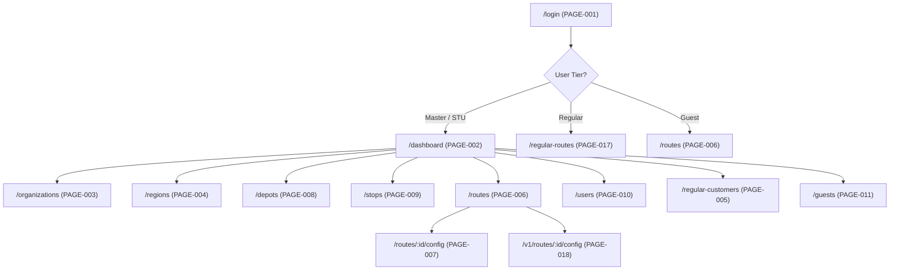

# Page-by-Page Functional Specifications: Navitronix RMS

**Target Application:** Navitronix RMS (`navitronics-ui`)  
**Specification Version:** 1.0.0-FINAL  
**Date:** October 12, 2026  
**Status:** Verified  
**Audience:** Frontend Engineers, System Architects, Quality Assurance Engineers  

---

## 1. Page Catalog Overview

This document provides exhaustive, implementation-independent specifications for all 18 navigable routes and views in the application.

---

## 2. Exhaustive Page Specifications

---

### `PAGE-001`: User Login Page (`/login`)
- **Route Path:** `/login`
- **File Implementation:** [`src/pages/HomePage.tsx`](file:///Users/vinaykongari/Nav/old/navitronics-ui/src/pages/HomePage.tsx), [`src/ui/components/UserLoginForm.tsx`](file:///Users/vinaykongari/Nav/old/navitronics-ui/src/ui/components/UserLoginForm.tsx)
- **Layout & Protection:** Standalone unauthenticated layout wrapped in `PublicRoute` (`COMP-016`). Redirects to `/dashboard` if user is already authenticated.
- **Allowed Roles:** Public / Unauthenticated.
- **Data Loaded on Init:** None.
- **UI Structure & Components:**
  - Centered auth card with Navitronix logo and tagline "Fleet Signboard Management System".
  - Email text field with validation (`type="email"`, required).
  - Password input field with visibility toggle (`type="password"`, required).
  - Submit button with spinner loading state.
  - "Remember me" checkbox (tied to browser session persistence).
- **Available Operations:**
  - `OP-001`: Submit Login Credentials.
- **State Transitions:**
  - `Loading`: Button displays loader spinner; inputs disabled.
  - `Error`: Displays toast notification with error message ("Invalid credentials" or "Account suspended").
  - `Success`: Rehydrates `useLoggedUserStore`; redirects based on resolved customer tier.

---

### `PAGE-002`: Executive Dashboard (`/dashboard`)
- **Route Path:** `/dashboard`
- **File Implementation:** [`src/pages/v2/DashboardPage.tsx`](file:///Users/vinaykongari/Nav/old/navitronics-ui/src/pages/v2/DashboardPage.tsx)
- **Layout & Protection:** `DefaultPageLayout` with `ProtectedRoute` (`master`, `admin`, `operator`).
- **Data Loaded on Init:**
  - Aggregated metrics query from `public.organizations`, `public.depots`, `public.routes`, `public.stops`.
  - Scoped to active depot in `useDepotStore` if non-master user.
- **UI Structure & Components:**
  - Top Metrics Cards: Total Organizations, Active Depots, Total Routes Configured, Multilingual Stops.
  - Interactive LED Signboard Live Preview: Miniature `LedSignBoard` component (`COMP-002`) rendering the most recently edited route.
  - Quick Actions Bar: "Create New Route", "Add Bus Stop", "Onboard STU", "Export All Routes".
  - Recent Route Modifications Table: List of last 5 updated routes with timestamp, author, and status badge.
- **Available Operations:**
  - Navigate to Route Creation (`PAGE-007`).
  - Switch active depot via top selector (`OP-003`).
  - Quick-export firmware ZIP for recent route (`OP-025`).

---

### `PAGE-003`: Organizations Management (`/organizations`)
- **Route Path:** `/organizations`
- **File Implementation:** [`src/pages/v2/OrganizationsPage.tsx`](file:///Users/vinaykongari/Nav/old/navitronics-ui/src/pages/v2/OrganizationsPage.tsx)
- **Layout & Protection:** `DefaultPageLayout`; Restricted to `master` role via `RBAC` (`COMP-017`).
- **Data Loaded on Init:**
  - Select all records from `public.organizations` where `status != 'deleted'` ordered by `created_at DESC`.
- **UI Structure & Components:**
  - Header with "Add Organization" button and search filter input.
  - Organizations Grid / Table: Name, Code (e.g., "TSRTC", "KSRTC", "APSRTC"), State, Contact Info, Total Depots count badge.
  - `CreateOrganizationDrawer` (`UI-002`): Slide-over drawer with fields `name`, `code`, `state`, `contact_email`, `contact_phone`, `address`.
  - `STUOnboardingWizard` modal trigger (`UI-009`): Comprehensive 4-step wizard.
  - Row Actions: Edit Organization, View Regions, Soft Delete (sets `status = 'deleted'`).
- **Available Operations:**
  - `OP-004`: Create Organization.
  - `OP-005`: Run STU Onboarding Wizard.
  - `OP-006`: Soft-delete Organization.

---

### `PAGE-004`: Transit Regions Management (`/regions`)
- **Route Path:** `/regions`
- **File Implementation:** [`src/pages/v2/RegionsPage.tsx`](file:///Users/vinaykongari/Nav/old/navitronics-ui/src/pages/v2/RegionsPage.tsx)
- **Layout & Protection:** `DefaultPageLayout`; Restricted to `master` and `admin`.
- **Data Loaded on Init:**
  - Select from `public.regions` joined with `public.organizations` filtered by active organization.
- **UI Structure & Components:**
  - Organization context filter dropdown.
  - Table of Regions: Region Code (e.g., "HYD", "SEC", "WGL"), Region Name, Organization, Depot Count.
  - `CreateRegionForm` modal (`UI-003`): Fields `name`, `code`, `organization_id`.
  - Actions: Edit, Delete (fails if child depots exist due to FK constraint).
- **Available Operations:**
  - `OP-007`: Create Region.
  - `OP-008`: Update Region.
  - `OP-009`: Delete Region.

---

### `PAGE-005`: Regular Customers Management (`/regular-customers`)
- **Route Path:** `/regular-customers`
- **File Implementation:** [`src/pages/v2/RegularCustomersPage.tsx`](file:///Users/vinaykongari/Nav/old/navitronics-ui/src/pages/v2/RegularCustomersPage.tsx)
- **Layout & Protection:** `DefaultPageLayout`; Restricted to `master`.
- **Data Loaded on Init:**
  - Query `public.users` where `role_code = 'regular'`.
- **UI Structure & Components:**
  - Customers Data Table: Username, Email, Phone Number, Virtual Depot ID, Total Routes, Created Date.
  - `CreateRegularCustomerDrawer` (`UI-005`): Slide-over form creating auth user and virtual depot.
  - Reset Password trigger for customer.
  - Deactivate account toggle (`status = 'inactive'`).
- **Available Operations:**
  - `OP-010`: Create Regular Customer.
  - `OP-011`: Deactivate Regular Customer.

---

### `PAGE-006`: Routes Catalog (`/routes`)
- **Route Path:** `/routes`
- **File Implementation:** [`src/pages/v2/RoutesPage.tsx`](file:///Users/vinaykongari/Nav/old/navitronics-ui/src/pages/v2/RoutesPage.tsx)
- **Layout & Protection:** `DefaultPageLayout`; Accessible by `master`, `admin`, `operator`, `guest`.
- **Data Loaded on Init:**
  - `useRoutes` hook: Queries `public.routes` scoped by `depot_id` (or all if `master`) where `status != 'deleted'`.
- **UI Structure & Components:**
  - Header Actions: "Create Route" button (navigates to `/routes/new`), "Export All Firmware" button.
  - Filters Bar: Search by Route Number, Service Type filter (Express, Deluxe, Ordinary), Direction filter (Up/Down).
  - Virtualized Route Table (`UI-013`): Columns: Route Number (composite `route_number_1` + `route_number_2`), Route Name, Service Type, Via Summary, Updated At, Status.
  - Row Action Menu:
    - Edit Route -> `/routes/:id/config`.
    - Duplicate Route (`OP-015`).
    - Simulate Route -> Opens `SimulationDialog` (`COMP-023`).
    - Export Firmware -> Opens `ExportFormatDialog` (`COMP-007`).
    - Soft Delete Route (`OP-016`).
- **Available Operations:**
  - `OP-014`: Search & Filter Routes.
  - `OP-015`: Duplicate Route.
  - `OP-016`: Delete Route (Soft Delete).
  - `OP-017`: Open Route Simulation Dialog.

---

### `PAGE-007`: Route Configuration Studio V2 (`/routes/new` & `/routes/:id/config`)
- **Route Path:** `/routes/new` (Draft mode) or `/routes/:id/config` (Edit mode)
- **File Implementation:** [`src/pages/v2/RouteConfigurationPage.tsx`](file:///Users/vinaykongari/Nav/old/navitronics-ui/src/pages/v2/RouteConfigurationPage.tsx) (106KB)
- **Layout & Protection:** Full-screen studio layout (`RouteCreationLayout.tsx`); Editable by `master`, `admin`, `operator`, `regular`. Read-only for `guest`.
- **Data Loaded on Init:**
  - If editing: Fetch route by ID including `configuration_v2` JSONB payload.
  - Fetch stops for active depot from `public.stops`.
  - Fetch supported fonts and language configurations.
- **UI Structure & Components (Three-Pane Studio Architecture):**
  - **Top Bar:** Route Number 1 & 2 inputs, separator toggle, Via summary, "Save Route", "Export Firmware", "Full Screen Preview".
  - **Left Panel (Display Board & Slide Navigator):**
    - Board selector tabs: Front Board, Side Board, Rear Board, Internal Board.
    - Format Selection Card: Single text, Two-half, Three-section format.
    - Slide Carousel & Reordering List: Add Slide, Reorder, Delete Slide, Clone Slide.
  - **Center Canvas Stage:**
    - `SignboardCanvasStage` (`COMP-001`): Live interactive canvas rendering LED dots, LED pitch, scroll motion, and active glyphs.
    - Playback bar: Play/Pause, Step Next, Scrub bar, Playback Speed (0.5x - 2.0x), LED Color picker.
  - **Right Panel (Slide Property Inspector):**
    - `SlidePropertyInspector` (`UI-019`) & `FontSettingsDrawerWrapper` (`COMP-010`).
    - Slide Duration (seconds), Scroll Speed (1-10), In-effect (Scroll Left, Curtain, Freeze), Out-effect.
    - Multilingual Text Inputs: English, Telugu (`te`), Hindi (`hi`) with embedded `IMEInput` transliteration.
    - Material Symbol Picker (`UI-017`): Embed bus, metro, airport, or handicap icons.
- **Available Operations:**
  - `OP-020`: Save Route Configuration.
  - `OP-021`: Auto-Discover & Insert Missing Stops from Via string.
  - `OP-022`: Export Route to Controller ZIP / JSON.
  - `OP-023`: Toggle Live LED Simulation Playback.
- **State Management & Logic:**
  - Deep immutable updates against `RouteConfigV2` state tree.
  - Sidecar `.NET` call via `bitmapService` for real-time ASCII font preview.

---

### `PAGE-008`: Bus Depots Management (`/depots`)
- **Route Path:** `/depots`
- **File Implementation:** [`src/pages/v2/DepotsPage.tsx`](file:///Users/vinaykongari/Nav/old/navitronics-ui/src/pages/v2/DepotsPage.tsx)
- **Layout & Protection:** `DefaultPageLayout`; Restricted to `master` and `admin`.
- **Data Loaded on Init:** Query `public.depots` joined with `public.regions` and `public.organizations`.
- **UI Structure & Components:**
  - Region selector dropdown filter.
  - Depots Grid: Cards showing Depot Code, Depot Name, Region, Total Routes count.
  - `CreateDepotForm` modal (`UI-004`): Name, Code, Region ID, Location string.
- **Available Operations:**
  - `OP-026`: Create Depot.
  - `OP-027`: Edit Depot.
  - `OP-028`: Soft Delete Depot.

---

### `PAGE-009`: Bus Stops & Audio Management (`/stops`)
- **Route Path:** `/stops`
- **File Implementation:** [`src/pages/v2/StopsPage.tsx`](file:///Users/vinaykongari/Nav/old/navitronics-ui/src/pages/v2/StopsPage.tsx) (39KB)
- **Layout & Protection:** `DefaultPageLayout`; Scoped to selected depot in `useDepotStore`.
- **Data Loaded on Init:** Query `public.stops` where `depot_id = active_depot` and `status != 'deleted'`.
- **UI Structure & Components:**
  - Top Actions: "Add Bus Stop" button, "Bulk Audio Generation" trigger.
  - Stops Data Table: Stop Code, English Name, Telugu Name, Hindi Name, Audio Status (Generated / Missing), Audio Waveform Player (`AudioFileContainer`).
  - `CreateStopForm` drawer (`UI-008`): Multilingual fields with phonetics, and "Generate Audio with AI" action calling Sarvam AI API.
- **Available Operations:**
  - `OP-030`: Create Bus Stop.
  - `OP-031`: Generate TTS Audio Announcement via Sarvam AI.
  - `OP-032`: Play / Preview Audio Clip.
  - `OP-033`: Soft Delete Bus Stop.

---

### `PAGE-010`: Staff & User Administration (`/users`)
- **Route Path:** `/users`
- **File Implementation:** [`src/pages/v2/UsersPage.tsx`](file:///Users/vinaykongari/Nav/old/navitronics-ui/src/pages/v2/UsersPage.tsx)
- **Layout & Protection:** `DefaultPageLayout`; Restricted to `master` and `admin`.
- **Data Loaded on Init:** Query `public.users` joined with `public.roles`.
- **UI Structure & Components:**
  - User Table (`UI-014`): Username, Email, Role, Organization, Depot, Status, Plaintext Password Cell (`PasswordViewerCell`, `SEC-02`).
  - `CreateUserForm2` modal (`UI-007`): Comprehensive user creation with tenant dropdowns.
  - Reset Password modal (`UI-028`).
- **Available Operations:**
  - `OP-035`: Provision New Staff User.
  - `OP-036`: Reset User Password.
  - `OP-037`: Deactivate User.

---

### `PAGE-011`: Guest Evaluator Management (`/guests`)
- **Route Path:** `/guests`
- **File Implementation:** [`src/pages/v2/GuestsPage.tsx`](file:///Users/vinaykongari/Nav/old/navitronics-ui/src/pages/v2/GuestsPage.tsx)
- **Layout & Protection:** `DefaultPageLayout`; Master only.
- **Data Loaded on Init:** Query `public.users` where `role_code = 'guest'`.
- **UI Structure & Components:**
  - Guest Accounts Table: Username, Email, Expiration Date (`expires_at`), Status.
  - `CreateGuestDrawer` (`UI-006`): Provision temporary view-only guest credentials with datepicker for expiration.
- **Available Operations:**
  - `OP-038`: Create Guest Account.
  - `OP-039`: Extend or Revoke Guest Access.

---

### `PAGE-012`: CCTV Video Surveillance (`/cctv`)
- **Route Path:** `/cctv`
- **File Implementation:** [`src/pages/v2/CCTVPage.tsx`](file:///Users/vinaykongari/Nav/old/navitronics-ui/src/pages/v2/CCTVPage.tsx)
- **Layout & Protection:** `DefaultPageLayout`; All authenticated users.
- **Status:** Not Implemented / Placeholder.
- **UI Structure:** Informational card stating "CCTV Fleet Surveillance Module under construction. RTSP streaming integration scheduled for next hardware revision."

---

### `PAGE-013`: Diagnostic Utility (`/utility`)
- **Route Path:** `/utility`
- **File Implementation:** [`src/pages/v2/UtilityPage.tsx`](file:///Users/vinaykongari/Nav/old/navitronics-ui/src/pages/v2/UtilityPage.tsx)
- **Layout & Protection:** `DefaultPageLayout`; Master only.
- **Status:** Not Implemented / Placeholder.
- **UI Structure:** Diagnostic placeholder view for testing RS485 and USB communication ports.

---

### `PAGE-014`: Font Configuration & Glyph Inspector (`/font-configuration`)
- **Route Path:** `/font-configuration`
- **File Implementation:** [`src/pages/v2/FontConfigurationPage.tsx`](file:///Users/vinaykongari/Nav/old/navitronics-ui/src/pages/v2/FontConfigurationPage.tsx)
- **Layout & Protection:** `DefaultPageLayout`; Master and Admin.
- **Data Loaded on Init:** Bundled TTF fonts list (`mangal`, `gautami`, `notosans`, `pixeloperator`).
- **UI Structure & Components:**
  - Font selection dropdown, size slider, language toggle.
  - `CanvasText` glyph matrix inspector (`COMP-004`): Renders discrete pixel boundaries for individual glyphs across Indian scripts.
- **Available Operations:**
  - `OP-040`: Inspect Font Glyphs & Pixel Heights.

---

### `PAGE-015`: Roles & Permissions RBAC (`/roles`)
- **Route Path:** `/roles`
- **File Implementation:** [`src/pages/Roles.tsx`](file:///Users/vinaykongari/Nav/old/navitronics-ui/src/pages/Roles.tsx)
- **Layout & Protection:** `DefaultPageLayout`; Master only.
- **Data Loaded on Init:** Query `public.roles`.
- **UI Structure & Components:**
  - Roles Table: Role Name, Code, Description, Created At.
  - `RoleForm` modal (`COMP-029`): Form to add new roles.
- **Available Operations:**
  - `OP-041`: Create Custom Role.

---

### `PAGE-016`: Application Settings (`/settings`)
- **Route Path:** `/settings`
- **File Implementation:** [`src/pages/Settings.tsx`](file:///Users/vinaykongari/Nav/old/navitronics-ui/src/pages/Settings.tsx)
- **Layout & Protection:** `DefaultPageLayout`; All authenticated users.
- **UI Structure & Components:**
  - Profile card: Username, email, assigned organization and depot.
  - Theme preference: Light, Dark, System (`ThemeToggle`).
  - Studio defaults: Default LED pitch (P10/P13), Default LED color (Amber/Red).
- **Available Operations:**
  - `OP-042`: Save User Interface Preferences.

---

### `PAGE-017`: Regular Customer Route Management (`/regular-routes`)
- **Route Path:** `/regular-routes`
- **File Implementation:** [`src/pages/v2/RegularRoutesPage.tsx`](file:///Users/vinaykongari/Nav/old/navitronics-ui/src/pages/v2/RegularRoutesPage.tsx) (26KB)
- **Layout & Protection:** Simplified layout for `regular` customer tier.
- **Data Loaded on Init:** Query `public.routes` where `created_by = auth.uid()`.
- **UI Structure & Components:**
  - Clean route table with "New Route" button, search input, simulation preview, and firmware export.
  - Omits all STU enterprise depot selectors and organization hierarchy filters.
- **Available Operations:**
  - Same route authoring and export operations as `PAGE-006` restricted to personal routes.

---

### `PAGE-018`: Legacy V1 Route Configuration Studio (`/v1/routes/:id/config`)
- **Route Path:** `/v1/routes/:id/config`
- **File Implementation:** [`src/pages/v1/CreateRoutePageV1.tsx`](file:///Users/vinaykongari/Nav/old/navitronics-ui/src/pages/v1/CreateRoutePageV1.tsx)
- **Layout & Protection:** `DefaultPageLayout`; Deprecated legacy studio retained for backward compatibility.
- **UI Structure & Components:**
  - `V1LeftPanel`, `V1DisplayEditor`, `V1RightPanel`, `V1SimulationPanel`.
  - Directly edits legacy flat V1 JSON schema and exports via legacy controller API.
- **Status:** Deprecated / Retained for migration compatibility.
