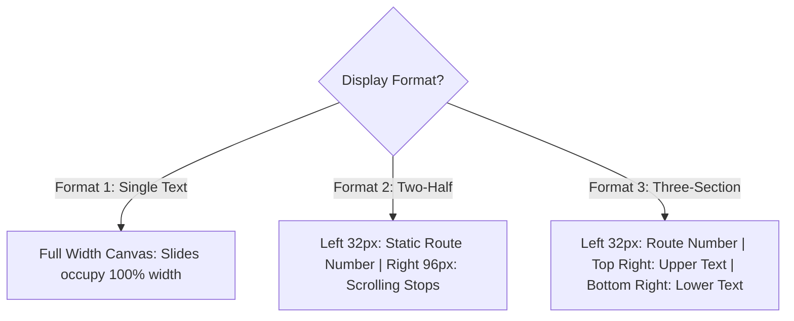

# Business Rules and Decision Tables: Navitronix RMS

**Target Application:** Navitronix RMS (`navitronics-ui`)  
**Specification Version:** 1.0.0-FINAL  
**Date:** October 12, 2026  
**Status:** Verified  
**Audience:** Business Analysts, Product Managers, Backend Architects, Test Engineers  

---

## 1. Business Rules Catalog

This document centralizes all extracted business rules, calculation formulas, eligibility conditions, and decision tables. Every rule is assigned a stable identifier (`BR-xxx`).

---

## 2. Core Business Rules & Formulas

### `BR-001`: Authentication Validation Rule
- **Rule ID:** `BR-001`
- **Rule Name:** Authentication Credential & Status Verification
- **Description:** A user is permitted to authenticate only if their email and password validate against Supabase GoTrue Auth AND their corresponding record in `public.users` has `status = 'active'`.
- **Condition / Formula:**
  $$\text{AllowLogin} \iff (\text{GoTrueAuth}(\text{email}, \text{password}) == \text{True}) \land (\text{user.status} == \text{'active'})$$
- **Enforcement Location:** Client-side post-auth hook in [`UserLoginForm.tsx`](file:///Users/vinaykongari/Nav/old/navitronics-ui/src/ui/components/UserLoginForm.tsx#L70-L95).
- **Rejection Behavior:** Displays toast error: "Your account is deactivated. Please contact your depot manager."
- **Verification Status:** Verified.

---

### `BR-002`: Customer Tier & Landing Route Resolution
- **Rule ID:** `BR-002`
- **Rule Name:** Dynamic Landing Route Resolution Decision Table
- **Description:** Determines the initial post-login destination URL based on user role and organization parameters.
- **Decision Table:**

| Role Code (`user.role_code`) | Organization ID (`user.organization_id`) | Depot ID (`user.depot_id`) | Customer Tier | Target Landing Route |
| :--- | :--- | :--- | :--- | :--- |
| `master` | *Any / NULL* | *Any / NULL* | `master` | `/dashboard` |
| `admin` | Not NULL | Not NULL | `stu` | `/dashboard` |
| `operator` | Not NULL | Not NULL | `stu` | `/routes` |
| `regular` | NULL | *Virtual Depot ID* | `regular` | `/regular-routes` |
| `guest` | NULL | NULL | `guest` | `/routes` (Read-only) |
| *Other / Unknown* | *Any* | *Any* | *Restricted* | `/login` (Forces logout) |

- **Enforcement Location:** [`src/utils/customerType.ts:L35-L80`](file:///Users/vinaykongari/Nav/old/navitronics-ui/src/utils/customerType.ts#L35-L80), [`src/components/ProtectedRoute.tsx:L40-L75`](file:///Users/vinaykongari/Nav/old/navitronics-ui/src/components/ProtectedRoute.tsx#L40-L75).
- **Verification Status:** Verified.

---

### `BR-003`: Guest Account Expiration Policy
- **Rule ID:** `BR-003`
- **Rule Name:** Guest Evaluator Temporal Expiration
- **Description:** Guest user sessions are automatically invalidated once the current server/client timestamp exceeds `user.expires_at`.
- **Condition / Formula:**
  $$\text{IsGuestValid}(user) \iff (\text{user.role\_code} \ne \text{'guest'}) \lor (\text{NOW}() < \text{user.expires\_at})$$
- **Enforcement Location:** Evaluated on login in [`UserLoginForm.tsx`](file:///Users/vinaykongari/Nav/old/navitronics-ui/src/ui/components/UserLoginForm.tsx#L85-L100).
- **Rejection Behavior:** Aborts session restoration; displays error toast "Guest evaluation period has expired".
- **Verification Status:** Verified.

---

### `BR-008`: Regular Customer Isolation & Virtual Depot Mapping
- **Rule ID:** `BR-008`
- **Rule Name:** Regular Customer Virtual Depot Scoping
- **Description:** Standalone private operators (Regular Customers) must not possess an `organization_id`, but must be allocated a private virtual depot in `public.depots` named `REGULAR_<username>`. All routes created by the user must reference this virtual depot, isolating their catalog from enterprise STU fleets.
- **Condition / Formula:**
  $$\text{IsRegular}(user) \implies (user.\text{organization\_id} = \text{NULL}) \land (user.\text{depot\_id} \in \text{VirtualDepots})$$
- **Enforcement Location:** [`src/ui/components/CreateRegularCustomerDrawer.tsx:L95-L140`](file:///Users/vinaykongari/Nav/old/navitronics-ui/src/ui/components/CreateRegularCustomerDrawer.tsx#L95-L140).
- **Verification Status:** Verified.

---

### `BR-009`: Standard LED Signboard Hardware Dimensions
- **Rule ID:** `BR-009`
- **Rule Name:** Signboard Matrix Dimension Constraints
- **Description:** Physical LED signboards must adhere strictly to supported hardware aspect ratios and pixel resolutions:

| Signboard Type | Permitted Widths (Pixels) | Permitted Heights (Pixels) | Default Pixel Dimensions | Permitted LED Colors |
| :--- | :--- | :--- | :--- | :--- |
| **Front Board** | 96, 128, 160, 192 | 16, 32 | **128 x 16** (or 128 x 32) | Amber (`#FFB000`), Red (`#FF0000`), RGB |
| **Side Board** | 96, 128, 160 | 16 | **128 x 16** | Amber, Red |
| **Rear Board** | 96 | 16 | **96 x 16** | Amber, Red |
| **Internal Board** | 128, 160 | 16 | **128 x 16** | Green (`#00FF00`), Amber, Red |

- **Enforcement Location:** [`src/types/routeConfigV2.ts:L20-L65`](file:///Users/vinaykongari/Nav/old/navitronics-ui/src/types/routeConfigV2.ts#L20-L65), [`src/components/DisplayEditor.tsx:L30-L75`](file:///Users/vinaykongari/Nav/old/navitronics-ui/src/components/DisplayEditor.tsx#L30-L75).
- **Verification Status:** Verified.

---

### `BR-010`: Display Format Matrix Layouts
- **Rule ID:** `BR-010`
- **Rule Name:** Signboard Visual Formatting Partitioning
- **Description:** Governs how the matrix display is partitioned across route numbers and text slides:

- **Format 1 (Single Full-Width):** Slide text spans entire board width (e.g., $128 \times 16$).
- **Format 2 (Two-Half):** Left section ($32 \times 16$ or $32 \times 32$) displays static Route Number; right section ($96 \times 16$ or $96 \times 32$) displays cycling/scrolling text slides.
- **Format 3 (Three-Section):** Left section displays Route Number; right section is split horizontally into Upper Half ($96 \times 8$ or $96 \times 16$) and Lower Half ($96 \times 8$ or $96 \times 16$).
- **Enforcement Location:** [`src/ui/components/FormatSelectionControl.tsx`](file:///Users/vinaykongari/Nav/old/navitronics-ui/src/ui/components/FormatSelectionControl.tsx), [`src/ui/components/SignboardCanvasStage.tsx`](file:///Users/vinaykongari/Nav/old/navitronics-ui/src/ui/components/SignboardCanvasStage.tsx).
- **Verification Status:** Verified.

---

### `BR-011`: Split Route Number Matrix Formatting
- **Rule ID:** `BR-011`
- **Rule Name:** Split Route Number Matrix Partitioning
- **Description:** When route numbers are split into `route_number_1` and `route_number_2`:
  - If board height is 32 pixels and stacked layout is active: `route_number_1` renders on rows $0..15$; `route_number_2` renders on rows $16..31$.
  - If board height is 16 pixels: Strings are concatenated with delimiter (`-` or `/`) and rendered horizontally using compact $5\times 7$ font.
- **Enforcement Location:** [`src/ui/components/RouteNumberControl.tsx`](file:///Users/vinaykongari/Nav/old/navitronics-ui/src/ui/components/RouteNumberControl.tsx).
- **Verification Status:** Verified.

---

### `BR-013`: Sidecar Rasterization Fallback Priority
- **Rule ID:** `BR-013`
- **Rule Name:** Matrix Rasterizer Engine Selection
- **Description:** Defines the fallback hierarchy for rasterizing text into LED dot arrays:
  1. Primary: Local .NET 8 sidecar (`http://127.0.0.1:5288/api/bitmap`).
  2. Fallback: Browser HTML5 Canvas 2D rasterizer using bundled TTF fonts (`gautami.ttf`, `mangal.ttf`).
- **Condition / Formula:**
  $$\text{Engine} = \begin{cases} \text{DotNetSidecar} & \text{if IsElectron} \land \text{SidecarHealthy} \\ \text{BrowserCanvas} & \text{otherwise} \end{cases}$$
- **Enforcement Location:** [`src/services/bitmapService.ts:L30-L75`](file:///Users/vinaykongari/Nav/old/navitronics-ui/src/services/bitmapService.ts#L30-L75).
- **Verification Status:** Verified.

---

### `BR-014`: Indic Phonetic Transliteration Fallback Priority
- **Rule ID:** `BR-014`
- **Rule Name:** Phonetic Transliteration Provider Resolution
- **Description:** Governs how phonetic Latin keystrokes are transformed into native Telugu and Devanagari:
  1. Primary: Google Input Tools Cloud API (`https://inputtools.google.com/request`).
  2. Fallback: Bundled `@indic-transliteration/sanscript` client-side transliteration engine.
- **Enforcement Location:** [`src/utils/transliteration.ts:L10-L35`](file:///Users/vinaykongari/Nav/old/navitronics-ui/src/utils/transliteration.ts#L10-L35).
- **Verification Status:** Verified.

---

### `BR-017`: Route Via String Parsing & Auto-Stop Insertion
- **Rule ID:** `BR-017`
- **Rule Name:** Automatic Stop Discovery & Insertion
- **Description:** When saving a route with a non-empty `via` field:
  1. The string is split by commas: $\text{Stops} = \text{via.split}(',').\text{map}(s \implies s.\text{trim}())$.
  2. For every stop name not present in `public.stops` for the route's `depot_id`:
     - System auto-generates a unique stop code `STP_<prefix>_<uuid>`.
     - System inserts row into `public.stops` with `name_english = stop_name`.
  3. The route record references the resolved stop IDs.
- **Enforcement Location:** [`src/pages/v2/RouteConfigurationPage.tsx:L420-L470`](file:///Users/vinaykongari/Nav/old/navitronics-ui/src/pages/v2/RouteConfigurationPage.tsx#L420-L470).
- **Known Issue:** Note that auto-created stops currently do not auto-generate Telugu/Hindi transliterations (`BUG-051`).
- **Verification Status:** Verified.

---

### `BR-020`: Soft Deletion Protocol & Partial Index Preservation
- **Rule ID:** `BR-020`
- **Rule Name:** Soft Deletion & Partial Unique Constraint Preservation
- **Description:** Deleting organizations, regions, depots, routes, or stops must NEVER issue a SQL `DELETE`. Instead, the system must issue `UPDATE ... SET status = 'deleted', updated_at = NOW()`.
- **Database Index Impact:** Uniqueness constraints on codes (e.g., `depot_code`, `route_number`) are enforced via partial unique indexes:
  $$\text{UNIQUE}(\text{depot\_id}, \text{route\_number\_1}, \text{route\_number\_2}) \quad \mathbf{WHERE} \quad \text{status} \ne \text{'deleted'}$$
  This ensures that a deleted route code can be reused immediately for a new route without collision.
- **Enforcement Location:** [`supabase/migrations/20260923_soft_delete_partial_unique_constraints.sql:L1-L120`](file:///Users/vinaykongari/Nav/old/navitronics-ui/supabase/migrations/20260923_soft_delete_partial_unique_constraints.sql#L1-L120).
- **Verification Status:** Verified.

---

### `BR-023`: Slide Duration & Scroll Speed Limits
- **Rule ID:** `BR-023`
- **Rule Name:** Slide Playback Bounds
- **Description:**
  - Slide duration must be an integer between **1 second** and **30 seconds** (default: 3 seconds).
  - Scroll speed must be an integer between **1 (slowest)** and **10 (fastest)** (default: 5).
  - Pause duration at end of scroll must be between **0.0 seconds** and **5.0 seconds** (default: 1.0 second).
- **Enforcement Location:** [`src/ui/components/SlidePropertyInspector.tsx`](file:///Users/vinaykongari/Nav/old/navitronics-ui/src/ui/components/SlidePropertyInspector.tsx).
- **Verification Status:** Verified.

---

### `BR-028`: Bus Service Type Matrix Codes
- **Rule ID:** `BR-028`
- **Rule Name:** Bus Service Classification Mapping
- **Description:** Maps bus category to hardware display color codes and prefix indicators:

| Service Type Code | Display Label | Standard LED Color | Controller Header Flag |
| :--- | :--- | :--- | :--- |
| `ORD` | City Ordinary / Palle Velugu | Amber (`#FFB000`) | `0x01` |
| `EXP` | Express | Red (`#FF0000`) | `0x02` |
| `DLX` | Deluxe | Green (`#00FF00`) | `0x03` |
| `SLX` | Super Luxury / Garuda | White (`#FFFFFF`) | `0x04` |
| `EV` | Electric City Bus | Full RGB / Blue | `0x05` |

- **Enforcement Location:** [`src/ui/components/RouteSpecificationPanel.tsx`](file:///Users/vinaykongari/Nav/old/navitronics-ui/src/ui/components/RouteSpecificationPanel.tsx).
- **Verification Status:** Verified.
