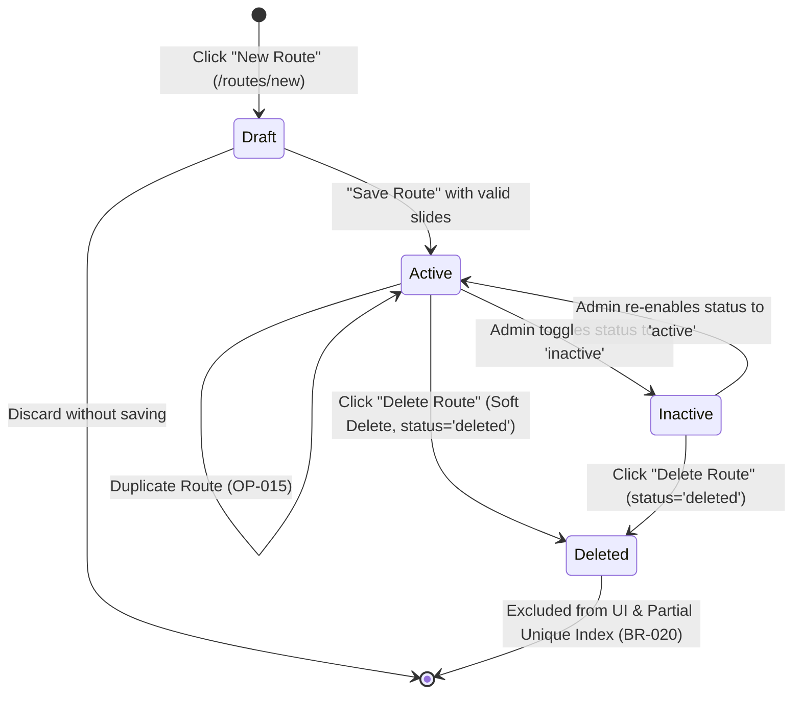
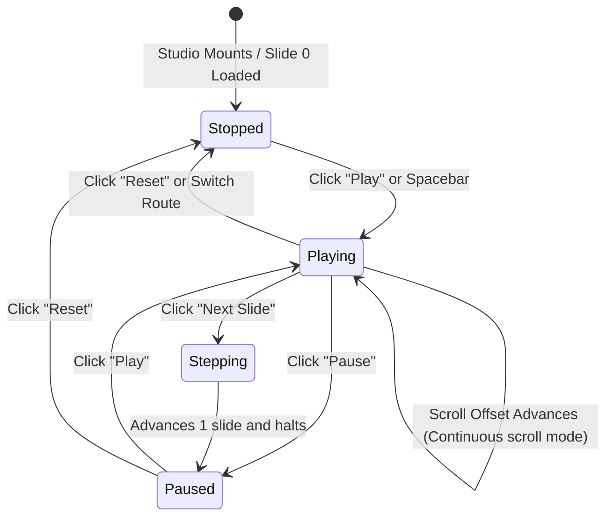
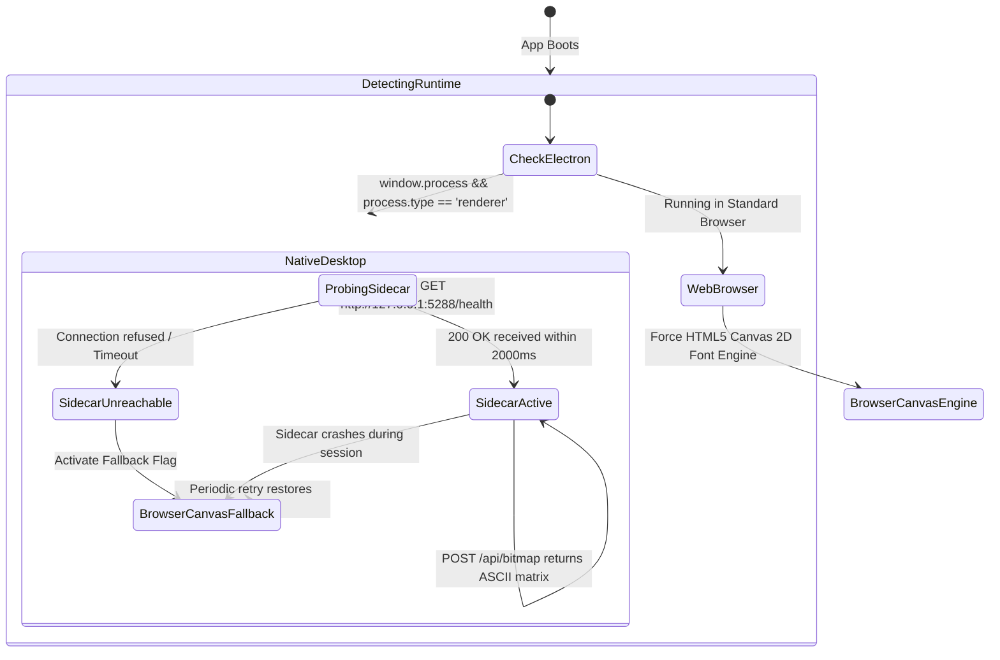

# User Workflows and State Machines: Navitronix RMS

**Target Application:** Navitronix RMS (`navitronics-ui`)  
**Specification Version:** 1.0.0-FINAL  
**Date:** October 12, 2026  
**Status:** Verified  
**Audience:** System Architects, UX Engineers, Backend Developers, QA Architects  

---

## 1. Overview & Diagram Taxonomy

This document models the core end-to-end workflows and state transitions of the application using Mermaid sequence diagrams, state machines, and procedural activity flows.

### Catalog Index
- `WF-001`: User Authentication & Tier Hydration Lifecycle
- `WF-002`: STU Enterprise Sequential Onboarding Lifecycle
- `WF-003`: Multilingual Route Authoring & Hardware Firmware Export
- `WF-004`: Bus Stop Creation & Sarvam AI Speech Synthesis Flow
- `WF-009`: Route Entity Lifecycle State Machine
- `WF-010`: LED Canvas Simulation Playback State Machine
- `WF-012`: Sidecar Font Rasterization & Fallback State Machine

---

## 2. End-to-End User Workflows

---

### `WF-001`: User Authentication & Tier Hydration Lifecycle

```mermaid
sequenceDiagram
    autonumber
    actor User as Transit Operator
    participant UI as UserLoginForm (PAGE-001)
    participant Auth as Supabase GoTrue Auth
    participant DB as PostgreSQL (public.users)
    participant Store as Zustand (useLoggedUserStore)
    participant Guard as ProtectedRoute (COMP-015)
    participant Router as React Router

    User->>UI: Enters email & password; clicks "Sign In"
    UI->>Auth: signInWithPassword({ email, password })
    alt Authentication Fails
        Auth-->>UI: 400 Bad Request (Invalid credentials)
        UI-->>User: Toast: "Invalid email or password"
    else Authentication Succeeds
        Auth-->>UI: 200 OK (JWT Token, User Session)
        UI->>DB: SELECT * FROM public.users WHERE id = auth.uid()
        DB-->>UI: User Profile Record (role_code, org_id, depot_id, status)
        alt Account Deactivated
            UI-->>User: Toast: "Account deactivated by administrator"
        else Account Active
            UI->>Store: setUser(userProfile)
            Store->>Store: Persist to localStorage ('logged-user-storage')
            UI->>Guard: Evaluate customerType(userProfile)
            alt Tier is Master
                Guard->>Router: Redirect to /dashboard
            else Tier is STU (Admin/Operator)
                Guard->>Router: Redirect to /dashboard or /routes
            else Tier is Regular Customer
                Guard->>Router: Redirect to /regular-routes
            else Tier is Guest
                Guard->>Router: Redirect to /routes (View-only)
            end
            Router-->>User: Render Target Workspace Page
        end
    end
```

---

### `WF-002`: STU Enterprise Sequential Onboarding Lifecycle

```mermaid
sequenceDiagram
    autonumber
    actor SuperAdmin as Super Admin (Master)
    participant Wizard as STUOnboardingWizard (UI-009)
    participant DB as PostgreSQL (Organizations, Regions, Depots)
    participant AuthHelper as supabaseAuthHelper (Isolated Client)
    participant UsersTable as PostgreSQL (public.users)

    SuperAdmin->>Wizard: Step 1: Enters Organization (Name, Code, State)
    Wizard->>Wizard: Validates Org Code format (Alpha, Unique)
    SuperAdmin->>Wizard: Step 2: Enters Region (Name, Code)
    SuperAdmin->>Wizard: Step 3: Enters Depot (Name, Code, Location)
    SuperAdmin->>Wizard: Step 4: Enters Depot Admin (Username, Email, Password)
    SuperAdmin->>Wizard: Clicks "Complete Setup"

    critical Sequential Tenant Creation
        Wizard->>DB: INSERT INTO public.organizations (...) RETURNING id
        DB-->>Wizard: organization_id
        Wizard->>DB: INSERT INTO public.regions (org_id, ...) RETURNING id
        DB-->>Wizard: region_id
        Wizard->>DB: INSERT INTO public.depots (org_id, region_id, ...) RETURNING id
        DB-->>Wizard: depot_id
        Wizard->>AuthHelper: auth.signUp({ email, password })
        AuthHelper-->>Wizard: auth_user_id
        Wizard->>UsersTable: INSERT INTO public.users (id, org_id, region_id, depot_id, role='admin', ...)
        UsersTable-->>Wizard: User profile committed
    option If Any Step Fails (Known Issue ARC-01)
        Wizard->>DB: Best-effort manual DELETE of partially created records
        Wizard-->>SuperAdmin: Toast: "Setup failed: Check unique codes"
    end

    Wizard-->>SuperAdmin: Display Success Card; close modal; refresh tables
```

---

### `WF-003`: Multilingual Route Authoring & Hardware Firmware Export

```mermaid
sequenceDiagram
    autonumber
    actor Designer as Route Designer
    participant Studio as RouteConfigurationPage (PAGE-007)
    participant IME as IMEInput (COMP-012)
    participant Google as Google Input Tools API
    participant Canvas as SignboardCanvasStage (COMP-001)
    participant Sidecar as .NET 8 BitmapFontApi (SVC-001)
    participant DB as PostgreSQL (public.routes, public.stops)
    participant ExportModal as ExportFormatDialog (COMP-007)
    participant ControllerAPI as Navitronix Controller API (api.navitronix.in)

    Designer->>Studio: Sets Route No 1 ("218") & Route No 2 ("A"); Separator ("/")
    Designer->>Studio: Types Via string: "Koti, Lakdikapul, Ameerpet"
    Designer->>IME: Types English phonetic stop names
    IME->>Google: Transliterate to Telugu ("కోటి", "లక్డికాపూల్")
    Google-->>IME: Native Telugu text
    IME-->>Studio: Populate Telugu text input fields

    Studio->>Canvas: Request LED preview redraw
    Canvas->>Sidecar: POST /api/bitmap { text: "కోటి", size: 16 }
    Sidecar-->>Canvas: ASCII matrix of '#' and '.'
    Canvas-->>Designer: Render glowing LED pixels on interactive canvas

    Designer->>Studio: Clicks "Save Route"
    Studio->>DB: Parse Via string; auto-insert missing stops into public.stops (FR-056)
    Studio->>DB: UPSERT INTO public.routes (configuration_v2, ...)
    DB-->>Studio: Route Saved OK

    Designer->>Studio: Clicks "Export Firmware"
    Studio->>ExportModal: Opens Export Modal; Designer selects "Controller ZIP"
    ExportModal->>ControllerAPI: POST /routes/export-v2 { route_data, format: 'zip' }
    ControllerAPI-->>ExportModal: Binary ZIP Blob (ROUTES.BIN, AUDIO files)
    ExportModal-->>Designer: Browser downloads "218-A_FIRMWARE.ZIP"
```

---

### `WF-004`: Bus Stop Creation & Sarvam AI Speech Synthesis Flow

```mermaid
sequenceDiagram
    autonumber
    actor Clerk as Transit Depot Clerk
    participant Form as CreateStopForm (UI-008)
    participant Sarvam as Sarvam AI TTS API (bulbul:v2)
    participant Storage as Supabase Storage (Bucket: 'audios')
    participant DB as PostgreSQL (public.stops)

    Clerk->>Form: Enters Stop Name in English ("Mehdipatnam")
    Clerk->>Form: Enters Telugu Name ("మెహదీపట్నం") and Hindi Name ("मेहदीपटनम")
    Clerk->>Form: Clicks "Generate Audio with AI"
    
    par Synthesize Telugu Audio
        Form->>Sarvam: POST /text-to-speech { inputs: ["మెహదీపట్నం"], target_language_code: "te-IN" }
        Sarvam-->>Form: Base64 WAV Audio Payload
        Form->>Storage: upload("audios/{depot_id}/{stop_code}_te.wav", blob)
        Storage-->>Form: public_url_te
    and Synthesize Hindi Audio
        Form->>Sarvam: POST /text-to-speech { inputs: ["मेहदीपटनम"], target_language_code: "hi-IN" }
        Sarvam-->>Form: Base64 WAV Audio Payload
        Form->>Storage: upload("audios/{depot_id}/{stop_code}_hi.wav", blob)
        Storage-->>Form: public_url_hi
    end

    Form-->>Clerk: Display Audio Waveform preview with playback button
    Clerk->>Form: Clicks "Save Stop"
    Form->>DB: INSERT INTO public.stops (name_en, name_te, name_hi, audio_url_te, audio_url_hi, ...)
    DB-->>Form: Stop row created
    Form-->>Clerk: Drawer closes; Stop table refetched
```

---

## 3. Entity Lifecycle State Machines

---

### `WF-009`: Route Entity Lifecycle State Machine



---

### `WF-010`: LED Canvas Simulation Playback State Machine



---

### `WF-012`: Sidecar Font Rasterization & Fallback State Machine


