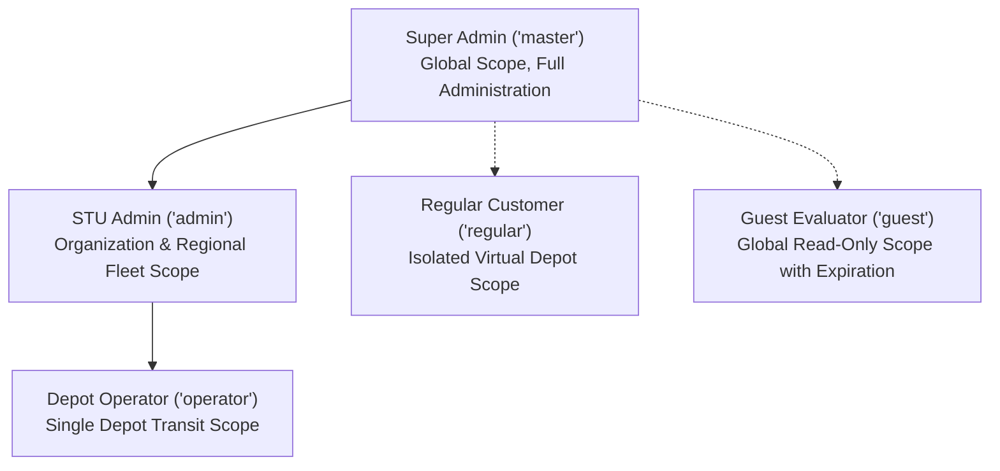

# Roles, Permissions, and RBAC: Navitronix RMS

**Target Application:** Navitronix RMS (`navitronics-ui`)  
**Specification Version:** 1.0.0-FINAL  
**Date:** October 12, 2026  
**Status:** Verified  
**Audience:** Security Architects, Compliance Leads, Full-Stack Developers  

---

## 1. Role Taxonomy & Hierarchy

The application defines five standard user roles, each tied to a specific data scope and authority level:



### Role Definitions
1. **Super Admin (`master`, `ROLE-001`):**
   - **Scope:** Global across all tenants and databases.
   - **Capabilities:** Manages organizations, runs STU onboarding wizards, provisions regular customers and guests, defines roles, accesses CCTV, and views system logs.
2. **STU Administrator (`admin`, `ROLE-002`):**
   - **Scope:** Bounded to assigned `organization_id` and all associated regions/depots.
   - **Capabilities:** Manages regional depots, creates depot operator accounts, reviews fleet route catalogs, and configures signboards.
3. **Depot Operator (`operator`, `ROLE-003`):**
   - **Scope:** Bounded strictly to assigned `depot_id`.
   - **Capabilities:** Creates and edits bus stops, generates audio announcements, configures multiboard LED routes, and exports controller firmware.
4. **Regular Customer (`regular`, `ROLE-004`):**
   - **Scope:** Standalone private operator (`organization_id = NULL`). Bounded to private virtual depot (`depot_id = virtual_depot_id`).
   - **Capabilities:** Authors private routes and exports firmware. Zero visibility into STU enterprise fleets, organizations, or users.
5. **Guest Evaluator (`guest`, `ROLE-005`):**
   - **Scope:** Read-only global access.
   - **Capabilities:** Inspects routes and preview displays in simulation dialog. All mutations and saves blocked. Session expires at `expires_at`.

---

## 2. Exhaustive Permission Matrix

The following matrix defines the operational clearance for every role across every resource and data scope:

| Resource / Entity | Operation | Super Admin (`master`) | STU Admin (`admin`) | Depot Operator (`operator`) | Regular Customer (`regular`) | Guest Evaluator (`guest`) | Enforcement Mechanism |
| :--- | :--- | :--- | :--- | :--- | :--- | :--- | :--- |
| **Organizations** | Create / Onboard | **Allowed** (Global) | Denied | Denied | Denied | Denied | UI + RLS (`is_super_admin`) |
| | Read / View | **Allowed** (All) | **Allowed** (Own Org) | Denied | Denied | Denied | UI + RLS (`current_user_org_id`) |
| | Update / Delete | **Allowed** (All) | Denied | Denied | Denied | Denied | RLS Policy |
| **Regions** | Create / Edit / Delete | **Allowed** (All) | **Allowed** (Own Org) | Denied | Denied | Denied | UI + RLS Policy |
| | Read / View | **Allowed** (All) | **Allowed** (Own Org) | **Allowed** (Assigned) | Denied | Denied | UI + RLS Policy |
| **Depots** | Create / Edit / Delete | **Allowed** (All) | **Allowed** (Own Org) | Denied | Denied | Denied | UI + RLS Policy |
| | Read / View | **Allowed** (All) | **Allowed** (Own Org) | **Allowed** (Assigned) | Denied | Denied | UI + RLS Policy |
| **Bus Stops** | Create / Edit / Delete | **Allowed** (All) | **Allowed** (Own Org) | **Allowed** (Own Depot) | Denied | Denied | UI + RLS Policy |
| | Generate Audio (TTS) | **Allowed** (All) | **Allowed** (Own Org) | **Allowed** (Own Depot) | Denied | Denied | Client API Call |
| | Read / View | **Allowed** (All) | **Allowed** (Own Org) | **Allowed** (Own Depot) | Denied | Denied | RLS Policy |
| **Routes** | Create Draft / V2 Studio| **Allowed** (All) | **Allowed** (Own Org) | **Allowed** (Own Depot) | **Allowed** (Own Virtual Depot)| Denied | UI + RLS Policy |
| | Edit Configuration | **Allowed** (All) | **Allowed** (Own Org) | **Allowed** (Own Depot) | **Allowed** (Own Routes)| Denied (Read-only view)| UI + RLS Policy |
| | Duplicate Route | **Allowed** (All) | **Allowed** (Own Org) | **Allowed** (Own Depot) | **Allowed** (Own Routes)| Denied | UI Action Guard |
| | Delete Route (Soft) | **Allowed** (All) | **Allowed** (Own Org) | **Allowed** (Own Depot) | **Allowed** (Own Routes)| Denied | RLS Policy |
| | Export Firmware (ZIP) | **Allowed** (All) | **Allowed** (Own Org) | **Allowed** (Own Depot) | **Allowed** (Own Routes)| **Allowed** (Preview Only)| External API Call |
| | Simulate Playback | **Allowed** (All) | **Allowed** (All) | **Allowed** (All) | **Allowed** (All) | **Allowed** (All) | Client Canvas Simulation |
| **Users / Staff** | Create / Onboard | **Allowed** (All) | **Allowed** (Own Org) | Denied | Denied | Denied | UI + `supabaseAuthHelper` |
| | Read / View Passwords | **Allowed** (All) | **Allowed** (Own Org) | Denied | Denied | Denied | UI Cell Renderer (`SEC-02`) |
| | Reset Password | **Allowed** (All) | **Allowed** (Own Org) | Denied | Denied | Denied | UI Action |
| | Deactivate / Suspend | **Allowed** (All) | **Allowed** (Own Org) | Denied | Denied | Denied | RLS Policy |
| **Regular Customers**| Onboard / Manage | **Allowed** (Global) | Denied | Denied | Denied | Denied | UI + RLS Policy |
| **Guests** | Create / Revoke | **Allowed** (Global) | Denied | Denied | Denied | Denied | UI + RLS Policy |
| **Roles & RBAC** | Define Custom Roles | **Allowed** (Global) | Denied | Denied | Denied | Denied | UI + RLS Policy |
| **Application Themes**| Switch Light/Dark | **Allowed** | **Allowed** | **Allowed** | **Allowed** | **Allowed** | Browser `localStorage` |

---

## 3. Discrepancies Between UI & Backend Enforcement

During the security reverse-engineering audit, several critical discrepancies between client-side UI visibility and PostgreSQL Row-Level Security enforcement were discovered:

1. **Self-Promotion via `public.users` RLS (`SEC-01`):**
   - *UI Behavior:* Normal users cannot see or navigate to the `/roles` or `/users` admin views.
   - *Database Reality:* The RLS policy on `public.users` grants `FOR ALL USING (id = auth.uid()) WITH CHECK (id = auth.uid())`. A malicious authenticated client can bypass the UI and execute:
     ```sql
     UPDATE public.users SET role_id = '<master_role_id>' WHERE id = auth.uid();
     ```
     This immediately elevates their privilege to Super Admin across all helper functions (`is_super_admin()`).
2. **Plaintext Password Exposure (`SEC-02`):**
   - *UI Behavior:* Passwords are displayed in the users table with an eye toggle.
   - *Database Reality:* Plaintext passwords are persisted directly in `public.users.password` instead of relying solely on bcrypt-hashed credentials in `auth.users`. Any user with read access to `public.users` can view staff passwords.
3. **Audio Generation Key Exposure (`SEC-03`):**
   - *UI Behavior:* Only Operators and Admins see the "Generate Audio" button.
   - *Network Reality:* The Sarvam AI API key is compiled directly into the client JavaScript bundle (`VITE_SARVAM_API_KEY`), allowing any guest or browser inspect user to extract the secret key and exhaust API quotas.
