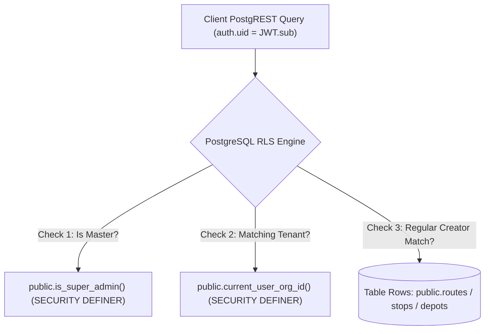

# Authorization and Row-Level Security (RLS) Policies: Navitronix RMS

**Target Application:** Navitronix RMS (`navitronics-ui`)  
**Specification Version:** 1.0.0-FINAL  
**Date:** October 12, 2026  
**Status:** Verified  
**Audience:** PostgreSQL Database Administrators, Security Architects, Backend Engineers  

---

## 1. Database Security Architecture

All database-level authorization is enforced by PostgreSQL Row-Level Security (RLS) in Supabase. When a client executes a query, the PostgreSQL engine automatically attaches `USING` and `WITH CHECK` predicates evaluated in the security context of `auth.uid()`.



---

## 2. Helper Security Functions

### 1. `public.current_user_org_id()`
- **Language / Flags:** SQL, `STABLE`, `SECURITY DEFINER`
- **Definition Source:** [`supabase/migrations/20260921_enable_row_level_security.sql:L11-L21`](file:///Users/vinaykongari/Nav/old/navitronics-ui/supabase/migrations/20260921_enable_row_level_security.sql#L11-L21)
- **SQL Body:**
  ```sql
  CREATE OR REPLACE FUNCTION public.current_user_org_id()
  RETURNS uuid
  LANGUAGE sql
  STABLE
  SECURITY DEFINER
  AS $$
    SELECT organization_id
    FROM public.users
    WHERE id = auth.uid() OR user_id = auth.uid()
    LIMIT 1;
  $$;
  ```
- **Operational Semantics:** Resolves the primary organization UUID for the calling user. Bypasses RLS recursion by using `SECURITY DEFINER`.

---

### 2. `public.is_super_admin()`
- **Language / Flags:** SQL, `STABLE`, `SECURITY DEFINER`
- **Definition Source:** [`supabase/migrations/20260921_enable_row_level_security.sql:L23-L38`](file:///Users/vinaykongari/Nav/old/navitronics-ui/supabase/migrations/20260921_enable_row_level_security.sql#L23-L38)
- **SQL Body:**
  ```sql
  CREATE OR REPLACE FUNCTION public.is_super_admin()
  RETURNS boolean
  LANGUAGE sql
  STABLE
  SECURITY DEFINER
  AS $$
    SELECT EXISTS (
      SELECT 1
      FROM public.users u
      JOIN public.roles r ON u.role_id = r.id
      WHERE (u.id = auth.uid() OR u.user_id = auth.uid())
        AND LOWER(r.name) IN ('master', 'super_admin')
        AND u.deleted = false
        AND u.active = true
    );
  $$;
  ```
- **Operational Semantics:** Returns `TRUE` if the calling user holds an active, non-deleted profile linked to a role named `master` or `super_admin`.

---

## 3. Row-Level Security Policies Catalog

The following table provides the exhaustive catalog of all 18 RLS policies active in the Supabase PostgreSQL database:

| Table Name | Policy Name | Command | Target Role | `USING` Expression | `WITH CHECK` Expression | Security Analysis |
| :--- | :--- | :--- | :--- | :--- | :--- | :--- |
| `public.organizations` | `Super admins manage organizations` | `ALL` | `public` | `public.is_super_admin()` | *None (Inherits USING)* | Full control for Super Admin. |
| `public.organizations` | `Users can view assigned organization` | `SELECT` | `public` | `id = public.current_user_org_id() OR auth.role() = 'anon'` | *N/A* | Allows tenant users to read own org; permits anonymous discovery. |
| `public.regions` | `Super admins manage regions` | `ALL` | `public` | `public.is_super_admin()` | *None* | Full administrative control. |
| `public.regions` | `Tenant users manage regions` | `ALL` | `public` | `organization_id = public.current_user_org_id()` | `organization_id = public.current_user_org_id()` | Bounded strictly to own tenant org. |
| `public.depots` | `Super admins manage depots` | `ALL` | `public` | `public.is_super_admin()` | *None* | Full administrative control. |
| `public.depots` | `Tenant users manage depots` | `ALL` | `public` | `organization_id = public.current_user_org_id() OR region_id IN (SELECT id FROM public.regions WHERE organization_id = public.current_user_org_id())` | `organization_id = public.current_user_org_id()` | Permits managing depots inside own organization. |
| `public.users` | `Super admins manage users` | `ALL` | `public` | `public.is_super_admin()` | *None* | Allows Master to manage all user records. |
| `public.users` | `Users can view and edit own profile` | `ALL` | `public` | `id = auth.uid() OR user_id = auth.uid()` | `id = auth.uid() OR user_id = auth.uid()` | **CRITICAL VULNERABILITY `SEC-01`**: Unrestricted write access permits self-promotion. |
| `public.users` | `Tenant admins view organization users` | `SELECT` | `public` | `organization_id = public.current_user_org_id()` | *N/A* | Allows STU admin to read all users in their tenant. |
| `public.routes` | `Super admins manage routes` | `ALL` | `public` | `public.is_super_admin()` | *None* | Full administrative access. |
| `public.routes` | `Tenant users manage routes` | `ALL` | `public` | `organization_id = public.current_user_org_id() OR depot_id IN (SELECT id FROM public.depots WHERE organization_id = public.current_user_org_id()) OR (created_by = auth.uid() AND (organization_id IS NULL OR organization_id = public.current_user_org_id()))` | `organization_id = public.current_user_org_id() OR created_by = auth.uid()` | Handles both STU fleet routes and Regular Customer private routes. |
| `public.stops` | `Super admins manage stops` | `ALL` | `public` | `public.is_super_admin()` | *None* | Full administrative control. |
| `public.stops` | `Tenant users manage stops` | `ALL` | `public` | `organization_id = public.current_user_org_id() OR depot_id IN (SELECT id FROM public.depots WHERE organization_id = public.current_user_org_id())` | `organization_id = public.current_user_org_id()` | Multi-depot stop sharing within organization. |
| `public.stop_audios` | `Super admins manage stop audios` | `ALL` | `public` | `public.is_super_admin()` | *None* | Full administrative control. |
| `public.stop_audios` | `Tenant users manage stop audios` | `ALL` | `public` | `stop_id IN (SELECT id FROM public.stops WHERE organization_id = public.current_user_org_id() OR depot_id IN (SELECT id FROM public.depots WHERE organization_id = public.current_user_org_id()))` | `stop_id IN (SELECT id FROM public.stops WHERE organization_id = public.current_user_org_id())` | Audio access scoped to stop's parent tenant. |
| `public.font_settings` | `Super admins manage font settings` | `ALL` | `public` | `public.is_super_admin()` | *None* | Master can update system font mappings. |
| `public.font_settings` | `All authenticated users view font settings` | `SELECT` | `authenticated` | `auth.role() = 'authenticated'` | *N/A* | Universal read-only font access for all staff. |

---

## 4. Storage Bucket Access Policies (`storage.objects`)

- **Bucket: `audios`**
  - **Public Read Access:** Enabled. Passenger announcement audio files (`.wav`) are streamed via public HTTP URLs.
  - **Authenticated Upload:** Enabled for `authenticated` users uploading to `audios/{depot_id}/*`.
- **Bucket: `stops`**
  - Used for stop route maps or photographic assets.
  - Read access permitted to authenticated users within tenant scope.

---

## 5. Security Recommendations for Target Architecture

1. **Fix `public.users` Self-Promotion Vulnerability (`SEC-01`):**
   - Replace policy `Users can view and edit own profile` with separate policies for `SELECT` and `UPDATE`.
   - On `UPDATE`, restrict modifiable columns to non-sensitive fields (`username`, `phone_number`), disallowing updates to `role_id`, `organization_id`, `depot_id`, or `active`.
2. **Move Administrative User Creation to Edge Function:**
   - Instead of client-side `supabaseAuthHelper.signUp()`, migrate user provisioning to a secure Supabase Edge Function running with `service_role` credentials to validate inviter permissions server-side.
