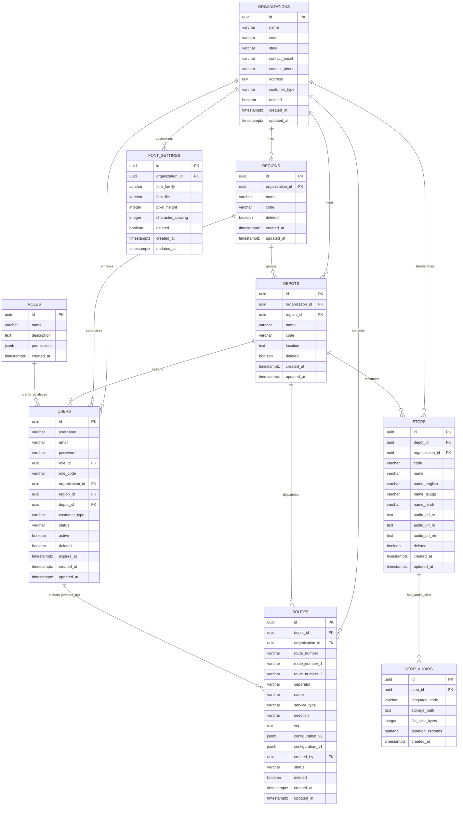

# Entity-Relationship Diagram: Navitronix RMS

**Target Application:** Navitronix RMS (`navitronics-ui`)  
**Specification Version:** 1.0.0-FINAL  
**Date:** October 12, 2026  
**Status:** Verified  
**Audience:** Database Architects, Data Engineers, Software Engineers  

---

## 1. Global Entity-Relationship Diagram

The following Mermaid ER diagram documents all entities, primary keys (`PK`), foreign keys (`FK`), and relational cardinalities in the PostgreSQL database:

---

## 2. Domain Subgraph Breakdowns

### 2.1 Organizational & Staff Hierarchy Domain
- **Key Relationships:**
  - An `Organization` can have multiple `Regions` ($1:N$).
  - An `Organization` has multiple `Depots` ($1:N$), either assigned to a `Region` or unassigned.
  - A `User` belongs to one `Role` ($N:1$).
  - A `User` can be globally scoped (`organization_id = NULL`), organization-scoped (`admin`), or depot-scoped (`operator`).
  - Standalone `Regular Customers` have `organization_id = NULL` and point to an auto-generated virtual `Depot`.

### 2.2 Route & Signboard Studio Domain
- **Key Relationships:**
  - An STU `Route` belongs to a specific `Depot` ($N:1$).
  - A Regular Customer `Route` has `depot_id = NULL` (or points to their virtual depot) and is owned directly by `created_by` pointing to `auth.users.id`.
  - The `configuration_v2` JSONB document stores the embedded multi-board layout (Front, Side, Rear, Internal) and sequence slides directly within the route record.

### 2.3 Multilingual Stops & Audio Storage Domain
- **Key Relationships:**
  - A `Stop` is scoped to a `Depot` ($N:1$).
  - A `Stop` has direct URL references (`audio_url_te`, `audio_url_hi`) pointing to WAV files in Supabase Storage.
  - A `Stop` can optionally link to multiple `StopAudios` detail rows ($1:N$) tracking playback metadata.
