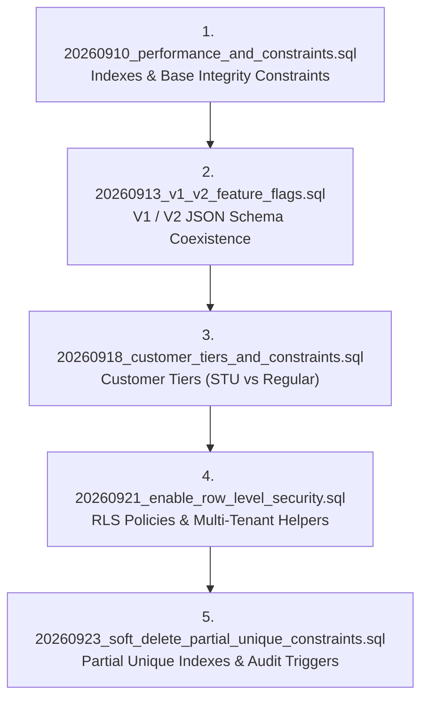

# Database Migrations and Seed Data: Navitronix RMS

**Target Application:** Navitronix RMS (`navitronics-ui`)  
**Specification Version:** 1.0.0-FINAL  
**Date:** October 12, 2026  
**Status:** Verified  
**Audience:** DevOps Engineers, Database Administrators, Migration Architects  

---

## 1. Migration History and Execution Order

All database changes are tracked under `supabase/migrations/` using chronological ISO timestamp prefixes. To reproduce the exact database state, migrations must be executed sequentially:



---

## 2. Detailed Migration Manifest

| Migration File | Execution Date | Purpose & Architectural Impact | Key SQL Objects Created / Modified |
| :--- | :--- | :--- | :--- |
| `20260910_performance_and_constraints.sql` | 2026-09-10 | Added composite B-tree performance indexes to accelerate foreign-key joins, tenant filters, and soft-deleted row exclusion. Introduced initial unique constraints. | `idx_regions_org_del`, `idx_depots_region_del`, `idx_depots_org_del`, `idx_users_org_del`, `idx_stops_depot_del`, `idx_routes_depot_del`, `unique_region_org_name`, `unique_depot_org_region_name`. |
| `20260913_v1_v2_feature_flags.sql` | 2026-09-13 | Introduced JSONB dual-schema columns on `public.routes` to support both legacy V1 firmware arrays and modern V2 multiboard studio trees simultaneously. | Added `configuration_v1` and `configuration_v2` JSONB columns to `public.routes`. |
| `20260918_customer_tiers_and_constraints.sql` | 2026-09-18 | Relaxed NOT NULL constraints on `organization_id` and `depot_id` across `users` and `routes` to accommodate standalone Regular Customers. Added `customer_type` classifier. | `ALTER TABLE users ALTER COLUMN organization_id DROP NOT NULL;` Added `customer_type` to `organizations` and `users`. Added `idx_routes_user_route_num`. |
| `20260921_enable_row_level_security.sql` | 2026-09-21 | Enabled Row Level Security across all core domain tables. Implemented `SECURITY DEFINER` helper functions to resolve calling user's tenant organization and role. | Enabled RLS on 8 tables. Created `public.current_user_org_id()`, `public.is_super_admin()`, and 18 multi-tenant RLS policies. |
| `20260923_soft_delete_partial_unique_constraints.sql` | 2026-09-23 | Hardened soft-delete handling. Removed unconditional unique constraints and replaced them with partial unique indexes scoped to `WHERE deleted = false`. Added `updated_at` audit triggers. | Deduplicated historical duplicates. Created `idx_unique_regions_active`, `idx_unique_depots_active`, `idx_unique_routes_depot_active`, `idx_unique_stops_depot_active`. Added `handle_updated_at()`. |

---

## 3. Mandatory Reference and Seed Data

For the migrated application to function immediately post-deployment, the database must be seeded with the following baseline lookup records:

### 3.1 System Roles (`public.roles`)
```sql
INSERT INTO public.roles (id, name, description, permissions) VALUES
  ('a1b2c3d4-e5f6-7a8b-9c0d-1e2f3a4b5c6d', 'master', 'Super Administrator with global unrestricted clearance', '{"all": true}'),
  ('b2c3d4e5-f6a7-8b9c-0d1e-2f3a4b5c6d7e', 'admin', 'Enterprise STU Organization Administrator', '{"org_manage": true, "routes_write": true, "stops_write": true}'),
  ('c3d4e5f6-a7b8-9c0d-1e2f-3a4b5c6d7e8f', 'operator', 'Depot Operator and Signboard Designer', '{"routes_write": true, "stops_write": true}'),
  ('d4e5f6a7-b8c9-0d1e-2f3a-4b5c6d7e8f9a', 'regular', 'Standalone Bus Operator / Freelancer', '{"private_routes": true}'),
  ('e5f6a7b8-c9d0-1e2f-3a4b-5c6d7e8f9a0b', 'guest', 'Temporary View-Only Evaluator', '{"read_only": true}')
ON CONFLICT (id) DO NOTHING;
```

---

### 3.2 Evaluation Guest User Profile
The repository includes a hardcoded guest identifier used for evaluation logins:
- **Guest UUID:** `3fd42bb4-31fd-4f27-9fe9-f2dbb2d77b6c`
- **Role Code:** `guest`
- **Expires At:** 2030-01-01T00:00:00Z (Must be verified against current time via `BR-003`).

---

### 3.3 Default Font Settings (`public.font_settings`)
```sql
INSERT INTO public.font_settings (font_family, font_file, pixel_height, character_spacing, deleted) VALUES
  ('gautami', 'gautami.ttf', 16, 1, false),
  ('mangal', 'mangal.ttf', 16, 1, false),
  ('notosans', 'notosans.ttf', 16, 1, false),
  ('notosanstelugu', 'notosanstelugu.ttf', 16, 1, false),
  ('pixeloperator', 'pixeloperator.ttf', 8, 1, false),
  ('pixeloperator8', 'pixeloperator8.ttf', 8, 0, false);
```

---

## 4. Rollback and Disaster Recovery Limitations

1. **Destructive Soft-Delete Deduplication in Migration `20260923`:**
   - Lines 21-100 of `20260923_soft_delete_partial_unique_constraints.sql` execute irreversible `UPDATE ... SET deleted = true` against older duplicates. Reverting this migration does not restore the prior `deleted = false` state of duplicate rows.
2. **Schema Drift Awareness:**
   - Any live database modifications executed directly via Supabase Studio UI without corresponding migration SQL files must be audited before final database export.
