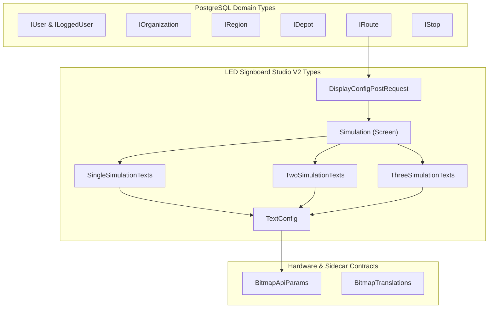

# TypeScript Types, Interfaces, and Data Contracts: Navitronix RMS

**Target Application:** Navitronix RMS (`navitronics-ui`)  
**Specification Version:** 1.0.0-FINAL  
**Date:** October 12, 2026  
**Status:** Verified  
**Audience:** Full-Stack Engineers, API Architects, Frontend Developers  

---

## 1. Type System Taxonomy

The application defines a rich TypeScript contract system covering PostgreSQL row models, React Query CRUD generic payloads, LED signboard matrix layouts, and external sidecar IPC parameters.



---

## 2. Core Domain Data Contracts (`src/types/`)

### 2.1 User & Staff Model (`IUser`, `ILoggedUser`)
- **Source:** [`src/types/IUser.ts`](file:///Users/vinaykongari/Nav/old/navitronics-ui/src/types/IUser.ts#L7-L28)
```typescript
export interface IUser {
  id: string;
  user_id: string;
  email: string | null;
  password?: string | null; // Plaintext storage (SEC-02)
  organization_id: string | null;
  region_id: string | null;
  depot_id: string | null;
  created_at: string;
  active: boolean;
  role_id: string;
  v1_routes?: boolean | null;
  v2_routes?: boolean | null;
  customer_type?: "regular" | "stu" | null;
}

export interface ILoggedUser extends IUser {
  region: IRegion | null;
  organization: IOrganization | null;
  depot: IDepot | null;
  role: IRole | null;
}
```

---

### 2.2 Bus Route Contract (`IRoute`, `src/types/IRoute.ts`)
```typescript
export interface IRoute {
  id: string;
  route_number: string;
  route_number_1?: string;
  route_number_2?: string;
  separator?: string;
  name: string;
  depot_id: string | null;
  organization_id?: string | null;
  service_type: "ORD" | "EXP" | "DLX" | "SLX" | "EV";
  direction: "UP" | "DOWN" | "CIRCULAR";
  via?: string;
  configuration_v2: DisplayConfigPostRequest;
  configuration_v1?: Record<string, unknown>;
  created_by?: string;
  status: "active" | "inactive" | "deleted";
  created_at: string;
  updated_at: string;
}
```

---

### 2.3 Bus Stop Contract (`IStop`, `src/types/IStop.ts`)
```typescript
export interface IStop {
  id: string;
  code: string;
  name: string;
  name_english: string;
  name_telugu?: string;
  name_hindi?: string;
  depot_id: string;
  organization_id?: string;
  audio_url_te?: string | null;
  audio_url_hi?: string | null;
  audio_url_en?: string | null;
  latitude?: number;
  longitude?: number;
  deleted: boolean;
  created_at: string;
}
```

---

## 3. Signboard Studio V2 Contract (`src/types/routeConfigV2.ts`)

### 3.1 Display Configuration Request Payload (`DisplayConfigPostRequest`)
```typescript
export interface DisplayConfigPostRequest {
  route_number: string;
  source: string;
  destination: string;
  via: string;
  route_number_1: string;
  route_number_2: string;
  separation: string;
  is_split_route: boolean;
  front: Simulation[];
  side: Simulation[];
  rear: Simulation[];
  internal: Simulation[];
  stops?: Simulation[];
  version: string;
  depot_id: string;
  organization_id: string;
  return: boolean;
}
```

---

### 3.2 Display Slide Model (`Simulation`)
```typescript
export type SimulationFormat = 'single' | 'two' | 'three';
export type SimulationHeight = 16 | 32;
export type SimulationWidth = 64 | 96 | 128 | 160 | 192 | 224;
export type SimulationType = 'route' | 'special message' | 'slogan' | 'stop';

export interface Simulation {
  format: SimulationFormat;
  texts: SingleSimulationTexts | TwoSimulationTexts | ThreeSimulationTexts;
  height: SimulationHeight;
  width: SimulationWidth;
  type: SimulationType;
  latitude?: number;
  longitude?: number;
  audioFileUrl?: string | null;
  audioFileName?: string | null;
  stopType?: string;
  stopTypeAudioFileUrl?: string | null;
  stopTypeAudioFileName?: string | null;
}
```

---

### 3.3 Text Block Configuration (`TextConfig`)
```typescript
export type ScrollType = 'Left To Right' | 'Right To Left' | 'Fixed';
export type Position = 'Left' | 'Right' | 'Center';
export type FontWeight = 'Regular' | 'Bold';

export interface TextConfig {
  text: string;
  bitmap?: string; // Precomputed ASCII dot matrix
  fontWidth?: number;
  scrollType: ScrollType;
  position: Position;
  scrollSpeed: number; // 1 to 10
  fontWeight: FontWeight;
  fontHeight?: number; // 7, 8, 10, 12, 14, 16, 24, 32
  language: string; // 'en', 'te', 'hi'
  icon?: string; // Google Material Symbol name
  iconPosition?: "start" | "end" | "center";
  iconWordIndex?: number;
  iconSpacing?: number;
  iconWidthScale?: number;
  vAlign?: "Center" | "Top" | "Bottom";
  padding?: boolean;
  pleft?: number;
  pright?: number;
  threshold?: number;
  autoFit?: boolean;
  fontSize?: number;
  spaceWidth?: number;
}
```

---

## 4. Sidecar Rasterizer IPC Contract (`src/types/bitmapApi.ts`)

```typescript
export interface BitmapApiParams {
  text?: string;
  icon?: string;
  iconPosition?: "start" | "end" | "center";
  iconWordIndex?: number;
  iconSpacing?: number;
  iconWidthScale?: number;
  targetRows?: number; // 8, 16, 24, 32
  height?: number;
  vAlign?: "Center" | "Top" | "Bottom";
  padding?: boolean;
  pleft?: number;
  pright?: number;
  threshold?: number; // 0 - 255
  family?: string;
  weight?: "Regular" | "Bold" | "";
  autoFit?: boolean;
  fontSize?: number;
  spaceWidth?: number;
}
```

---

## 5. Runtime Deserialization & Boundary Safeguards

1. **JSONB Date Parsing:**
   - Dates stored in JSONB columns (`configuration_v2`) serialize as standard ISO-8601 strings (`2026-10-12T11:00:00.000Z`). Client parsing must wrap them in `new Date(str)` before executing date math.
2. **Missing Properties & Null Coalescing:**
   - Older routes migrated from V1 lack `route_number_1` and `route_number_2`. The client studio must parse legacy `route_number` strings (e.g., splitting on `-` or `/`) to initialize studio state.
3. **Empty Text Objects:**
   - In Two-Half or Three-Section formats, `sideText` or `lowerHalfText` can be `undefined`. The canvas stage must safely fall back to an empty string `""` to prevent null-dereference crashes during frame rendering.
