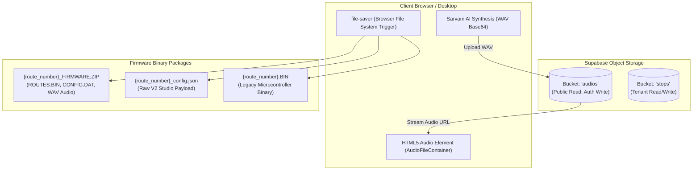

# File Storage, Imports, and Exports: Navitronix RMS

**Target Application:** Navitronix RMS (`navitronics-ui`)  
**Specification Version:** 1.0.0-FINAL  
**Date:** October 12, 2026  
**Status:** Verified  
**Audience:** Cloud Storage Engineers, Hardware Technicians, Software Developers  

---

## 1. File Handling Overview

The application interacts with files across two primary domains: cloud object storage in Supabase Storage (`audios` and `stops` buckets) for audio announcements and stop imagery, and client-side firmware bundle compilation and export.

---

## 2. Cloud Storage Buckets & Policies

### 2.1 Bucket: `audios`
- **Purpose:** Stores synthetic voice recordings of transit stop announcements in Indian languages.
- **Access Policy:**
  - **Read:** Publicly accessible (`public: true`). Permitted without authentication token to allow low-latency HTTP streaming inside standard HTML5 `<audio>` tags.
  - **Write / Upload:** Bounded to authenticated operators uploading to directory path:
    $$\text{Path} = \text{audios/}\{\text{depot\_id}\}/\{\text{stop\_code}\}\_\{\text{language\_code}\}.\text{wav}$$
- **MIME Types Supported:** `audio/wav`, `audio/x-wav`, `audio/mpeg`.
- **Maximum File Size:** $5\text{ MB}$ per audio clip.
- **Lifecycle / Retention:** Retained permanently until corresponding stop is deleted.

---

### 2.2 Bucket: `stops`
- **Purpose:** Optional photographic assets or geographical schematics for bus stops.
- **Access Policy:** Bounded to authenticated users within the same tenant organization.

---

## 3. Firmware Binary & Configuration Exports

### 3.1 Controller Firmware ZIP Bundle (`OP-023`)
- **Trigger Component:** [`src/components/ExportFormatDialog.tsx`](file:///Users/vinaykongari/Nav/old/navitronics-ui/src/components/ExportFormatDialog.tsx#L35-L80)
- **File Name Schema:** `{route_number_1}_{route_number_2}_FIRMWARE.ZIP` (e.g., `218_A_FIRMWARE.ZIP`).
- **Compilation Mechanism:** The client converts the route's `configuration_v2` into `DisplayConfigPostRequest` and dispatches it to `https://api.navitronix.in/navitranix/api/routes/export-v2`. The remote service packages:
  1. `ROUTES.BIN`: Byte-aligned binary table of route names, via points, and display durations.
  2. `DISPLAYS.DAT`: Hardware timing flags and character matrix rasterizations.
  3. `AUDIO/*.WAV`: Downloaded audio announcements from Supabase Storage.
- **Download Method:** Binary stream converted to Blob and downloaded via `file-saver` (`saveAs(blob, filename)`).

---

### 3.2 Route V2 JSON Export
- **Trigger Component:** [`src/utils/fileSystemExport.ts`](file:///Users/vinaykongari/Nav/old/navitronics-ui/src/utils/fileSystemExport.ts#L1-L25)
- **File Name Schema:** `{route_number}_v2_config.json`.
- **Payload Content:** Uncompressed formatted JSON representation of `RouteConfigV2`.
- **MIME Type:** `application/json;charset=utf-8`.

---

### 3.3 Legacy V1 Binary Export (`OP-044`)
- **Trigger Component:** Deprecated V1 Route Header (`RouteCreationHeaderV1.tsx`).
- **File Name Schema:** `{route_number}.BIN`.
- **Payload:** Raw 8-bit microcontroller memory image generated by legacy endpoint `.../routes/export`.
- **Status:** Retained for backward compatibility with older P10 single-board controllers.

---

## 4. Import & Auto-Discovery Mechanisms

### 4.1 Via-String Auto-Discovery & Stop Synthesis (`FR-056`)
- Rather than requiring CSV spreadsheet imports, the application allows bulk stop ingest via standard route definition:
  - Users input a comma-separated list into the "Via" text field (e.g., "Koti, Lakdikapul, Ameerpet, SR Nagar, Erragadda, Kukatpally").
  - On route save, the application splits the string, queries the depot stop registry, synthesizes unique stop codes for missing stops, and inserts them directly into `public.stops`.
