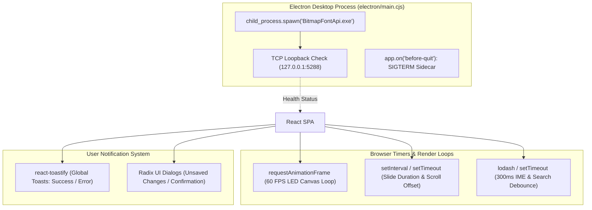

# Realtime, Background Jobs, and Notifications: Navitronix RMS

**Target Application:** Navitronix RMS (`navitronics-ui`)  
**Specification Version:** 1.0.0-FINAL  
**Date:** October 12, 2026  
**Status:** Verified  
**Audience:** Systems Engineers, Electron Developers, Full-Stack Architects  

---

## 1. Asynchronous Architecture Overview

The application utilizes three tiers of asynchronous and background execution: Electron native process management, high-frequency browser animation render loops, and client-side reactive toast notifications.



---

## 2. Background Process Lifecycle: Electron Sidecar

### 2.1 Spawning & Supervision
- **Implementation:** [`electron/main.cjs`](file:///Users/vinaykongari/Nav/old/navitronics-ui/electron/main.cjs#L60-L115)
- **Executable Path:** `resources/bin/BitmapFontApi.exe` (Packaged into NSIS binary).
- **Execution Lifecycle:**
  1. When Electron fires `app.whenReady()`, it resolves the sidecar binary path:
     ```javascript
     const sidecarPath = app.isPackaged
       ? path.join(process.resourcesPath, 'bin', 'BitmapFontApi.exe')
       : path.join(__dirname, '..', 'resources', 'bin', 'BitmapFontApi.exe');
     ```
  2. Spawns child process using Node.js `child_process.spawn(sidecarPath, ['--urls', 'http://127.0.0.1:5288'])`.
  3. Pipes `stdout` and `stderr` to Electron terminal logs for diagnostic tracking.
  4. Waits for TCP port 5288 to become responsive before loading the React renderer window (`wait-on tcp:5288`).

---

### 2.2 Graceful Teardown & Orphan Prevention
- **Termination Handler:**
  ```javascript
  app.on('before-quit', () => {
    if (sidecarProcess && !sidecarProcess.killed) {
      sidecarProcess.kill('SIGTERM');
      setTimeout(() => {
        if (!sidecarProcess.killed) sidecarProcess.kill('SIGKILL');
      }, 2000);
    }
  });
  ```
- **Known Risk:** If Electron experiences a hard crash or power termination, `BitmapFontApi.exe` can remain orphaned in the Windows background task manager on port 5288.

---

## 3. Client Timers & Continuous Render Loops

### 3.1 Signboard 60 FPS Canvas Simulation Loop
- **Implementation:** [`src/ui/components/SignboardCanvasStage.tsx`](file:///Users/vinaykongari/Nav/old/navitronics-ui/src/ui/components/SignboardCanvasStage.tsx#L180-L260)
- **Mechanism:** Continuous `requestAnimationFrame` loop.
- **Timing Logic:** Computes delta time (`dt = now - lastFrameTime`). If scroll mode is active, increments pixel offset by:
  $$\Delta x = (\text{scrollSpeed} \times 1.5) \times \frac{dt}{16.6}$$
- **Teardown:** `cancelAnimationFrame(animationFrameId)` executed in `useEffect` cleanup return to prevent memory leaks.

---

### 3.2 Slide Sequence Duration Ticker
- **Implementation:** [`src/store/useSimulationStore.ts`](file:///Users/vinaykongari/Nav/old/navitronics-ui/src/store/useSimulationStore.ts)
- **Mechanism:** Timer checking active slide elapsed time against configured `duration` (in seconds).
- **Transition:** When `elapsedMs >= duration * 1000`, resets elapsed counter and advances `currentSlideIndex = (currentSlideIndex + 1) % slides.length`.

---

## 4. Notification & Alert System

### 4.1 Toast Notifications (`react-toastify`)
- **Container Mounting:** Mounted globally in [`src/App.tsx`](file:///Users/vinaykongari/Nav/old/navitronics-ui/src/App.tsx#L95) with configuration:
  - `position: "top-right"`
  - `autoClose: 3000` (3 seconds)
  - `hideProgressBar: false`
  - `theme: "colored"`
- **Standard Notification Types:**
  - `toast.success("Route configuration saved successfully")`
  - `toast.error("Audio generation failed: Rate limit exceeded")`
  - `toast.warning("Guest session expires in 2 hours")`
  - `toast.info("Firmware download started")`

---

### 4.2 Modal Dialogs & Confirmation Prompts
- **Unsaved Changes Dialog (`ConfirmBackDialog.tsx`):** Warns the designer when attempting to navigate away from an unsaved route configuration.
- **Field Errors Dialog (`FieldErrorsDialog.tsx`):** Displays a detailed bulleted list of missing required route fields before firmware compilation.
- **Simulation Dialog (`SimulationDialog.tsx`):** Full-screen animated playback modal for depot staff inspection.
