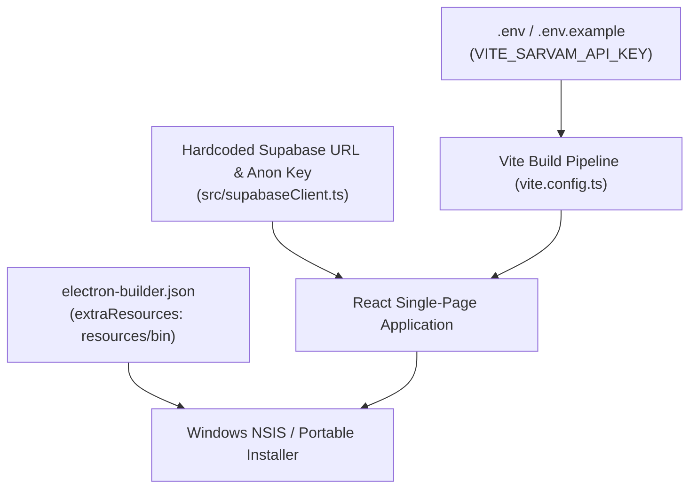

# Environment and Configuration Specification: Navitronix RMS

**Target Application:** Navitronix RMS (`navitronics-ui`)  
**Specification Version:** 1.0.0-FINAL  
**Date:** October 12, 2026  
**Status:** Verified  
**Audience:** DevOps Engineers, Security Architects, Build Specialists  

---

## 1. Environment Topology & Configuration Vectors

The application is configured through environment variable declarations, Vite build-time constants, hardcoded production client parameters, and Electron package manifests.

---

## 2. Environment Variables & Secret Manifest

| Variable Name | Required? | Defined Location | Exposure Target | Purpose & Sensitivity | Target Migration Requirement |
| :--- | :--- | :--- | :--- | :--- | :--- |
| `VITE_SARVAM_API_KEY` | Yes (for TTS) | `.env.example`, `.env` | **Exposed in Client JS (`SEC-03`)** | Sarvam AI API subscription key for `bulbul:v2` speech synthesis. | **Mandatory:** Remove from frontend; proxy through Supabase Edge Function with server-side secrets. |
| `VITE_SUPABASE_URL` | Optional (Currently hardcoded) | `src/supabaseClient.ts` | Client SPA | Supabase Project Gateway URL (`https://supabase.navitronix.in`). | Externalize into `.env` as `VITE_SUPABASE_URL`. |
| `VITE_SUPABASE_ANON_KEY` | Optional (Currently hardcoded) | `src/supabaseClient.ts` | Client SPA | Supabase Public Anonymous JWT Key. | Externalize into `.env` as `VITE_SUPABASE_ANON_KEY`. |
| `PORT` | No | `vite.config.ts` | Dev Server | Local development web server port (Default: `9092`). | Standard dev port. |
| `SIDECAR_PORT` | No | `electron/main.cjs` | Local Loopback | Local HTTP port for .NET sidecar (Default: `5288`). | Bind dynamically or pass via command-line argument. |

---

## 3. Build & Runtime Configuration Manifests

### 3.1 Vite Bundler Configuration (`vite.config.ts`)
- **Base Path:** `base: "./"` — Set to relative path to allow file-protocol loading inside packaged Electron windows (`file:///.../index.html`).
- **Server Port:** `9092` (Configured to avoid collisions with standard Vite 5173).
- **Chunk Size Limit:** Raised to `800 KB` (`chunkSizeWarningLimit: 800`).
- **Manual Rollup Chunks (`manualChunks`):**
  - `react-vendor`: `react`, `react-dom`, `react-router`, `react-router-dom`.
  - `supabase-vendor`: `@supabase/supabase-js`.
  - `tanstack-vendor`: `@tanstack/react-query`, `@tanstack/react-query-devtools`.
  - `ui-vendor`: `@subframe/core`, `@radix-ui/*`, `@headlessui/*`.
  - `export-vendor`: `jszip`, `file-saver`.

---

### 3.2 Electron Desktop Package Configuration (`electron-builder.json`)
- **Application ID:** `com.navitronix.studio`
- **Product Name:** `Navitronix Studio`
- **Execution Level:** `asInvoker` (Executes without requiring Windows UAC administrator elevation).
- **Extra Resources Bundling:**
  - `resources/bin/**/*` is mapped to `bin/` inside the application installation directory.
  - Contains `.NET 8` executable `BitmapFontApi.exe` and dependent DLLs.
- **Targets:**
  - `nsis` (Interactive Windows installer with desktop and Start Menu shortcuts).
  - `portable` (Self-contained standalone single `.exe` for flash drives).
