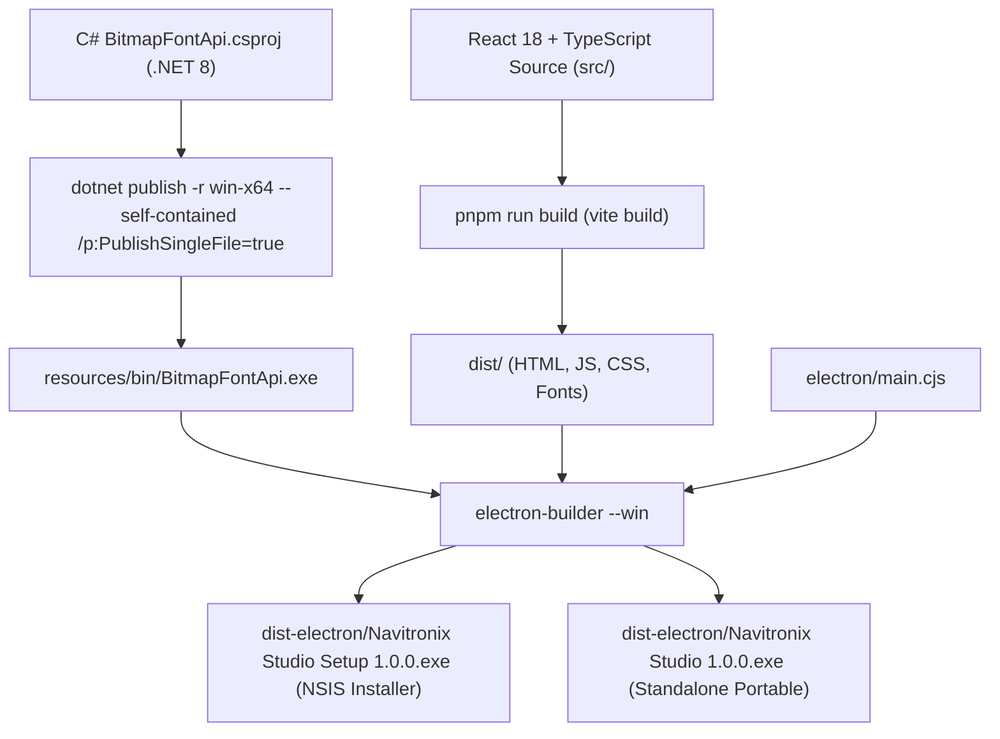

# Build, Deployment, and Infrastructure: Navitronix RMS

**Target Application:** Navitronix RMS (`navitronics-ui`)  
**Specification Version:** 1.0.0-FINAL  
**Date:** October 12, 2026  
**Status:** Verified  
**Audience:** DevOps Engineers, Release Managers, Build Specialists  

---

## 1. Build & Release Pipeline

The application features a hybrid compilation pipeline combining a .NET 8 C# self-contained binary build with a Vite/TypeScript web application bundle, packaged into a native Windows executable via Electron Builder.



---

## 2. Build Toolchains & System Prerequisites

### 2.1 Software Prerequisites
- **Node.js:** `v20.x` or `v22.x` LTS.
- **Package Manager:** `pnpm` v9.x or `npm` v10.x (`pnpm-lock.yaml` present).
- **.NET SDK:** `.NET 8.0 SDK` (`dotnet` in PATH).
- **Target Host OS:** Windows 10/11 x64 (Build host and runtime).

---

## 3. Step-by-Step Compilation Protocol

The build pipeline can be executed via command-line or using automated scripts [`build-windows.bat`](file:///Users/vinaykongari/Nav/old/navitronics-ui/build-windows.bat) / [`build-windows.ps1`](file:///Users/vinaykongari/Nav/old/navitronics-ui/build-windows.ps1):

### Step 1: Compile .NET 8 Bitmap Engine
```cmd
dotnet publish "../bitmapapi/BitmapFontApi.csproj" ^
  -c Release ^
  -r win-x64 ^
  --self-contained true ^
  /p:PublishSingleFile=true ^
  /p:IncludeNativeLibrariesForSelfExtract=true ^
  -o "resources\bin"
```
*Outcome:* Produces single-file binary `resources/bin/BitmapFontApi.exe` and bundles glyph assets (`icons.ttf`).

### Step 2: Install Node.js Dependencies
```cmd
pnpm install --frozen-lockfile
```

### Step 3: Compile Web Single-Page Application
```cmd
pnpm run build
```
*Outcome:* Vite compiles React code into `dist/` with relative asset links (`base: "./"`) and manual code chunks (`react-vendor`, `supabase-vendor`, `tanstack-vendor`, `ui-vendor`, `export-vendor`).

### Step 4: Package Windows Electron Application
```cmd
npx electron-builder --win
```
*Outcome:* Bundles `dist/`, `electron/`, and `resources/bin/` into `dist-electron/`:
- `Navitronix Studio Setup 1.0.0.exe`: Interactive NSIS installer.
- `Navitronix Studio 1.0.0.exe`: Self-contained portable binary.

---

## 4. Web Deployment Architecture

When hosted as a pure web application:
- **Hosting Target:** Any modern static web host (Vercel, Netlify, Cloudflare Pages, AWS S3/CloudFront).
- **Routing Constraint:** React Router v7 uses client-side browser routing. The web server must be configured with a fallback redirect rule sending all 404 requests to `/index.html`:
  ```nginx
  location / {
    try_files $uri $uri/ /index.html;
  }
  ```
- **Sidecar Degradation in Web Mode:** In a standard web browser, the Electron runtime and port 5288 loopback are absent. The application automatically degrades to client-side HTML5 Canvas 2D rasterization (`BR-013`).
