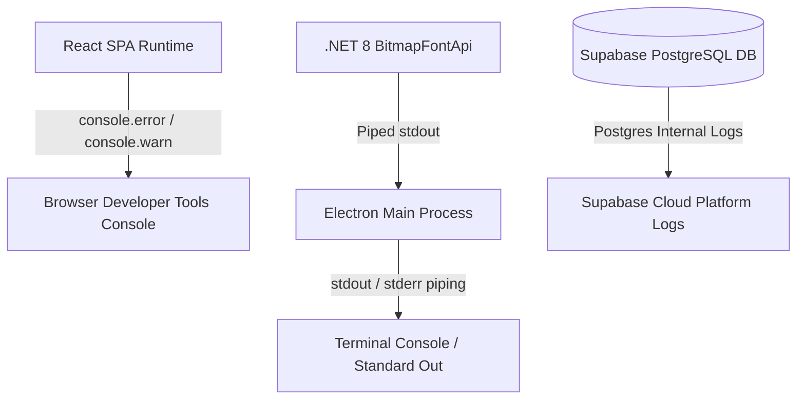

# Logging, Monitoring, and Observability: Navitronix RMS

**Target Application:** Navitronix RMS (`navitronics-ui`)  
**Specification Version:** 1.0.0-FINAL  
**Date:** October 12, 2026  
**Status:** Verified  
**Audience:** Site Reliability Engineers (SRE), Operations Leads, Security Architects  

---

## 1. Observability Baseline & Existing Implementation

In its current state, `navitronics-ui` relies exclusively on browser and terminal console logging without centralized telemetry, error monitoring, or persistent database audit logging.



---

## 2. Existing Telemetry Points

### 2.1 Sidecar Process Diagnostic Logging
- In [`electron/main.cjs`](file:///Users/vinaykongari/Nav/old/navitronics-ui/electron/main.cjs#L80-L95), Electron pipes process streams:
  ```javascript
  sidecarProcess.stdout.on('data', (data) => {
    console.log(`[Sidecar C#]: ${data.toString().trim()}`);
  });
  sidecarProcess.stderr.on('data', (data) => {
    console.error(`[Sidecar C# ERROR]: ${data.toString().trim()}`);
  });
  ```

---

### 2.2 Client-Side Exception Handling
- **Rasterizer Fallback Warning:** In [`src/services/bitmapService.ts`](file:///Users/vinaykongari/Nav/old/navitronics-ui/src/services/bitmapService.ts#L60), failures log:
  `console.warn("[BitmapService] Sidecar unavailable, falling back to Canvas font engine:", err)`.
- **Speech Synthesis Error:** In [`src/utils/fetchTTS.ts`](file:///Users/vinaykongari/Nav/old/navitronics-ui/src/utils/fetchTTS.ts#L120), failures log:
  `console.error("[TTS API Error]: Failed to synthesize audio:", err.response?.data || err.message)`.
- **React Query Errors:** Handled via TanStack Query `onError` callbacks displaying toast messages to end users.

---

## 3. Observability Deficiencies & Target Migration Mandates

| Observation Category | Current Implementation Status | Risk / Operational Impact | Migration Target Requirement |
| :--- | :--- | :--- | :--- |
| **Crash Reporting** | **None** | Silent desktop app crashes or uncaught React errors leave no audit trail. | Integrate **Sentry** (or Bugsnag) in both Electron main process and React renderer. |
| **Audit Logging** | **None** | Administrative actions (user creation, soft deletes, password viewer accesses) cannot be attributed to actors. | Implement `public.audit_logs` table in PostgreSQL tracking `actor_id`, `action`, `entity_type`, `entity_id`, and `ip_address`. |
| **API Performance Tracking** | **None** | High-latency queries on large stop datasets cannot be profiled in production. | Enable Supabase Performance Insights and OpenTelemetry distributed tracing. |
| **Disk & Memory Metrics** | **None** | Unbounded memory consumption in Electron canvas loops cannot be detected remotely. | Instrument periodic Electron memory and CPU sampling. |
