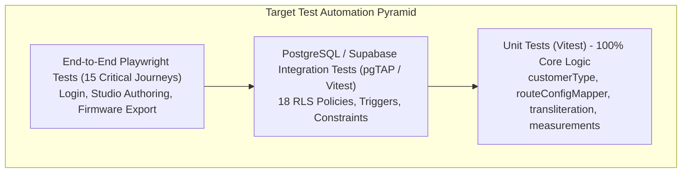

# Test Catalog and Verification Specification: Navitronix RMS

**Target Application:** Navitronix RMS (`navitronics-ui`)  
**Specification Version:** 1.0.0-FINAL  
**Date:** October 12, 2026  
**Status:** Verified  
**Audience:** QA Architects, Test Automation Engineers, Full-Stack Developers  

---

## 1. Test Coverage Baseline: Zero Automated Tests (`TST-01`)

- **Current Repository State:** The existing repository contains **0% automated test coverage**.
- **Evidence:**
  - `package.json` contains no `"test"` script or test runner dependencies (no Vitest, Jest, Cypress, Playwright, or Mocha).
  - Zero `.test.ts`, `.spec.ts`, or `__tests__/` files exist in `src/`.
- **Compensating Asset:** Comprehensive manual QA verification records exist in the repository root:
  - [`qa_audit_report.md`](file:///Users/vinaykongari/Nav/old/navitronics-ui/qa_audit_report.md) (108 structured manual test scenarios).
  - [`bug_tracker_audit.md`](file:///Users/vinaykongari/Nav/old/navitronics-ui/bug_tracker_audit.md) (76 verified defect scenarios).
  - [`consolidated_bug_tracker.md`](file:///Users/vinaykongari/Nav/old/navitronics-ui/consolidated_bug_tracker.md) (120 audited behavior items).

---

## 2. Core Manual Test Scenario Catalog (Derived from `qa_audit_report.md`)

The following test scenarios represent the verified behavior of critical user journeys:

| Test ID | Test Scenario Name | Target Module / Route | Preconditions | Inputs / User Actions | Expected Assertions |
| :--- | :--- | :--- | :--- | :--- | :--- |
| `TEST-001` | Super Admin Login & Dashboard Load | `/login` (`PAGE-001`) | Active master user in `public.users` | Input `master@navitronix.in` + valid password | Redirects to `/dashboard`; all 12 navigation items visible; metrics cards loaded. |
| `TEST-002` | Regular Customer Route Isolation | `/routes` (`PAGE-006`) | Regular user logged in | Inspect route catalog and navigation | Only personal routes where `created_by = auth.uid()` rendered; Organizations/Depots hidden. |
| `TEST-003` | Guest Account Expiration Rejection | `/login` (`PAGE-001`) | Guest user with `expires_at < NOW()` | Input guest credentials and submit | Login rejected; toast alert: "Guest evaluation period has expired"; no JWT persisted. |
| `TEST-004` | STU Depot Context Filter Switching | Header (`COMP-014`) | Admin user with multi-depot access | Select alternate depot from dropdown | TanStack cache invalidates; routes table re-renders showing only records for new depot. |
| `TEST-005` | Split Route Number Stacked Formatting | `/routes/:id/config` | Front board height set to 32px | Input `218` (No 1) and `A` (No 2); select stacked | Canvas renders dual stacked 16px font matrices on leftmost 32 pixels. |
| `TEST-006` | Indic Phonetic IME Transliteration | Route Studio (`COMP-012`) | Telugu language selected | Type "koti" + Spacebar | Input text converts to "కోటి"; Canvas redraws glowing Telugu glyphs. |
| `TEST-007` | Sidecar Rasterizer Port 5288 Fallback | Studio Canvas | Terminate `BitmapFontApi.exe` | Trigger text redraw in studio | Fallback flag set; Canvas 2D engine renders text without throwing uncaught exceptions. |
| `TEST-008` | Auto-Stop Discovery on Route Save | `/routes/new` (`PAGE-007`) | Depot has no stop named "Patancheru" | Enter Via: "Koti, Patancheru"; click Save | Route saves successfully; new row created in `public.stops` for "Patancheru" (`FR-056`). |
| `TEST-009` | Sarvam AI Audio Synthesis & Storage | `/stops` (`PAGE-009`) | Valid `VITE_SARVAM_API_KEY` | Click "Generate Audio" next to stop | WAV file created; uploaded to `audios` bucket; audio wave player renders in table. |
| `TEST-010` | Controller Firmware ZIP Download | Route Studio | Valid saved route | Select "Controller ZIP" -> Download | Browser downloads `{route_no}_FIRMWARE.ZIP` containing `ROUTES.BIN` and `AUDIO/*.WAV`. |
| `TEST-011` | Soft Deletion & Code Re-use | `/depots` (`PAGE-008`) | Active depot `MSR1` | Delete `MSR1` (soft delete); Create new `MSR1` | Deletion sets `deleted = true`; new depot created with identical code without collision (`BR-020`). |

---

## 3. Mandatory Automated Test Matrix for Target Migration

The migration team must construct a comprehensive automated test pyramid to guarantee zero regression:

### 3.1 Unit Test Specifications
- `test/utils/customerType.test.ts`: Verify tier classification across all combinations of `role_code`, `organization_id`, and `depot_id`.
- `test/utils/routeConfigMapper.test.ts`: Test bidirectional conversion between V1 flat arrays and V2 `DisplayConfigPostRequest`.
- `test/utils/transliteration.test.ts`: Test offline Sanscript phonetic mapping across Latin, Telugu, and Devanagari.
- `test/utils/measurements.test.ts`: Test aspect ratio, pixel coordinate mapping, and scroll boundary calculations.

### 3.2 Database RLS Integration Tests (`pgTAP` / Vitest)
- Test `public.users` self-promotion prevention (Ensure normal user cannot update `role_id`).
- Test `public.routes` tenant isolation (Ensure Operator from Depot A cannot read or modify routes from Depot B).
- Test Regular Customer isolation (Ensure regular user can only access routes where `created_by = auth.uid()`).
