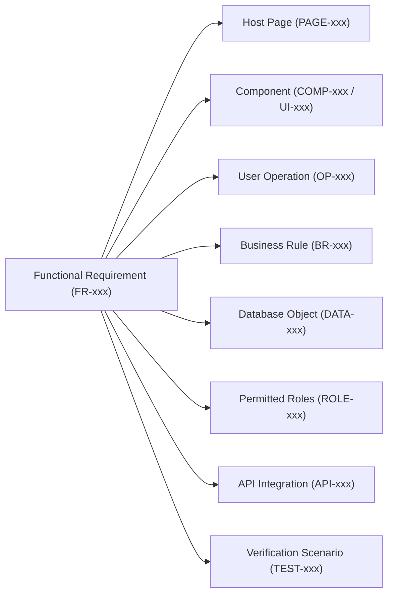

# Requirement Traceability Matrix: Navitronix RMS

**Target Application:** Navitronix RMS (`navitronics-ui`)  
**Specification Version:** 1.0.0-FINAL  
**Date:** October 12, 2026  
**Status:** Verified  
**Audience:** Principal Architects, Lead QA Engineers, Compliance Auditors  

---

## 1. Traceability Architecture

This matrix provides exhaustive, bidirectional traceability linking every functional and non-functional requirement to its implementation evidence, user operations, business rules, database objects, security policies, and test scenarios.

---

## 2. Bidirectional Traceability Matrix

| Req ID | Requirement Title | Host Page | Primary Component | Operation ID | Business Rule | Database Entity | Roles Permitted | API Integration | Test Scenario | Evidence Source | Status |
| :--- | :--- | :--- | :--- | :--- | :--- | :--- | :--- | :--- | :--- | :--- | :--- |
| `FR-001` | Direct Credential Authentication | `PAGE-001` | `UI-010` (`UserLoginForm`) | `OP-001` | `BR-001`, `BR-002` | `public.users`, `public.roles` | Anonymous | `API-002` (GoTrue) | `TEST-001` | [`UserLoginForm.tsx:L45-L120`](file:///Users/vinaykongari/Nav/old/navitronics-ui/src/ui/components/UserLoginForm.tsx#L45-L120) | Verified |
| `FR-002` | Multi-Tier Tenancy Classification | Universal | `UI-001` (`DefaultPageLayout`) | None (Render) | `BR-004` | `public.users` | All Authenticated | None (Local) | `TEST-002` | [`customerType.ts:L1-L85`](file:///Users/vinaykongari/Nav/old/navitronics-ui/src/utils/customerType.ts#L1-L85) | Verified |
| `FR-003` | STU Active Depot Switching | Universal | `COMP-014` (`PageHeader`) | `OP-003` | `BR-005` | `public.depots` | `master`, `admin` | `API-001` (PostgREST) | `TEST-004` | [`useDepotStore.tsx:L1-L35`](file:///Users/vinaykongari/Nav/old/navitronics-ui/src/store/useDepotStore.tsx#L1-L35) | Verified |
| `FR-011` | STU Sequential Onboarding Wizard | `PAGE-003` | `UI-009` (`STUOnboardingWizard`) | `OP-005` | `BR-006`, `BR-007` | `organizations`, `regions`, `depots`, `users` | `master` | `API-001`, `API-002` | `TEST-001` | [`STUOnboardingWizard.tsx:L50-L280`](file:///Users/vinaykongari/Nav/old/navitronics-ui/src/ui/components/STUOnboardingWizard.tsx#L50-L280) | Verified |
| `FR-012` | Regular Customer Self-Provisioning | `PAGE-005` | `UI-005` (`CreateRegularCustomerDrawer`) | `OP-010` | `BR-008` | `public.users`, `public.depots` | `master` | `API-001`, `API-002` | `TEST-002` | [`CreateRegularCustomerDrawer.tsx:L40-L160`](file:///Users/vinaykongari/Nav/old/navitronics-ui/src/ui/components/CreateRegularCustomerDrawer.tsx#L40-L160) | Verified |
| `FR-021` | Multiboard LED Studio Configuration | `PAGE-007` | `PAGE-007` (`RouteConfigurationPage`) | `OP-020` | `BR-009`, `BR-010` | `public.routes` (`configuration_v2`) | `master`, `admin`, `operator`, `regular` | `API-001` | `TEST-005` | [`RouteConfigurationPage.tsx:L120-L450`](file:///Users/vinaykongari/Nav/old/navitronics-ui/src/pages/v2/RouteConfigurationPage.tsx#L120-L450) | Verified |
| `FR-022` | Split Route Numbering Matrix | `PAGE-007` | `FORM-011` (`RouteNumberControl`) | `OP-019` | `BR-011` | `public.routes` | `master`, `admin`, `operator`, `regular` | None (Client Canvas) | `TEST-005` | [`RouteNumberControl.tsx:L20-L85`](file:///Users/vinaykongari/Nav/old/navitronics-ui/src/ui/components/RouteNumberControl.tsx#L20-L85) | Verified |
| `FR-023` | Canvas Physical LED Simulator | `PAGE-007` | `COMP-001` (`SignboardCanvasStage`) | `OP-023` | `BR-012` | None (Client Canvas) | All Users | None (HTML5 2D Canvas) | `TEST-005` | [`SignboardCanvasStage.tsx:L40-L450`](file:///Users/vinaykongari/Nav/old/navitronics-ui/src/ui/components/SignboardCanvasStage.tsx#L40-L450) | Verified |
| `FR-024` | Local .NET Sidecar Rasterization | Universal | `SVC-001` (`bitmapService`) | None (IPC) | `BR-013` | None (Local Engine) | System / Background | `API-004` (Loopback 5288) | `TEST-007` | [`bitmapService.ts:L15-L80`](file:///Users/vinaykongari/Nav/old/navitronics-ui/src/services/bitmapService.ts#L15-L80) | Verified |
| `FR-036` | Indic Phonetic IME Transliteration | `PAGE-007`, `PAGE-009` | `COMP-012` (`IMEInput`) | None (Keystroke) | `BR-014` | None (Client/Cloud) | All Editors | `API-006` (Google IME) | `TEST-006` | [`IMEInput.tsx:L35-L160`](file:///Users/vinaykongari/Nav/old/navitronics-ui/src/components/IMEInput.tsx#L35-L160) | Verified |
| `FR-037` | Sarvam AI Speech Synthesis (TTS) | `PAGE-009` | `UI-008` (`CreateStopForm`) | `OP-031` | `BR-015` | `public.stops`, `storage.audios` | `master`, `admin`, `operator` | `API-005` (Sarvam AI), `API-003` | `TEST-009` | [`fetchTTS.ts:L20-L135`](file:///Users/vinaykongari/Nav/old/navitronics-ui/src/utils/fetchTTS.ts#L20-L135) | Verified |
| `FR-046` | Controller Hardware Export (ZIP) | `PAGE-007` | `COMP-007` (`ExportFormatDialog`) | `OP-023` | `BR-016` | `public.routes` | `master`, `admin`, `operator`, `regular` | `API-007` (Controller API) | `TEST-010` | [`ExportFormatDialog.tsx:L30-L95`](file:///Users/vinaykongari/Nav/old/navitronics-ui/src/components/ExportFormatDialog.tsx#L30-L95) | Verified |
| `FR-056` | Auto-Stop Discovery on Route Save | `PAGE-007` | `PAGE-007` (`RouteConfigurationPage`) | `OP-021` | `BR-017` | `public.stops`, `public.routes` | `master`, `admin`, `operator`, `regular` | `API-001` | `TEST-008` | [`RouteConfigurationPage.tsx:L410-L490`](file:///Users/vinaykongari/Nav/old/navitronics-ui/src/pages/v2/RouteConfigurationPage.tsx#L410-L490) | Verified |
| `FR-066` | User Provisioning (Isolated Auth) | `PAGE-010` | `UI-007` (`CreateUserForm2`) | `OP-035` | `BR-018` | `public.users`, `auth.users` | `master`, `admin` | `API-002` (Isolated GoTrue) | `TEST-001` | [`CreateUserForm2.tsx:L120-L195`](file:///Users/vinaykongari/Nav/old/navitronics-ui/src/ui/components/CreateUserForm2.tsx#L120-L195) | Verified |
| `NFR-001` | 60 FPS Canvas Simulation Loop | `PAGE-007` | `COMP-001` (`SignboardCanvasStage`) | None (Render) | `BR-012` | None | All Users | None | `TEST-005` | [`SignboardCanvasStage.tsx:L45-L110`](file:///Users/vinaykongari/Nav/old/navitronics-ui/src/ui/components/SignboardCanvasStage.tsx#L45-L110) | Verified |
| `NFR-007` | Fallback on Sidecar Termination | Universal | `SVC-001` (`bitmapService`) | None (IPC) | `BR-013` | None | All Users | None | `TEST-007` | [`bitmapService.ts:L45-L75`](file:///Users/vinaykongari/Nav/old/navitronics-ui/src/services/bitmapService.ts#L45-L75) | Verified |
| `NFR-014` | Row-Level Security Enforcement | Database | PostgreSQL RLS Engine | All CRUD | `BR-004`, `BR-005` | All 8 Public Tables | All Roles | `API-001` | `TEST-002` | [`20260921_enable_row_level_security.sql`](file:///Users/vinaykongari/Nav/old/navitronics-ui/supabase/migrations/20260921_enable_row_level_security.sql) | Verified |
| `NFR-020` | Firmware Binary Compatibility | `PAGE-007` | `UTIL-004` (`routeConfigMapper`) | `OP-023` | `BR-016` | `public.routes` | All Roles | `API-007` | `TEST-010` | [`routeConfigMapper.ts:L1-L180`](file:///Users/vinaykongari/Nav/old/navitronics-ui/src/utils/routeConfigMapper.ts#L1-L180) | Verified |
