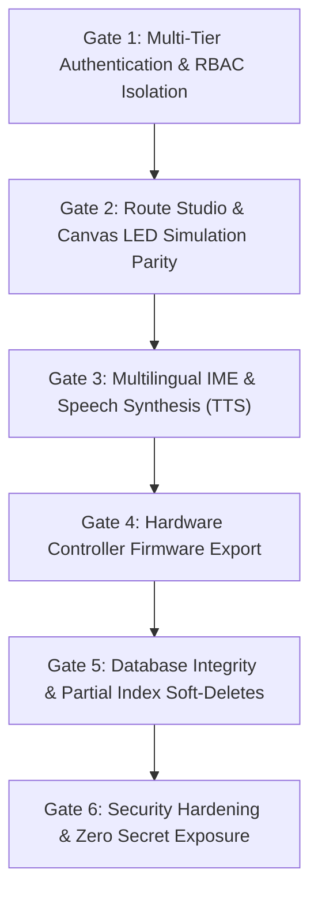

# Migration Acceptance Criteria: Navitronix RMS

**Target Application:** Navitronix RMS (`navitronics-ui`)  
**Specification Version:** 1.0.0-FINAL  
**Date:** October 12, 2026  
**Status:** Verified  
**Audience:** Product Acceptance Committee, QA Leads, Project Stakeholders  

---

## 1. Acceptance Gates Framework

The recreated application will be deemed production-ready and acceptable for deployment only upon passing all six objective verification gates:

---

## 2. Objective Acceptance Criteria Matrix

### Gate 1: Multi-Tier Authentication & RBAC Isolation (`AC-01` - `AC-05`)
- [ ] **`AC-01`:** Given valid credentials, users in all five roles (`master`, `admin`, `operator`, `regular`, `guest`) authenticate and land on their designated routes (`BR-002`).
- [ ] **`AC-02`:** A Regular Customer user cannot access or view Organizations, Regions, Depots, or Staff menus; routes are strictly filtered to `created_by = auth.uid()`.
- [ ] **`AC-03`:** A Guest user whose `expires_at` is in the past is rejected at login with toast "Guest evaluation period has expired".
- [ ] **`AC-04`:** Switching active depot context in the top header instantly refetches all route tables, stop tables, and metrics scoped to the newly selected depot.
- [ ] **`AC-05`:** Creating staff users in `CreateUserForm2` uses an isolated authentication client without terminating or overwriting the active administrator session.

---

### Gate 2: Route Studio & Signboard Simulation Parity (`AC-06` - `AC-10`)
- [ ] **`AC-06`:** The Route Studio allows configuring up to four distinct signboards (Front 128x16/32, Side 128x16, Rear 96x16, Internal 128x16) within a single route record.
- [ ] **`AC-07`:** The split route number control allows entering dual route numbers (e.g., `218` and `A`) with delimiter (`/`) and renders stacked half-height matrices on 32px height boards.
- [ ] **`AC-08`:** The HTML5 Canvas simulation renders active LED pixels, realistic luminescence glow, background bead grids, and sustains $\ge 60\text{ FPS}$ during playback.
- [ ] **`AC-09`:** Terminating the local .NET sidecar process causes the studio to fall back transparently to browser Canvas 2D font rasterization without crashing or halting editing.
- [ ] **`AC-10`:** Saving a route with new via points automatically discovers and inserts missing stops into `public.stops` (`FR-056`).

---

### Gate 3: Multilingual IME & Speech Synthesis (`AC-11` - `AC-14`)
- [ ] **`AC-11`:** Typing phonetic Roman text in Telugu or Hindi stop fields auto-converts into native Indic Unicode script in real time via Google Input Tools / Sanscript.
- [ ] **`AC-12`:** Clicking "Generate Audio" calls Sarvam AI TTS API, generates a valid WAV audio file, and stores it in Supabase Storage bucket `audios`.
- [ ] **`AC-13`:** Bus stop audio preview plays back cleanly inside the table row waveform player component.
- [ ] **`AC-14`:** Failure of the Sarvam AI service does not prevent saving bus stop metadata; the stop is saved and audio marked pending.

---

### Gate 4: Hardware Controller Firmware Export (`AC-15` - `AC-17`)
- [ ] **`AC-15`:** Exporting a route in "Controller ZIP" format produces a valid `.zip` archive containing `ROUTES.BIN`, `CONFIG.DAT`, and bundled stop `.WAV` audio files.
- [ ] **`AC-16`:** Exported binary firmware compiles without errors when flashed onto physical Navitronix Master Display Controllers.
- [ ] **`AC-17`:** Exporting in "V2 JSON" format produces valid, well-formed JSON matching the `RouteConfigV2` schema contract.

---

### Gate 5: Database Integrity & Partial Index Soft-Deletes (`AC-18` - `AC-20`)
- [ ] **`AC-18`:** Deleting a route or depot marks `deleted = true` and updates `updated_at` via database trigger.
- [ ] **`AC-19`:** Creating a new route with the same route number as a previously deleted route succeeds without a PostgreSQL 23505 unique collision.
- [ ] **`AC-20`:** All historical route UUIDs, depot UUIDs, and foreign key relations are preserved intact.

---

### Gate 6: Mandatory Security Remediation Verification (`AC-21` - `AC-24`)
- [ ] **`AC-21`:** Table `public.users` contains **NO plaintext password column**. The `PasswordViewerCell` component is eliminated.
- [ ] **`AC-22`:** Row-Level Security on `public.users` prevents any non-master user from altering `role_id`, `organization_id`, or `active` status (**`SEC-01` remediation verified**).
- [ ] **`AC-23`:** `VITE_SARVAM_API_KEY` is completely removed from the frontend client bundle and proxied via a secure server-side Edge Function (**`SEC-03` remediation verified**).
- [ ] **`AC-24`:** The multi-entity STU onboarding wizard executes within a single atomic database transaction (**`ARC-01` remediation verified**).
